# China's Industrial Rise — From Imitation at Scale to Selective Frontier Leadership

*A policy-relevant deep dive into where China stands on the imitation-to-innovation
arc, the supply-chain leverage it has accumulated along the way, and the
headwinds that will test the model in the decade ahead.*

*October 2026 edition — data updated to 2025, and to 2026 where
available. First published May 2026.*

> **What changed in the October 2026 edition**
>
> *New data.* China's goods trade surplus passed \$1 trillion for the
> first time (\$1,189 billion in 2025). BYD outsold Tesla on
> battery-electric cars (2.26 vs 1.64 million), China's plug-in share of
> new-car sales reached 54%, and it installed 59% of the world's new
> industrial robots. China's fossil-fuel generation fell for the first
> time in a decade. Battery packs reached \$108/kWh.
>
> *Events.* China deployed its largest export-control package yet
> (April and October 2025 rare-earth rounds), then suspended much of it
> in the November 2025 truce; the suspensions expire in November 2026.
> US chip controls tightened, then partly loosened (H20 and H200
> licensing). The US Supreme Court struck down the IEEPA tariffs; the
> US rolled back much of the IRA and took an equity stake in Intel;
> China adopted its 15th Five-Year Plan.
>
> *Corrections.* Several series in the first edition did not match
> their cited sources and have been rebuilt: China's robot density is
> 166 per 10,000 workers on the IFR's re-based figures, not 470 (below
> the US, Japan and Germany, not level with them); credit-to-GDP now
> comes directly from BIS (China ~300%, US ~251%); China's share of
> world manufacturing peaked at 30% in 2021 and was never "larger than
> the US and EU combined"; ISO secretariat counts, 2023 aircraft
> deliveries, chip-fab capacity shares, data-centre demand, solar
> additions, shipbuilding shares and the investment-efficiency (ICOR)
> series were corrected. Charts on industrial electricity prices,
> pharmaceutical-ingredient dependency and the open-weight AI
> leaderboard were dropped because no citable current data exists;
> those points are now made in the text.

---

## §1 Executive Summary

For three decades the question "is China innovating or just copying?"
had a defensible one-word answer: copying. Through 2018 most Western
capitals assumed that China's catch-up would stall well below the
productivity frontier, as Japan's did after 1990 and Korea's after 2005,
leaving the West's frontier lead wide and structurally protected.

The data in this brief argue that assumption is now out of date. China
remains conspicuously behind in advanced semiconductors, commercial
aerospace, originator pharmaceuticals and industrial software — though
the pharmaceuticals gap is narrowing fastest, with a record ~\$136
billion of Chinese drug out-licensing deals in 2025. But in batteries,
electric vehicles, parts of applied AI, industrial robotics, solar PV,
electricity build-out and several upstream supply-chain chokepoints,
China is now at the frontier or setting it.

The brief tests three propositions and finds the evidence consistent
with each:

1. **The three-phase trajectory.** Chinese industry has moved through
   *absorb and scale* (1978–2005), *catch up and substitute* (2005–2015)
   and *lead selectively* (2015–present). The third phase is real,
   sector-specific and well documented in international data.

2. **Selective frontier leadership.** In batteries, EVs, solar PV, parts
   of AI and industrial robotics, Chinese firms set the global cost
   frontier, hold majority world market share and increasingly define
   the dominant paradigm (LFP chemistry, open-weight LLMs, humanoid
   platforms from under \$6,000). In 2025 they supplied 70% of the
   world's EV-battery installations, and China installed 59% of its new
   industrial robots — a lead of scale and cost, since Chinese factories
   still have fewer robots per worker than those of the US, Japan or
   Germany. The lead rests not on subsidies alone but on scale, learning
   curves, integrated supply chains and an energy cost base Western
   competitors cannot easily match (EU energy-intensive industry pays
   more than 1.5 times Chinese electricity prices).

3. **Supply-chain leverage as the second pillar.** Independent of
   frontier innovation, China refines ~85% of the world's magnet rare
   earths and 74–96% of its lithium, cobalt, manganese and battery-grade
   graphite, and makes 86–96% of every stage of the solar value chain.
   The April and October 2025 rare-earth controls showed the leverage in
   use; the November 2025 truce, suspending the October package until
   November 2026, showed it is also a bargaining chip. It is real but
   finite: rare-earth refining concentration fell for the first time in
   2025, though for most other minerals it is still rising.

The headwinds are serious: a working-age population that peaked in 2015
and is projected to be ~268 million smaller by 2050, a fertility rate of
~1.0 and record-low births (7.92 million in 2025), construction starts
down 74% from their 2019 peak, a roughly doubled ICOR, and US controls
on advanced AI compute, now partly negotiable but still barring the
newest Nvidia generations. But the same arguments were made for Japan in
1990 and Germany in 2005, and neither stopped exporting frontier
engineering products. China's goods trade surplus reached \$1,189
billion in 2025 — the first year above \$1 trillion — even as US tariffs
on Chinese goods peaked at 145% and exports to the US fell by about a
fifth. The export engine has not broken; it has re-routed.

**Implications.** Western industrial policy converged in 2022–2023 on
production subsidies, domestic-content preferences and strategic-sector
targeting (the IRA, CHIPS Act and the EU's Net-Zero Industry and
Critical Raw Materials Acts), but not in a straight line: since 2025 the
US has rolled back much of the IRA's clean-energy credits in favour of
tariffs, deals and equity stakes (Intel, MP Materials), while the EU has
added negotiated minimum-price undertakings to its EV duties. The brief
notes the convergence without prescribing one model. The defining choice
for the West is no longer whether to do industrial policy but how to
manage the multi-year window in which Chinese supply-chain leverage
binds while alternative supply catches up — a window that, as 2025
showed, can be reopened and closed at will, with the key rare-earth
suspensions due to lapse in November 2026.

---

## §2 Forty Years in Numbers

Three macro series describe the scale of what has happened since 1978.

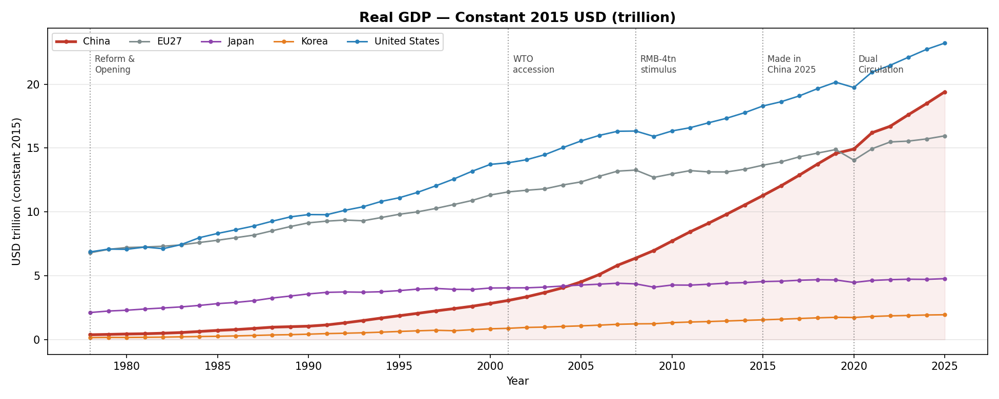

Real GDP at constant 2015 prices captures the absolute scale: from \$370
billion in 1978 to \$19.4 trillion in 2025, a 52-fold expansion. The US
expanded ~3.4-fold over the same period. In constant-USD terms China
overtook Japan in 2005 (the commonly-cited "second-largest economy in
2010" milestone is in *nominal* USD, where Japan's yen depreciation
delayed the crossover); on this real-GDP series China sits at ~84% of
the US economy in 2025, and has been larger than the US on PPP terms
since 2014 (34% larger by 2025). Japan in real terms has been nearly
flat over the entire post-2000 period (4.0T → 4.8T, ~18% total growth
in 25 years — the "lost decades" continuing); Korea grew solidly (~3.4%
CAGR, 2.3x over 2000–2025) but on a scale dominated by China and the US looks
visually compressed near the bottom of the chart. The vertical-line
markers identify the five policy phases this brief uses as scaffolding:
Reform & Opening (1978), WTO accession (2001), the RMB-4-trillion
stimulus (2008–09), Made in China 2025 (2015), and Dual Circulation
(2020).

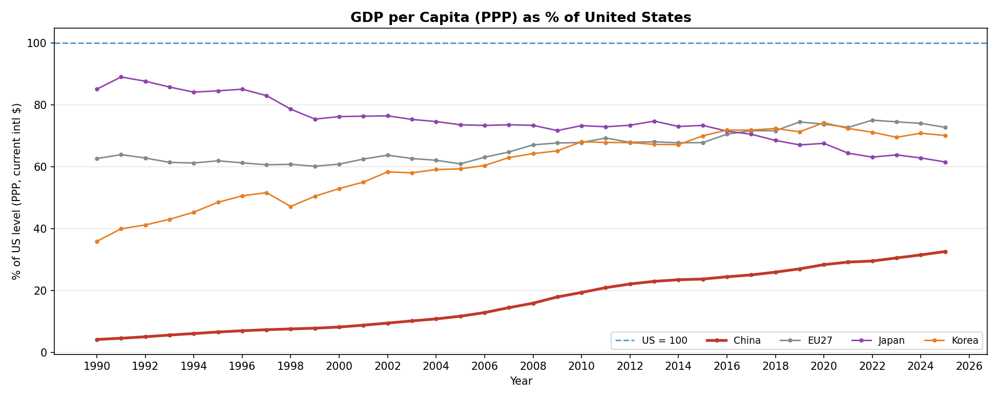

Per-capita GDP at PPP shows the convergence story. China was 4% of US
per-capita income in 1990, ~24% by 2015, and ~33% by 2025. Korea stood
at 70% of the US level in the same year. These levels mean China is no longer
the cheap-labour pole it was in 2005; rising wages have been the proximate
trigger for both robotics adoption (§7) and outbound manufacturing
investment to Vietnam, Mexico, and Hungary.

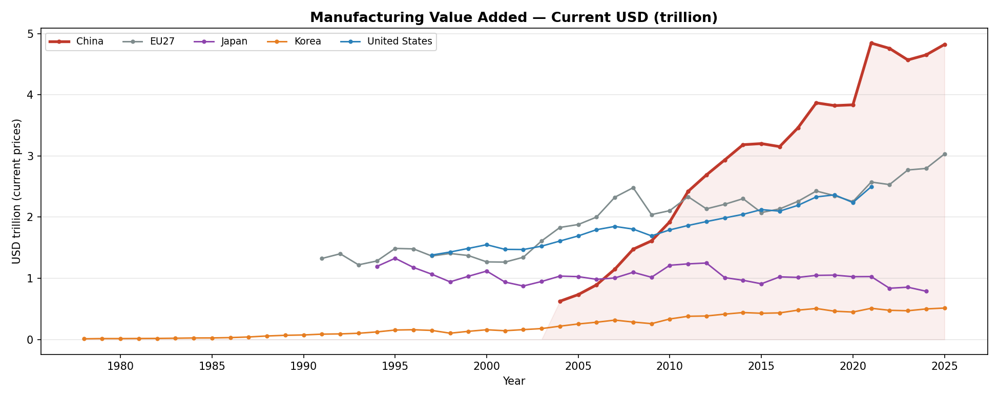

Manufacturing value added is where the convergence story turns asymmetric.
China's manufacturing VA passed the United States in 2010 and was
roughly double the US level by 2021, the last year with a comparable
World Bank figure for the US. The expansion has been at the
expense of Japanese and (post-2010) European manufacturing in absolute
terms.

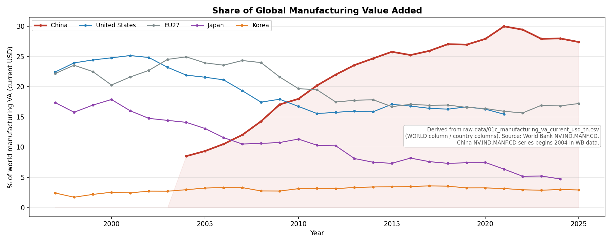

The share-of-world chart is the single most important framing graphic for
this brief. China's share of global manufacturing value added rose from
under 9% in 2004 (the first year in the World Bank series) to a peak of
30% in 2021 — roughly equal to the US and EU27 combined (31%) — and has
since eased to ~27% in 2025 — partly a current-dollar effect of a weaker
renminbi and falling factory-gate prices, not only lost volume. The US
and Japanese shares have both compressed; the EU27 share has held at
~16–18% since 2012.

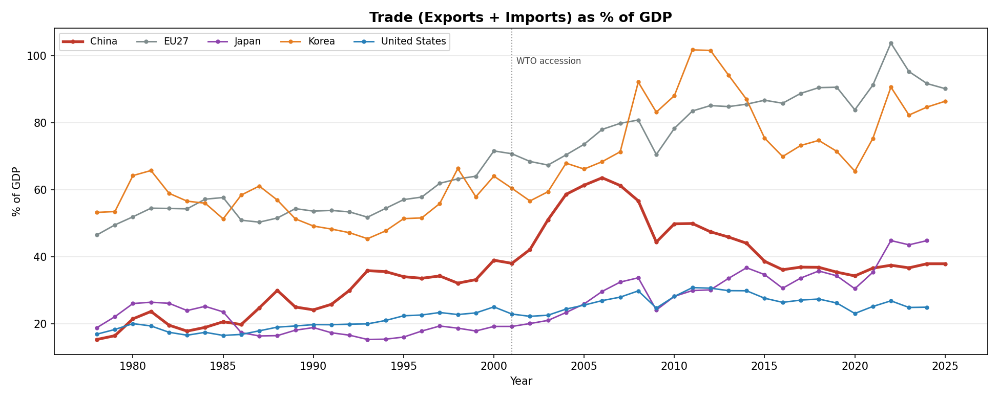

Trade-to-GDP is the WTO-accession discontinuity. Chinese trade openness
went from ~33% in the late 1990s to a peak of ~64% in 2006, and has since
declined to ~38% as the economy grew faster than trade. This last number
is sometimes used to argue China is "decoupling from globalisation"; the
truer reading is that the denominator (the domestic economy) grew very
fast. Trade is still climbing in absolute USD — see §12 on the 2025
record trade surplus, the first above \$1 trillion.

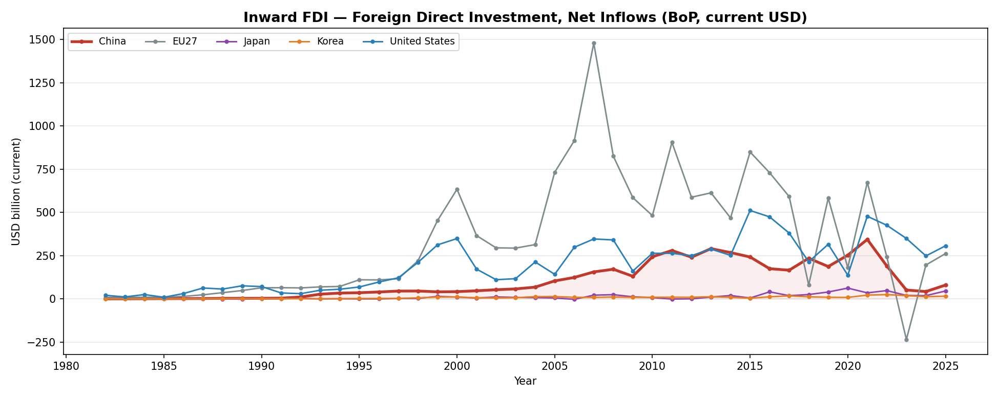

Inward FDI tells the partner side of the story: from \$1.7 billion in 1985
to \$344 billion in 2021, then a sharp drop to \$51 billion in 2023 and
\$43 billion in 2024 as the combination of zero-COVID overhang,
geopolitical risk, and a weak domestic market shifted Western capital
toward India, Vietnam, and Mexico. Inflows partly recovered to \$80
billion in 2025, but remain below a quarter of the 2021 peak; the trend
break since 2021 is unambiguous. (The World Bank has revised these
balance-of-payments figures substantially — the 2024 number was
originally reported at under \$19 billion.)

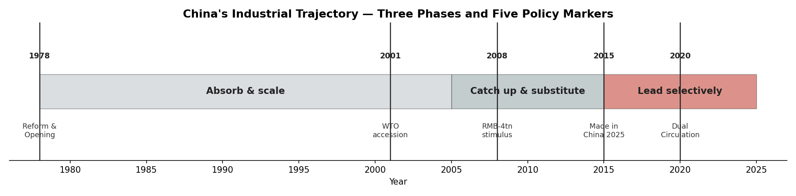

The phase diagram summarises the framing. *Absorb and scale* — 1978 to
roughly the mid-2000s — was about WTO-era market access, foreign-invested
export factories, and the build-out of basic infrastructure. *Catch up
and substitute* — roughly 2005 to 2015 — was the period of mass
investment in domestic R&D, the rise of the indigenous-innovation
doctrine, and Made in China 2025 in its drafting phase. *Lead selectively*
— from roughly 2015 to today — is the period in which Chinese firms in
specific sectors set rather than chase the global frontier. The brief is
in essence a sectoral test of how much of the third phase is real and
where it stops.

---

## §3 From Imitator to Co-Innovator — The National Indicators

Before drilling into individual sectors, the national-level innovation
indicators are worth establishing as context. They are the necessary but
not sufficient evidence for the *lead selectively* hypothesis: a country
with collapsing R&D, falling patenting, and shrinking researcher density
could not credibly lead any frontier sector; a country with the opposite
trends can in principle do so.

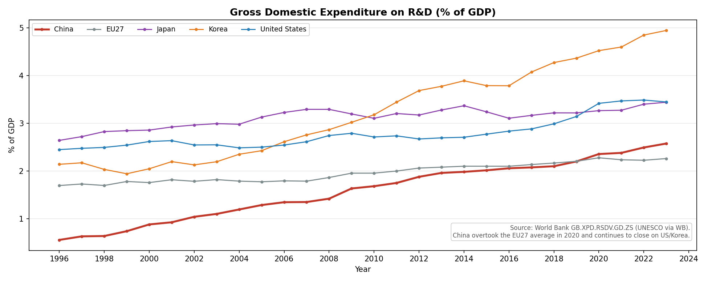

R&D intensity (gross domestic expenditure on R&D as a share of GDP) is
the cleanest input indicator. China's GERD share rose from under 0.6% in
1996 to ~2.6% by 2023 — past the EU27 average (2.3%) in 2020, and on a
path toward the US (3.4%) and Korea (4.9%) over the next decade.
R&D intensity at
the present level is consistent with frontier participation in many
sectors; it is the *combination* with absolute scale that matters
strategically.

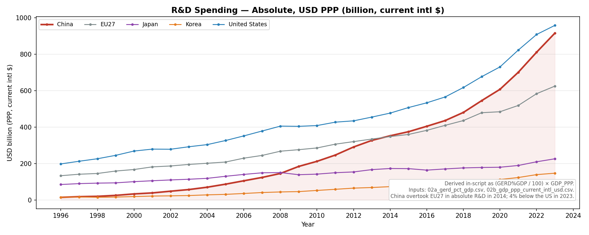

Absolute R&D spending — derived as GERD-share × GDP-PPP — is the
strategic metric. China passed the EU27 in absolute R&D in 2014 and by
2023 was within ~5% of US absolute R&D spending (\$916 billion vs \$959
billion at PPP). This is the metric that supports the *frontier
participation* thesis: a country spending over \$900 billion a year on
R&D is not a follower.

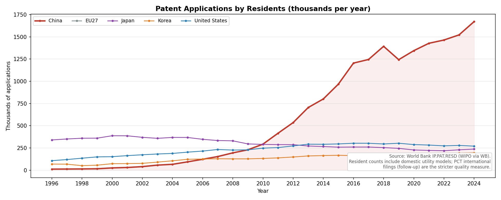

Resident patent applications need a quality caveat — Chinese patent
counts include large volumes of low-quality utility models, and the
international comparison is partly an artefact of which patent systems
apply which thresholds. The volume divergence is still striking. China
files more resident patents per year than the US, Japan and Korea
combined — 1.67 million in 2024, 2.4 times the US, Japan and Korea
together — with the gap widening every year since 2019. The stricter quality
metric is PCT (international) filings, where China and the US are now
neck-and-neck — discussed further in the sectoral chapters where the
patents are domain-specific (batteries, AI).

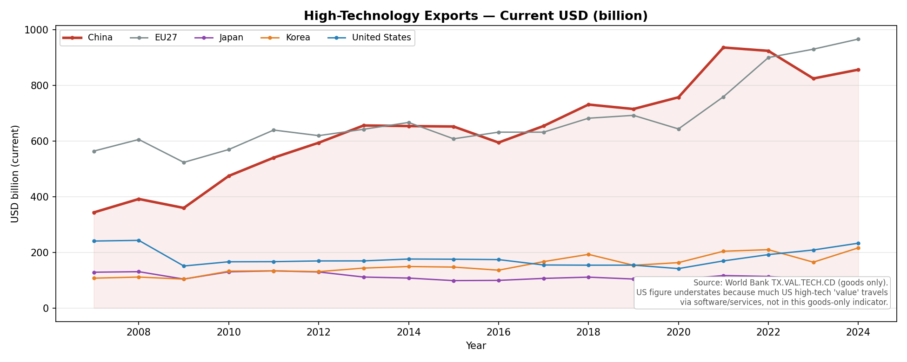

High-technology exports in absolute USD show China (\$857 billion in
2024) far ahead of every single-country comparator on the goods-only
measure; only the EU27 aggregate is larger (\$967 billion), and that
figure counts trade between EU member states. The US figure also understates
because the World Bank indicator is goods-only and much US high-tech
"value" travels via software and services not captured here. The chart
should be read alongside (not instead of) the share chart below.

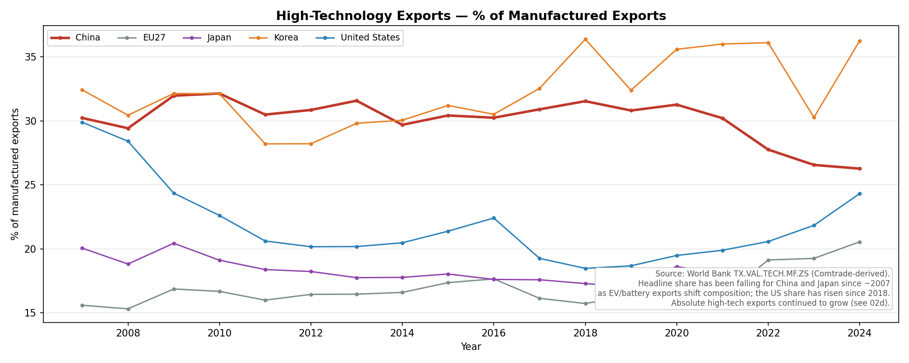

The share-of-manufactured-exports series has been falling for China and
Japan since the mid-2000s (China from ~30% to 26%), while the US share
has risen every year since 2018. For China the reason is composition: software,
services, EVs, batteries and chemicals (in the case of China) have shifted
the export mix away from the narrow definition of "high-tech" the indicator
captures. The absolute series above continued to grow over the same
period.

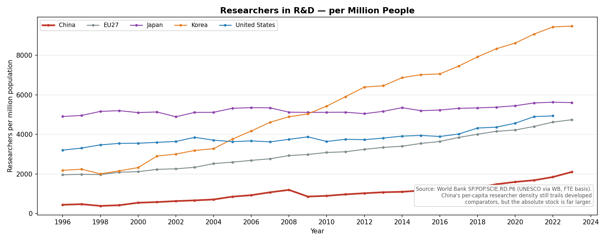

Researchers per million — the human-capital intensity metric — still
trails the four developed comparators. China sits at ~2,100 researchers
per million (2023, up from ~1,700 in 2021); Korea is at ~9,500, Japan
~5,600, the US ~4,900 and the EU27 ~4,700. The Chinese absolute researcher stock is the largest in the
world by some margin (the country is large), but the per-capita
intensity has further to climb. This is the cleanest of the *China still
catching up* indicators and it cuts directly against any narrative that
the China-leads-everything frame is universal.

The composite read on the national indicators is the brief's framing
claim in compressed form: China has the absolute R&D scale, patent
volume, and high-tech export base of a frontier economy; it does not yet
have the per-capita researcher density of one. This is exactly what
"selective leadership" looks like in the data.

---

## §4 Sectoral Deep Dive — Lithium-Ion Batteries

Batteries are the cleanest case of the selective-leadership thesis: the
data is unambiguous on market share, cost frontier and chemistry.

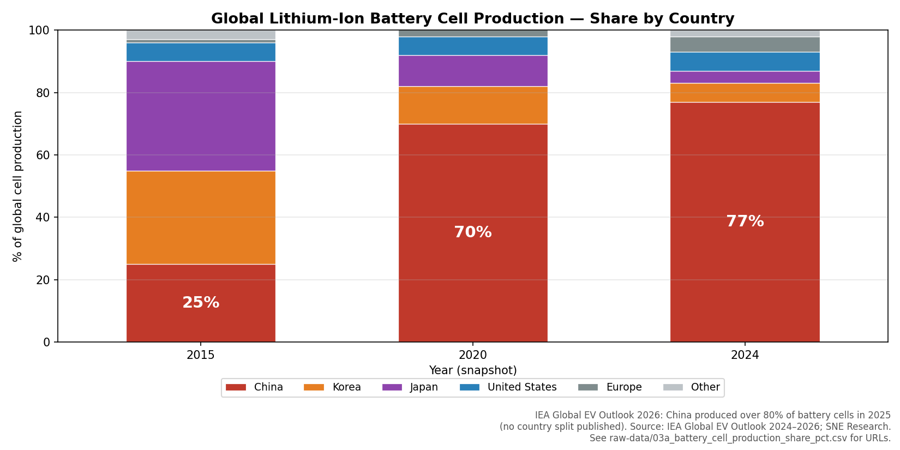

In 2015 Japan and Korea together made about 65% of the world's
lithium-ion cells and China about 25%. By 2024 China made roughly 77%
(Japan and Korea ~10%), and the IEA's Global EV Outlook 2026 puts it at
over 80% in 2025. The US, despite the IRA's 45X production tax credit
and its largest-ever battery greenfield-build cycle, sat at ~6%, and 45X
is getting harder to claim as rules on China-linked supply chains
tighten — hardest on the US-exposed Korean and Japanese makers.

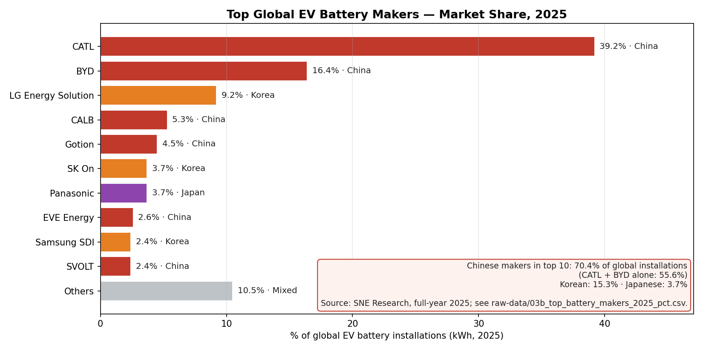

Global EV-battery installations reached 1,187 GWh in 2025, up 32%. CATL
and BYD held 55.6%; with CALB, Gotion, EVE and SVOLT, the Chinese
top-ten makers held 70.4%, against 15.3% for the three Korean makers (LG
Energy Solution, SK On, Samsung SDI) and 3.7% for Panasonic. A year
earlier the split was ~65% to ~24%: the gap widened again. Chinese
producers now supply over half of the EU's EV batteries, almost double
their 2023 share, but just over 5% of the US's.

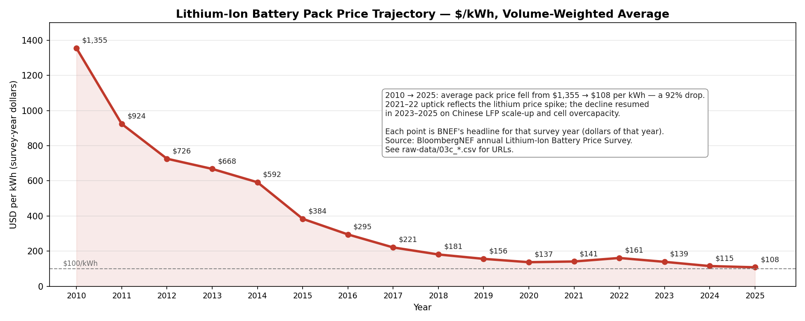

The cost frontier matters most for strategic forecasting.
Volume-weighted average pack prices fell 92%, from \$1,355/kWh in 2010
to \$108/kWh in 2025; after the 2021–22 lithium-carbonate spike, Chinese
LFP scale-up, cell overcapacity and price competition resumed the fall.
The all-segment average is not quite at the \$100/kWh commonly cited as
unsubsidised EV–ICE parity on total cost of ownership, but BEV packs
averaged \$99/kWh in 2025, below \$100 for the second year running, and
the average pack sold in China cost \$84/kWh. LFP packs averaged
\$81/kWh against \$128/kWh for NMC. BNEF expects a further fall in 2026,
but the floor is firmer than it looks: lithium prices in early 2026 were
more than double a year earlier, cobalt prices doubled after the
Democratic Republic of the Congo's 2025 export ban and quotas, and the
IEA notes that record-low prices partly rest on cathode producers
operating at a loss since 2023.

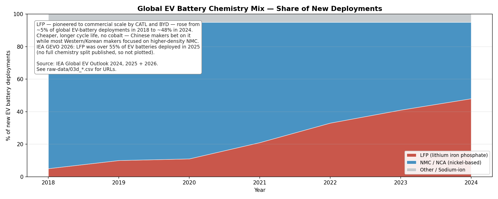

Chemistry gives the leadership claim its sharpest support. In 2018 LFP
(lithium iron phosphate) was ~5% of the EV-battery mix, and the
consensus held that its lower energy density left serious EVs to NMC
(nickel-manganese-cobalt). CATL and BYD bet otherwise on the cheaper,
longer-cycle, cobalt-free chemistry, which cell-to-pack designs made
competitive on usable range for non-premium EVs: LFP reached ~48% of
deployments in 2024 (NMC 47%) and, per the IEA, over 55% in 2025.
Outside China uptake is uneven: two-thirds of EV batteries in emerging
markets, mostly via imported Chinese cars, but just over 10% in the EU,
and almost halved in the US in 2025 under tariffs and sourcing rules.
Western and Korean makers switching US lines to LFP (over 50 GWh in
2025, including LG Energy Solution's and Ford's) mainly target
stationary storage, not cars. The next bet is again Chinese: CATL and
BYD are scaling sodium-ion cells, which avoid lithium and hold up far
better in the cold but, at ~175 Wh/kg, remain a niche for short-range
cars, two-wheelers and storage.

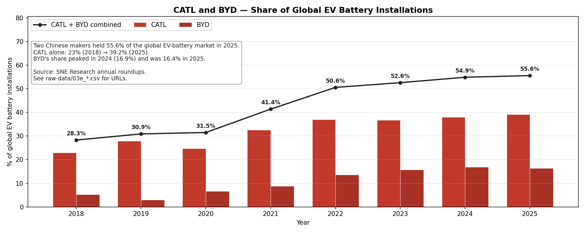

CATL's share climbed from 23% (2018) to 39.2% (2025); BYD's from 5% to a
peak of 16.9% in 2024, easing to 16.4% in 2025. Together they crossed
50% in 2022 and have held ~55% since 2024 (54.5% in January–August
2026). Both are vertically integrated (BYD makes its own cells, motors
and vehicles; CATL co-invests in lithium upstream) and produce a major
cell-format generation roughly every 18 months. CATL earned an 18%
operating margin in 2025 on revenue roughly 40% larger than that of LG
Energy Solution, Samsung SDI, SK On and Panasonic Energy combined; SK On
has posted recurring losses, and the IEA estimates that LG Energy
Solution would have been loss-making in 2024 and 2025 without US
production tax credits.

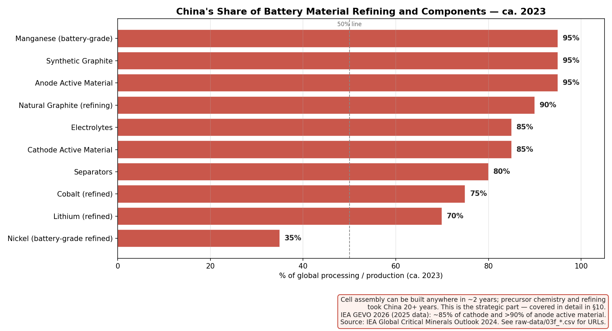

The upstream picture sets up §10. Cell assembly can be built anywhere in
roughly two years; precursor chemistry, electrode coating and material
refining took two decades of capital, learning and permissive
environmental policy in China and are not similarly portable. China
refines or processes 70–95% of every material and component shown except
battery-grade nickel (35%) — ca. 2023 values; §10 has the 2025 refining
shares (lithium ~74%, cobalt ~76%) — and IEA 2025 data put it at ~85% of
cathode and over 90% of anode active-material production. That, not the
cells, is the real strategic chokepoint, as Beijing has signalled: in
October 2025 it announced export controls on cathode and anode
materials, their precursors, LFP components and related equipment and
technology, before pausing them for a year.

This is the most important sectoral evidence in the brief. Two Chinese
firms with combined R&D budgets larger than most mid-size national R&D
programmes hold over half the global market for the energy-storage
technology underpinning the EV transition, grid storage and (§8) the
data-centre buffer energy stack — and are the only major producers
earning healthy margins doing so.

---

## §5 Sectoral Deep Dive — Electric Vehicles

Batteries are the input; the EV market is the application.

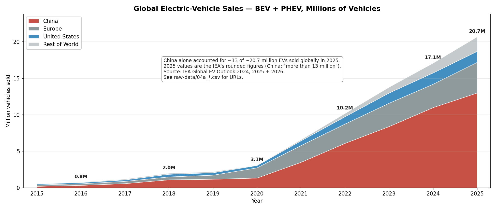

Global EV sales rose from ~0.55 million in 2015 to ~17.1 million in 2024
and ~20.7 million in 2025 — roughly 38-fold in a decade, and one in four
new cars sold worldwide. China accounted for more than 13 million (a
lower bound), more than Europe (4.2M), the US (1.5M) and the rest of the
world (2.0M) combined. Europe grew fastest among the large markets
(+30%) under tighter EU CO₂ standards; China by less than 20% as its
trade-in subsidy was briefly paused; US sales slipped after federal EV
tax credits ended on 30 September 2025, falling 45% year on year in the
fourth quarter. Around 60% of EVs sold in emerging markets outside China
were imported from China. The IEA expects about 23 million EV sales in
2026, 28% of the global car market.

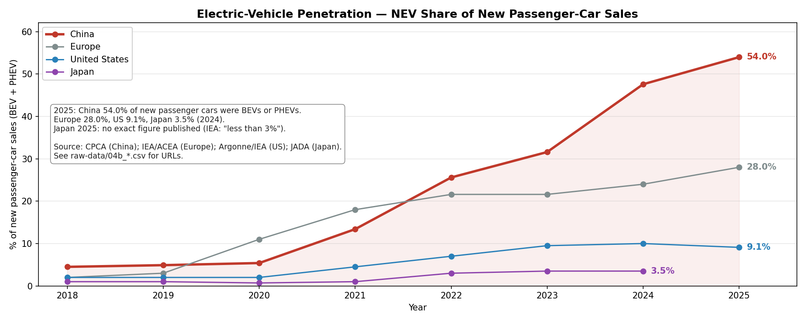

China's NEV (BEV + PHEV) share of new passenger-car retail sales reached
54.0% in 2025, up from 47.6% in 2024, nearing 60% by year-end — against
~28% in Europe, ~9% in the US and below 3% in Japan, a different phase
of the diffusion curve. 2026 is testing how much of that depended on
policy: with the NEV purchase-tax exemption halved to a 5% levy for
2026–27, NEV retail volumes fell 12% year on year in January–August, yet
penetration hit a record 65% in August as conventional-car sales fell
faster.

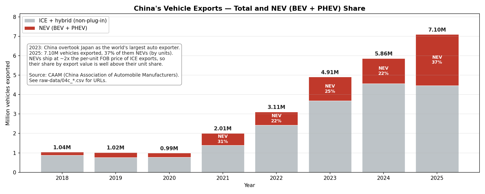

China became the world's largest auto exporter in 2023, overtaking Japan
on units, and shipped 5.86 million vehicles in 2024 and 7.10 million in
2025. NEVs drove the growth — 2.6 million in 2025, double the 2024 level
and 37% of units — while conventional-car exports were flat to slightly
down. By *value* the NEV share is higher, as NEVs ship at roughly 2x the
per-unit FOB price of the ICE vehicles in the mix: in 2024 a 22% unit
share was about 40% of export value. The 3.4 million NEVs exported in
January–August 2026 already exceed all of 2025, partly because Chinese
production now outruns domestic demand (by about 20% for electric cars
in 2025, per the IEA).

Trade policy is diverging. The EU's October 2024 countervailing duties
on Chinese BEVs (17.4–35.3% on top of the existing 10% tariff) have not
stopped growth — sales of China-made EVs in Europe rose almost 50% in
2025, to about 940,000 — and since early 2026 Brussels has accepted
model-by-model minimum-price undertakings instead. Mexico raised its
tariff on Chinese cars from 20% to 50% from January 2026; Canada swapped
its 100% surtax for a quota of 49,000 Chinese EVs a year at 6.1%.

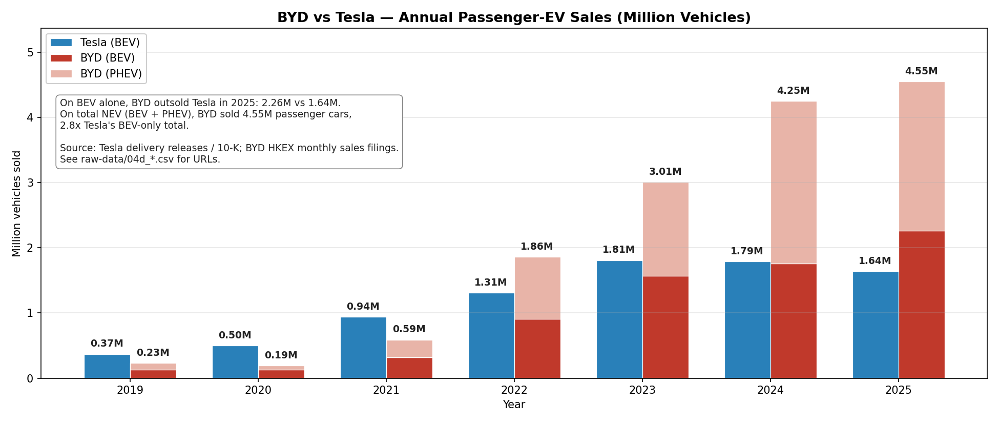

BYD and Tesla finished 2024 within ~30,000 units on BEV-only volume
(1.76M vs 1.79M); in 2025 BYD sold 2.26M passenger BEVs to Tesla's 1.64M
deliveries (Tesla's second consecutive annual decline) and 4.55M
passenger NEVs including PHEVs, 2.8x Tesla's volume. BYD's momentum is
not unbroken: its total grew only ~7% in 2025, PHEV sales fell ~8%, and
growth now comes from abroad, where sales passed 1 million and its first
Brazilian plant began production. Tesla, with lower-priced Model 3/Y
trims launched as US tax credits ended, is growing again in 2026 (1.32M
deliveries in January–September, up ~9%). BYD's range runs from the
roughly \$10,000 Seagull to the Yangwang U9 at around \$200k.

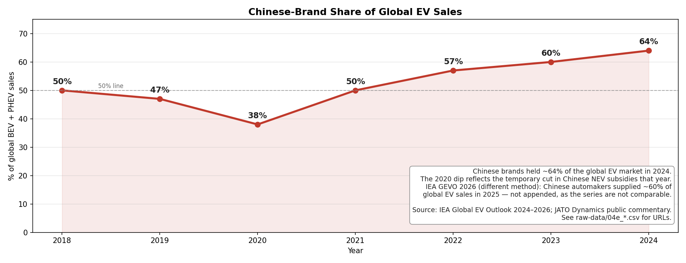

By brand of origin (a BYD sold in Brazil counts as Chinese; a Tesla
shipped from Shanghai as US), Chinese brands had ~64% of global EV sales
in 2024; the 2020 dip reflects that year's temporary cut in Chinese NEV
subsidies, not competitiveness. The IEA's manufacturer-headquarters
measure, not directly comparable, gives Chinese automakers 60% of 2025
electric car sales, against about 15% each for European and North
American ones. Four in five China-made EVs sold overseas in 2025 came
from Chinese manufacturers, up from fewer than two in five in 2021.

The EV story is the *visible* expression of the battery story in §4.
Chinese vertical integration (BYD making its own cells, CATL
co-investing in lithium and recycling, Geely owning Volvo and Polestar,
Great Wall co-developing with BMW) turns the same cost-frontier and
chemistry advantages into price points and product breadth. The 2025–26
data add a second reading: with production outrunning domestic demand
and margins squeezed at home, the leadership is now expressed through
exports, and partner-country trade policy — not Chinese competitiveness
— has become the main variable in where those cars end up.

---

## §6 Sectoral Deep Dive — Artificial Intelligence

AI is the messiest and most contested of the three frontier-sector
cases: China is at or near the frontier on some dimensions and behind on
others. The 2025–26 data narrow the gap on model quality and widen it on
capital.

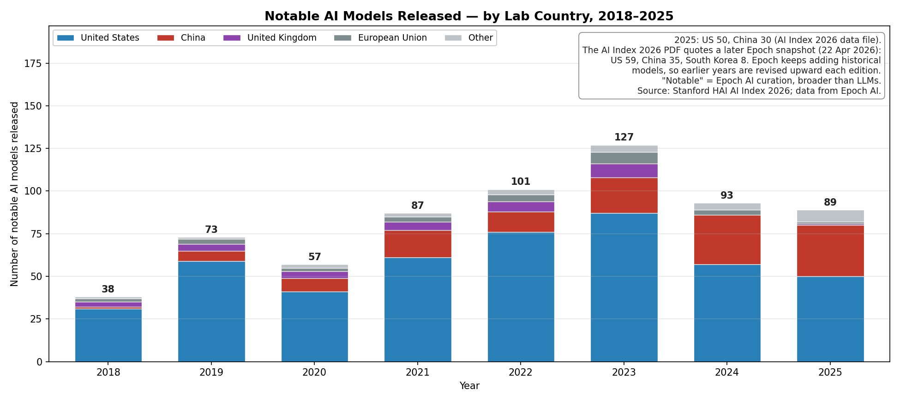

The US still leads on notable models, but the gap has narrowed sharply:
in the Stanford AI Index 2026 data file (Epoch AI database) it released
50 in 2025 to China's 30, a 1.7x lead against 31 to 1 in 2018. Epoch
keeps adding historical models — 2024 counts reported a year ago as US
40, China 15 now stand at 57 and 29 — so editions should not be
compared. As larger training runs cut total releases from a 2023 peak of
127 to 89 in 2025, China rose from 21 to 29 to 30 while the US fell from
87 to 57 to 50. Industry produces over 90% of notable models; OpenAI
(20), Google (14) and Alibaba (11) led in 2025. "Notable" covers all AI
architectures, not just LLMs, which become the dominant subset only
after ChatGPT (late 2022).

On the Arena human-preference leaderboard (as exported for the AI Index
in March 2026) the top US model, Anthropic's Claude Opus 4.6 (1,503),
led the top Chinese one, ByteDance's Dola-Seed-2.0 Preview (1,464), by
39 points, or 2.7%; in February 2025 DeepSeek-R1 (1,400) briefly came
within 5 points of OpenAI's o1 (1,405). The frontier is US-led, but by a
few per cent that has fluctuated rather than widened.

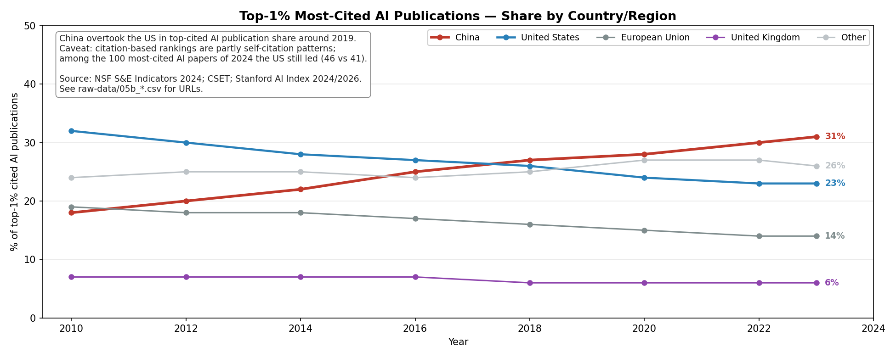

China overtook the US in share of top-1% most-cited AI publications
around 2019, reaching ~31% in 2023; self-citation plays a part, but the
crossover holds across Stanford HAI, NSF and CSET methods. Chinese
papers took 20.6% of all AI citations in 2024, ahead of Europe (19.5%)
and the US (12.6%). At the very top the US still leads: 46 of the 100
most-cited AI papers of 2024 had US authors, against 41 for China (34 a
year earlier).

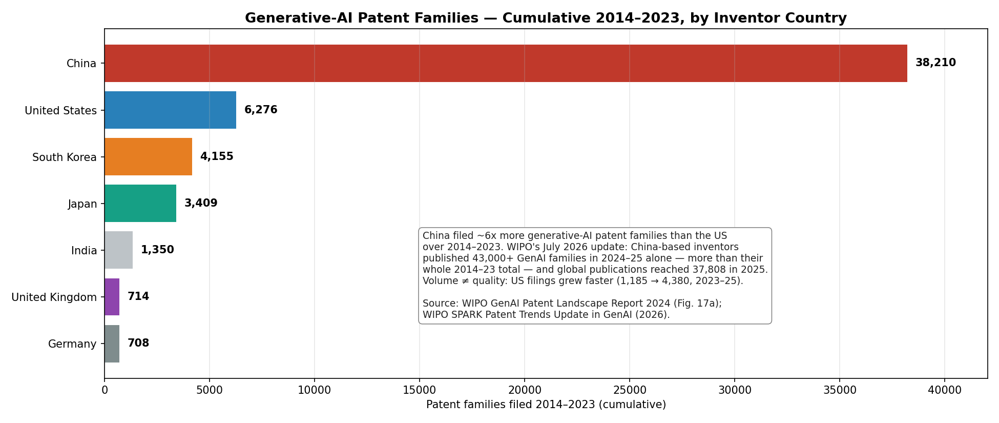

Patents are the starkest case. WIPO's 2024 Patent Landscape Report
counts 38,210 generative-AI patent families from China across 2014–2023
against 6,276 for the US, a ~6x lead, with China outpacing the rest of
the world combined every year since 2017. WIPO's July 2026 update shows
the ramp accelerating: global GenAI patent-family publications doubled
from 18,862 in 2024 to 37,808 in 2025, and China-based inventors
published more than 43,000 families in 2024–25 alone, more than their
entire 2014–2023 output. US publications also rose, from about 1,185 in
2023 to over 4,380 in 2025, and Japan overtook Korea for third place on
the back of SoftBank, now the single largest GenAI patent holder (2,985
families). Volume is not quality, but the ramp fits Chinese firms'
production-oriented industrial-AI focus.

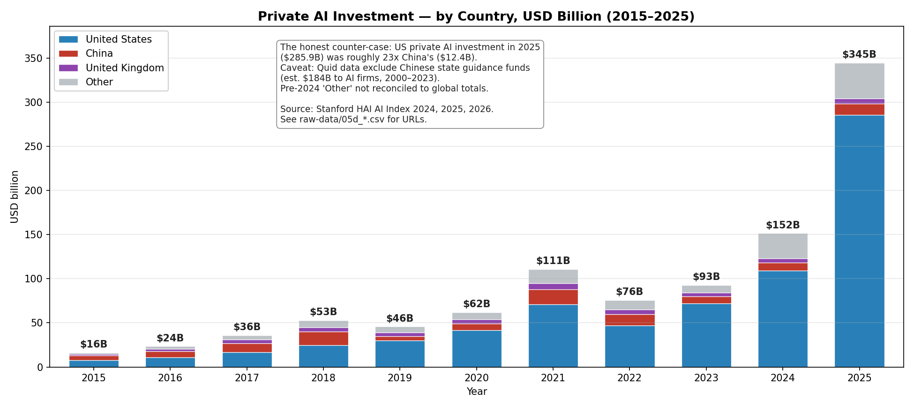

Private investment is the honest counter-case, and the gap has widened.
US private AI investment reached \$285.9 billion in 2025, up from
\$109.1 billion in 2024 and roughly 23x China's \$12.4 billion (Stanford
AI Index); the global total more than doubled to \$344.7 billion. In
generative AI the US drew \$163.6 billion, against \$4.7 billion for
China and Europe combined. But the underlying Quid data exclude Chinese
government guidance funds, which the AI Index estimates directed some
\$184 billion to AI companies between 2000 and 2023, so the
private-capital gap overstates the total-capital gap. Closed-frontier
labs (Anthropic, OpenAI, Google DeepMind, xAI) remain US-headquartered,
with capital, infrastructure and chip access that Chinese firms cannot
fully match.

Chip access became less one-directional in 2025. After requiring
licences for Nvidia's China-specific H20 in April and letting sales
resume in August against a 15% revenue share, Washington in December
approved H200 sales to vetted Chinese customers for a 25% fee
(formalised in January 2026), keeping Blackwell and Rubin off-limits;
Chinese take-up is an open question. DeepSeek's open-weight V4 (preview,
April 2026) was supported on Huawei's Ascend 950 clusters from launch,
and Huawei says its chips were used for part of the training — the
clearest sign yet of an indigenous compute path, though its scale is
unproven.

Chinese labs set the pace in the open-weight tier. In March 2026 Zhipu's
GLM-5 (1,454) was the Arena's top open-weight model; the AI Index's
open-weight leaders run from Meta's Llama-3.1-405B (2024) through
Alibaba's Qwen3-235B (2025) to GLM-5, a hand-over begun by DeepSeek-R1
in January 2025, whose training-cost claims triggered a market
reassessment of the AI-compute cost curve. Two qualifications: the
open–closed gap has reopened, with GLM-5 49 points (~3.4%) behind the
top closed model against 0.5% in August 2024, and six of the Arena's top
ten closed; and OpenAI re-entered the open-weight field with
gpt-oss-120b and -20b in August 2025, its first since GPT-2, even as
Meta's Arena performance has flattened since early 2025.

The composite AI picture is asymmetric. China leads on citation share,
GenAI patents and open-weight model quality and is within a few per cent
at the closed frontier; the US leads on notable-model count, private
capital (by a widening margin), the very top of the closed frontier, and
per-firm compute access. The Arena figures are a March 2026 snapshot;
the trend — near-parity in quality, a growing gulf in capital — is the
read.

---

## §7 Sectoral Deep Dive — Robotics & Industrial Automation

Robotics sits at the intersection of China's three earlier strengths
(manufacturing scale, battery/motor supply chain, applied AI), and the
15th Five-Year Plan (2026–2030) puts robotics and "physical AI" at the
centre of an industrial strategy built on self-reliance and the
modernisation of traditional industries.

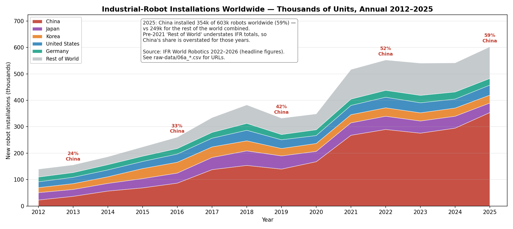

Global installations broke 600,000 for the first time in 2025 — 603,000,
up 11%, after four years around 550,000. China installed 354,000 (up
20%), or 59%: more than the rest of the world combined, up from 51% in
2023 (an earlier edition's ~54% rested on an unreconciled "rest of
world" bucket) and 54% in 2024. The US (38,400, up 12%) overtook Japan
(36,200, down 19%) as the second-largest market. Growth is not linear —
installations dipped in 2019 and 2023, and China's food and beverage
installations fell 37% in 2025 after 86% growth in 2024 — but the IFR
still expects 5–10% annual growth in China to 2029.

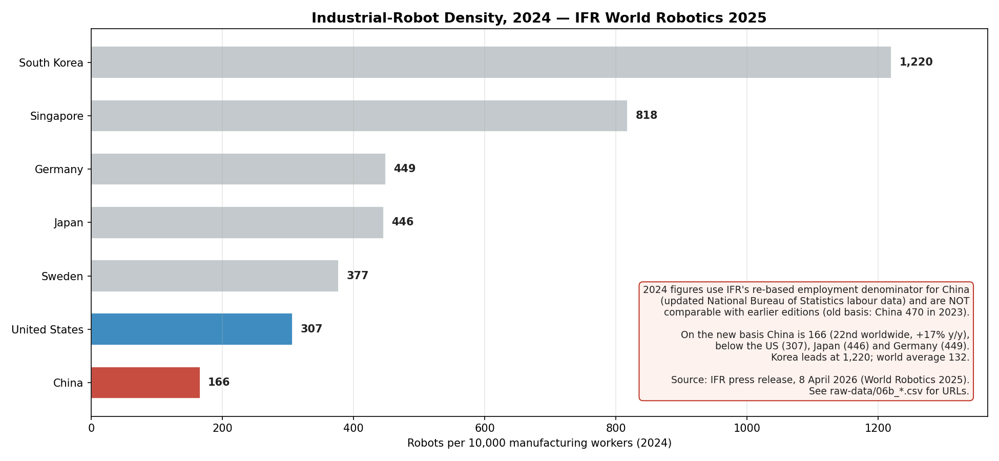

Density (robots per 10,000 manufacturing workers) tells a different
story: in April 2026 the IFR re-based China's figure on updated National
Bureau of Statistics data implying a much larger manufacturing
workforce. On the new basis China's density was 166 in 2024 (up 17%),
22nd in the world — below the US (307), Japan (446) and Germany (449),
and far behind South Korea (1,220) and Singapore (818). The previous
edition's 470 for 2023, and the claims that China overtook the US in
2021 and was within 10% of Germany and Japan, rest on the old
denominator and are not comparable with 166. China's robot stock is the
world's largest (around 2 million, ~4.5x Japan's) because its factory
workforce is, not because that workforce is unusually automated.

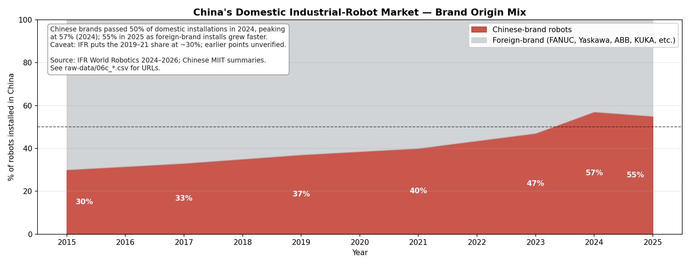

Brand origin is the import-substitution success story. The IFR puts the
domestic-supplier share at around 30% in 2019–2021, rising to 47% in
2023 and 57% in 2024 as Estun, Inovance, Siasun, EFORT and Han's Robot
took share from the foreign "Big Four" (FANUC, Yaskawa, ABB, KUKA). In
2025 it slipped to 55%, as foreign-brand installations grew 27% against
15% for Chinese brands. The textbook pattern (foreign suppliers absorb
early demand; tax / land / finance preferences back domestic
challengers) holds, but not monotonically when demand surges where
foreign suppliers are strong. (The chart's 2019 and 2021 points come
from an older source putting the share at 37–40%; the IFR's ~30% is
better documented.)

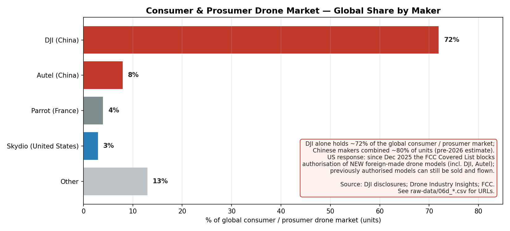

DJI alone holds ~72% of the global consumer / prosumer drone market;
Chinese makers combined ~80%. In December 2025 the FCC added
foreign-made drones and critical components, including DJI and Autel, to
its Covered List, barring authorisation of new models; previously
authorised models can still be sold and flown, and DJI is contesting the
decision. The share figures pre-date the ban, whose effect will show in
2026 data as DJI's US line-up ages.

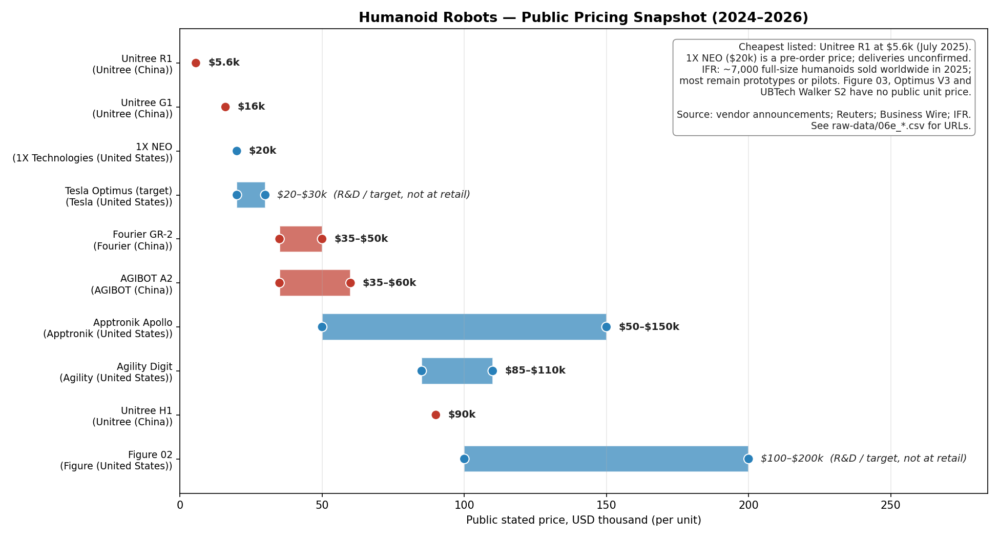

The humanoid cost frontier is still falling in China. Unitree's G1
launched in 2024 at 99,000 yuan (\$16,000 in the US); its R1 (July 2025)
starts at 39,900 yuan, about \$5,600. AGIBOT A2 and Fourier GR-2 sit at
\$35–60k. Western platforms are mostly unpriced or pilot-stage: Figure
03 has no public price, Tesla's Optimus V3 had not been unveiled by
October 2026 against a \$20–30k target, and 1X's NEO (\$20,000 or \$499
a month) had no confirmed deliveries, with early reviews finding its
household tasks tele-operated. The IFR counts about 7,000 full-size
humanoids sold in 2025, from 174 manufacturers (more than half Chinese),
most of them prototypes or pilots. Money has arrived first: Unitree,
which shipped more than 5,500 in 2025, listed on Shanghai's STAR Market
in August 2026 after raising 6.1 billion yuan, and UBTech reported
Walker-series orders above 800 million yuan by November 2025. A usable
humanoid now costs less than an entry-level car; the business case is
unproven.

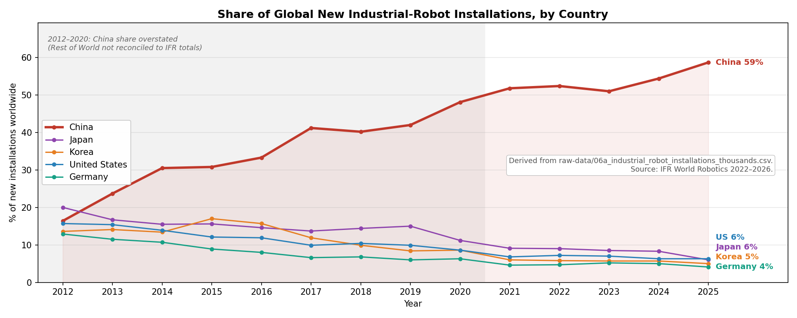

China's share rose from 51–52% in 2021–2023 to 59% in 2025. The
unreconciled pre-2021 rest-of-world bucket (shaded) overstates China's
early share; the 2012 starting point was below the ~16% shown. No
comparator has gained: Japan fell from 9% in 2021 to 6%, and the US
(6%), Korea (5%) and Germany (4%) are flat to falling.

Robotics is the fourth frontier-leadership case alongside batteries, EVs
and parts of AI, but the revised density data change its character: it
rests on domestic-market scale, a home supplier base holding more than
half its market, and a humanoid cost reset — not on automation
intensity, where Chinese manufacturing trails the US, Japan and Germany.
That is less a weakness than a runway.

---

## §8 Energy — The AI-Era Strategic Asset

This is a *structural-advantage* chapter, not a frontier-innovation one.
Its thesis: as AI becomes energy-bound rather than purely chip-bound,
China's electricity build-out confers a cost and capacity advantage not
easily reversed by policy.

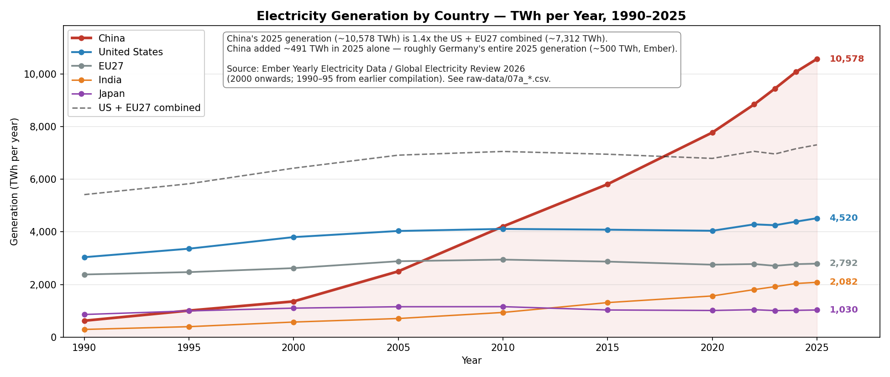

China generated ~10,578 TWh in 2025 — 1.4 times the US (~4,520 TWh) and
EU27 (~2,792 TWh) combined. Its annual increment is itself a large
European power system: ~630 TWh in 2024 and ~491 TWh in 2025, roughly
Germany's 2025 generation (~500 TWh). Earlier versions mixed sources and
overstated China's 2024 total (~10,250 TWh; Ember's current release
gives ~10,087 TWh).

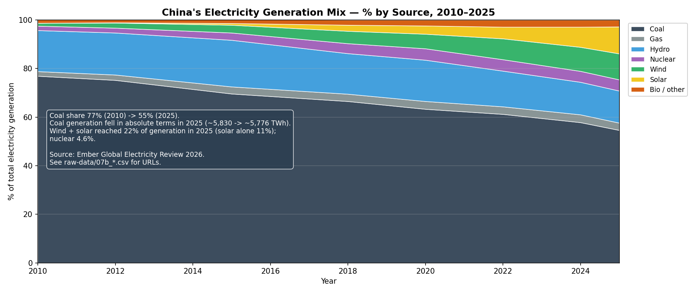

Coal's share fell from 77% (2010) to 55% (2025). Until 2024 coal still
grew in absolute TWh; in 2025 it did not. Wind and solar reached 22% of
generation (solar alone 11%, overtaking wind for the first time); with
hydro (13%) and nuclear (4.6%), clean sources covered all demand growth,
and fossil generation fell slightly — its first annual decline since
2015 in Ember's data, with coal down roughly 55 TWh to ~5,770 TWh. One
year is not a trend: a dry hydro year or a hot summer could reverse it.
Globally, Ember records renewables overtaking coal in 2025 (33.8% vs
33.0%) for the first time in roughly a century.

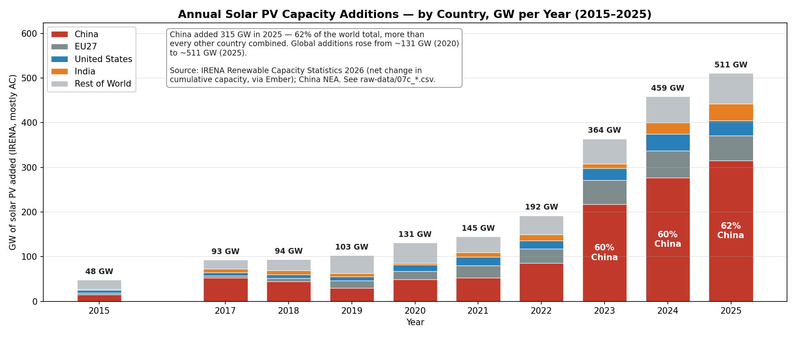

China added ~315 GW of solar PV in 2025, up from ~277 GW in 2024 — more
than the entire global fleet in 2014 (~180 GW) — and took 60% of global
additions in 2023 and 2024 and 62% in 2025 on IRENA's basis. (The chart
uses a single IRENA series, replacing a mixed-source 556 GW global 2024
figure; IRENA counts mostly AC capacity, so DC-based industry totals run
higher.) The total hides a policy shock: monthly installations peaked at
~93 GW in May, ahead of the June 2025 switch from fixed tariffs to
market-based pricing, then fell sharply, and the CPIA expects 2026
installations to drop roughly 20–25%. Record annual figures are not a
floor.

On industrial prices, the country chart is dropped (no citable free 2025
table exists; the earlier 2023 snapshot overstated the gap) for the
IEA's *Electricity 2026* ratios: for large energy-intensive users, EU
prices rose more than 7% in 2025, are around 1.6 times their 2019 level,
more than double US prices and more than 50% above China's and India's.
Within China, Guangdong proxy prices ran about twice hydro-rich Yunnan's
in January–September 2025 — hence siting energy-intensive industry
inland. Germany's subsidised €50/MWh industrial price from 1 January
2026 (around 2,000 firms, half their consumption, three years) and
Italy's Energy Release 2.0 (€65/MWh, 24 TWh a year) narrow the gap for
selected firms without changing the generation cost base. For aluminium,
chemicals, refining and data centres, a 1.5–2x cost differential
compounds over a multi-decade asset life.

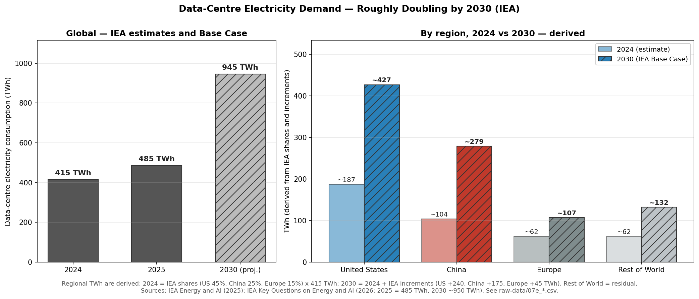

Global data-centre use rose 17% from ~415 TWh in 2024 (about 1.5% of
world electricity) to ~485 TWh in 2025. The IEA's Base Case roughly
doubles that to ~945–950 TWh by 2030, with AI-focused facilities
tripling to ~465 TWh. Applying the IEA's published shares and increments
(derived figures, not IEA-published TWh), US consumption rises from ~187
TWh to ~427 TWh — more than Italy's entire 2025 demand (~310 TWh) —
China's from ~104 to ~279 TWh and Europe's from ~62 to ~107 TWh. China
is the second-largest growth market, not a co-equal one; the earlier
claim that both reach ~400 TWh matched no IEA publication.

The binding constraint is power and grid connection, not chips. ERCOT's
Texas large-load queue, mainly data centres, grew more than 3.5 times in
2024–2026; over 100 GW of gas capacity has been announced worldwide as
dedicated data-centre supply, mostly in the US, though the IEA expects
only ~15–27 GW of onsite gas powering data centres by 2030. China is the
mirror image: cheap power, spare western capacity, and the East-Data
West-Compute ("dong shu xi suan") directive steering compute there,
backed in 2025 by 42 registered GPU clusters of more than 10,000 chips
and a dedicated fibre upgrade. But officials including Xi Jinping have
warned against overinvestment, and many projects were cancelled in 2025:
China's advantage is power, not demand certainty.

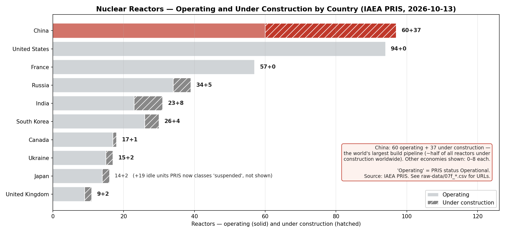

On the IAEA's PRIS database (October 2026), China has 60 reactors
operating and 37 under construction — close to half the 78 being built
worldwide; next are India (8) and Russia (5). The United States has
none: Vogtle Unit 4, cited in earlier editions, entered commercial
operation in April 2024, leaving a 94-reactor fleet with nothing under
construction. China's pipeline alone would take it to ~97 reactors, past
France's 57 and level with or above today's US fleet. (Japan's count of
14 reflects PRIS's newer categories: 19 further idle units are now
"suspended operation", so its operable fleet is unchanged at 33.) For
technologies needing cheap, clean baseload through the 2030s, China's
cost base is structurally advantaged.

Only in energy does leadership rest almost entirely on *scale* and
*integrated build-out*: the technologies are internationally available;
the differentiator is build rate, cost and grid integration. In 2025 the
build-out began to bite on fossil generation — and the AI demand it was
meant to serve proved concentrated in the United States, where power,
not chips, is the scarce input.

---

## §9 Where China Is *Not* Yet Leading — The Honest Counter-Evidence

Several major industrial domains remain firmly Western-led; documenting
them keeps the "selective leadership" claim precisely selective.

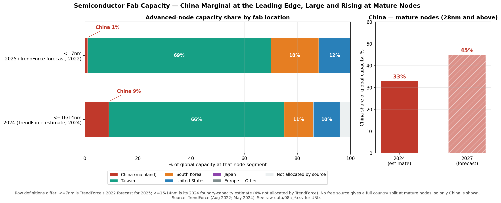

Semiconductors are the most consequential lag. At the leading edge (≤7nm
logic, where every modern AI accelerator, high-end mobile SoC and
advanced GPU is made) TrendForce projected China's 2025 capacity share
at about 1%, against ~69% for Taiwan, 18% for South Korea and 12% for
the United States. On a broader definition (16/14nm and below) China
held ~9% of foundry capacity in 2024, against Taiwan's 66%. The two
figures use different TrendForce publications and node definitions, and
no free source has a consistent country table, so the chart shows them
side by side. EUV lithography, required for ≤7nm at commercial yields,
is single-source (ASML, Netherlands) and barred from China since 2019.
SMIC has pushed DUV multi-patterning further than expected — the Kirin
9000s (2023) was 7nm-class; the Kirin 9030 in Huawei's Mate 80 (late
2025) uses SMIC's N+3, which TechInsights classifies as a scaled
7nm-class node significantly less dense than TSMC or Samsung 5nm. The
gap is narrowing at great cost; it is not closed.

Mature nodes (28nm and older — analog, power, automotive, IoT) differ:
TrendForce puts China's share at ~33% in 2024 and forecasts ~45% by
2027. In October–November 2025, after the Dutch government took control
of Chinese-owned Nexperia, Beijing barred exports from its China
operations, and European carmakers warned of line stoppages within weeks
until civilian-use exemptions were granted. At the leading edge China is
dependent; at the mature edge it is already a source of leverage.

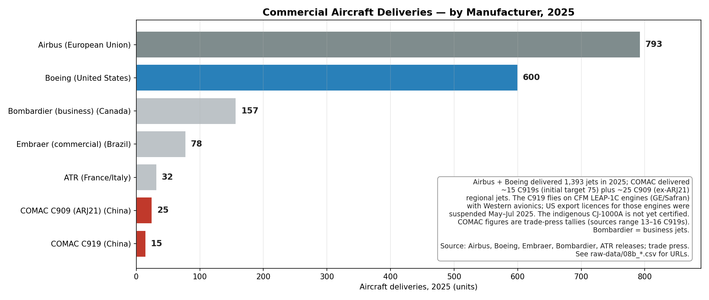

Commercial aerospace is the second lag. Airbus (793) and Boeing (600)
delivered 1,393 jets in 2025; COMAC delivered roughly 15 C919s (tallies
range from 13 to 16) against an initial target of 75, reportedly cut to
~25 mid-year, plus about 25 C909 regional jets (the renamed ARJ21). The
C919 uses CFM LEAP-1C engines (GE/Safran), Western avionics (Honeywell,
Collins) and ~60% Western content by value — a dependency made concrete
in May 2025, when Washington suspended the engine export licences in
response to Chinese rare-earth curbs, restoring them in early July. The
indigenous CJ-1000A has completed testbed flight trials; certification
is expected in 2027–28 at the earliest. Against 60+ years of accumulated
certification experience, an extremely demanding safety regime and
global maintenance networks, the path to challenger status is under way
but multi-decadal.

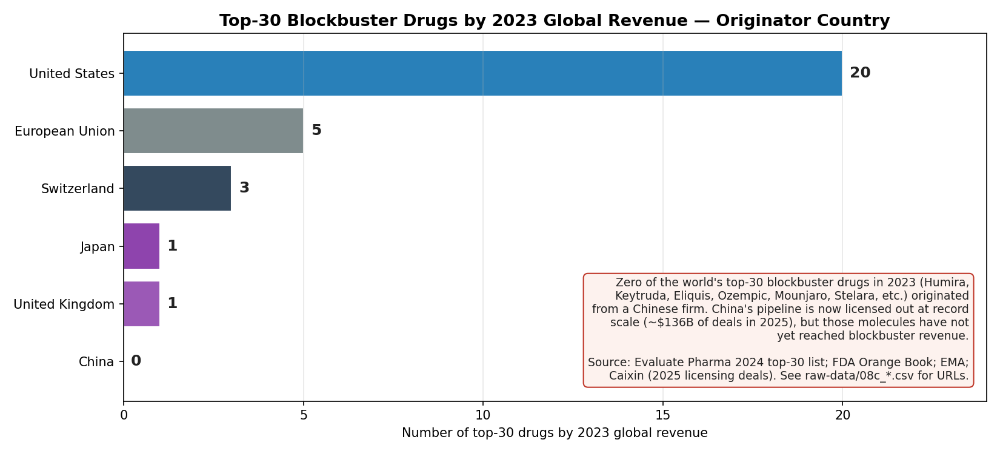

Originator biopharmaceuticals are the third lag — and the fastest
changing. None of the world's top-30 drugs by 2023 revenue was
originated by a Chinese firm; the US accounts for 20, the EU 5,
Switzerland 3, the UK and Japan one each. China's best-seller, BeOne's
Brukinsa (zanubrutinib), reached \$3.9B in 2025 sales — a genuine global
product, short of the top tier. What has changed is the pipeline:
Chinese developers signed a record ~\$136B of cross-border out-licensing
deals in 2025, more than double 2024, as Western majors facing patent
cliffs bought Chinese-discovered molecules. China is also strong in APIs
and generics (§10). But late-stage global trials, regulatory interaction
and commercial reach remain concentrated in US, EU, Swiss and UK majors
— now increasingly the *buyers* of Chinese discovery.

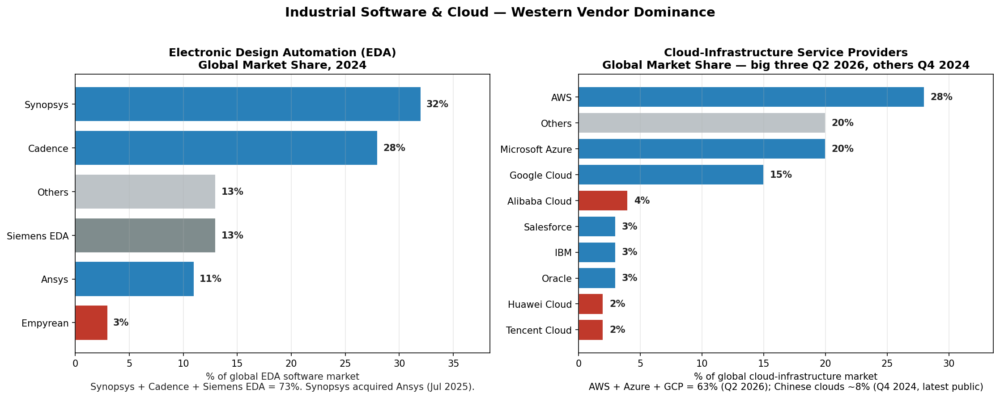

Industrial software and cloud are the fourth and fifth lags. In
Electronic Design Automation (EDA, the software every modern chip is
designed with) Synopsys, Cadence and Siemens EDA held ~73% of the global
market in 2024; the largest Chinese firm, Empyrean, ~3%. Synopsys's
\$35B purchase of Ansys (July 2025) tightened the field, and the
dependency was briefly weaponised: in late May 2025 the US ordered the
three vendors to stop supplying Chinese customers, rescinding the order
on 2 July in the rare-earths truce. In cloud, AWS, Azure and Google
Cloud held 28%, 20% and 15% in Q2 2026, while Alibaba, Tencent and
Huawei Cloud held ~8% globally in the latest public split (Q4 2024):
dominant inside China, marginal outside. Chinese firms compete on the
*applications* and *commodity-hardware* layers of the digital economy;
the high-margin platform and tooling layers remain Western.

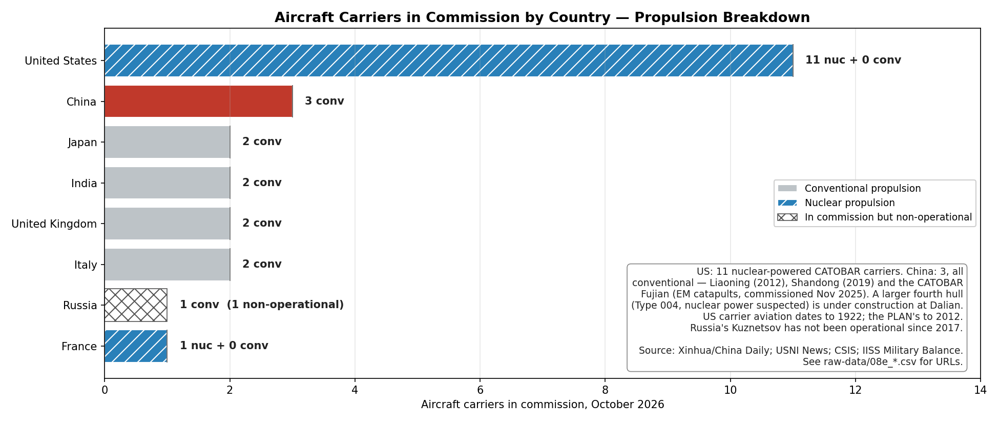

Defense is the sixth lag, and the clearest case of catch-up's
*experience* dimension. The US Navy operates 11 nuclear-powered CATOBAR
carriers (USS Nimitz's retirement pushed to March 2027 to hold the
statutory minimum), backed by carrier aviation since 1922. The PLAN has
three conventionally-powered carriers: Liaoning (ex-Soviet hull, 2012),
Shandong (first indigenously built, 2019) and Fujian (Type 003, its
first CATOBAR carrier, with electromagnetic catapults, November 2025). A
larger Type 004 is under construction at Dalian (satellite imagery
suggests nuclear propulsion, unconfirmed), and the Type 076 amphibious
assault ship Sichuan, with its own electromagnetic catapult, is in final
trials. Operational experience takes decades; the asset-count gap is
closing quickly.

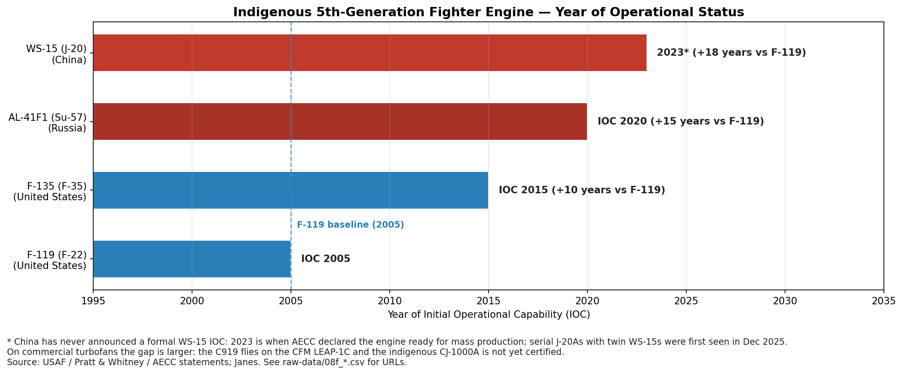

Fighter engines show the gap most cleanly: the US F-119 (F-22) reached
initial operational capability in 2005, the F-135 (F-35) in 2015,
Russia's AL-41F1 (Su-57) in 2020. China has never announced a formal IOC
for the WS-15 (J-20): its builder declared it ready for mass production
in 2023, and serial-production J-20As with twin WS-15s were first seen
in December 2025 — at least 18 years after the F-119. In commercial
high-thrust turbofans, given the uncertified CJ-1000A, the gap is larger
still.

China's lags concentrate in domains with *single-source upstream inputs*
(EUV lithography, certain APIs), *deep accumulated institutional
experience* (aerospace certification, carrier aviation) or
*platform-level network effects* (cloud, EDA) — where catch-up is
hardest and Western capacity most durably differentiated. 2025 added a
corollary: the lags are also bargaining chips. Washington's EDA and
jet-engine licence suspensions and Beijing's rare-earth and Nexperia
export bans were traded within weeks: the dependencies run both ways,
and both sides use them.

---

## §10 Supply-Chain Leverage

The brief's second pillar. Independent of frontier innovation, China
controls upstream chokepoints in several strategic supply chains. 2025
tested that leverage: Beijing deployed it at a scale not seen since
2010, then traded part of it for a truce with Washington — while the
first measurable erosion of its rare-earth refining share appeared in
the data.

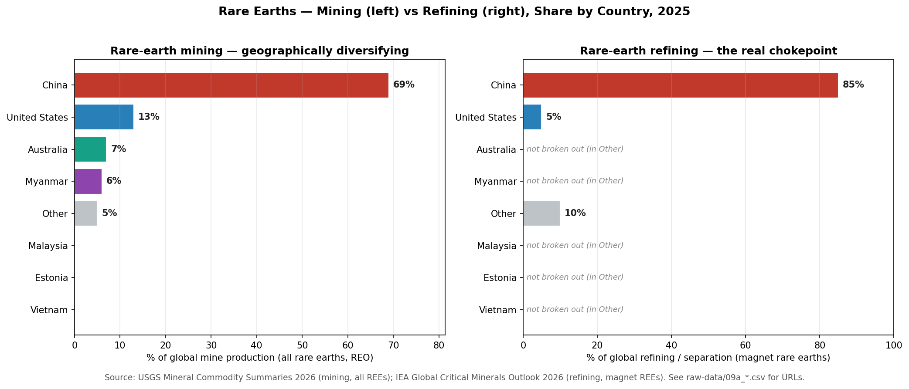

China mined ~69% of the world's rare earths in 2025 (USGS), the US 13%
(Mountain Pass). But the chokepoint is refining and separation, where
2025 brought the first movement: the IEA estimates China's share of
magnet rare-earth refining fell from ~90% in 2024 to ~85% in 2025,
mostly to new US capacity and the rest to Lynas's expanded Malaysian
output, and projects ~73% by 2035 on announced projects. That is
diversification at the margin, not displacement: a green-field
separation plant still takes 5–10 years, and ex-China refining capacity
covers only about a quarter of projected ex-China demand for 2035.
(Mining shares cover all rare earths; refining shares the four magnet
elements.)

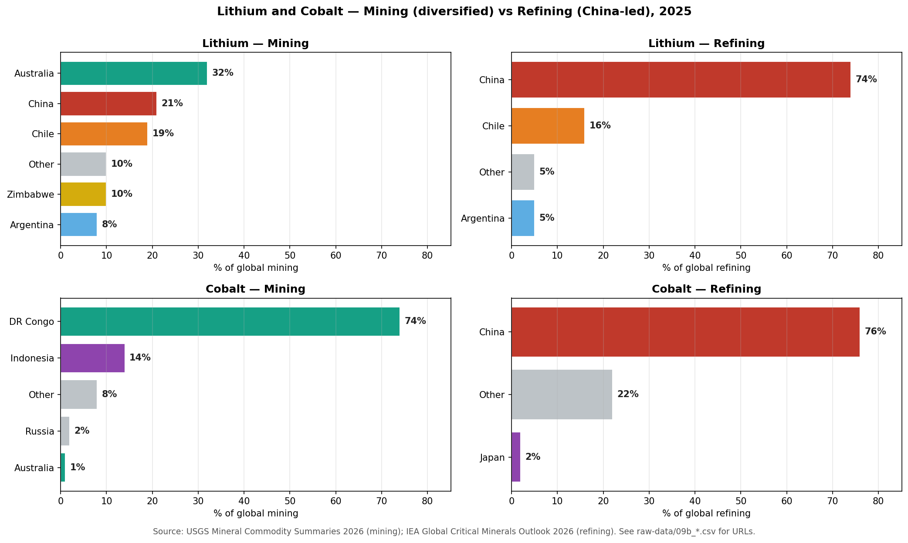

Lithium and cobalt follow the same pattern. Lithium mining has
diversified quickly (Australia's share is down to 32%), while cobalt
mining is dominated by the DRC (74%); refining has gone the other way.
China refined ~74% of the world's lithium in 2025, up from ~70% in 2023
as new Chinese plants ramped up while ex-China capacity ran at low
utilisation, and ~76% of its cobalt. The mine follows geology; the
refinery follows capital, permits and integrated downstream demand — and
even new mines increasingly feed China, with Chinese-headquartered
companies owning over 65% of new African lithium mining capacity. A
second front is producer-country resource nationalism: the DRC moved to
cobalt export quotas in October 2025, and Zimbabwe suspended
lithium-concentrate exports in February 2026. Both tighten supply for
everyone but aim at capturing processing locally, not at the West.

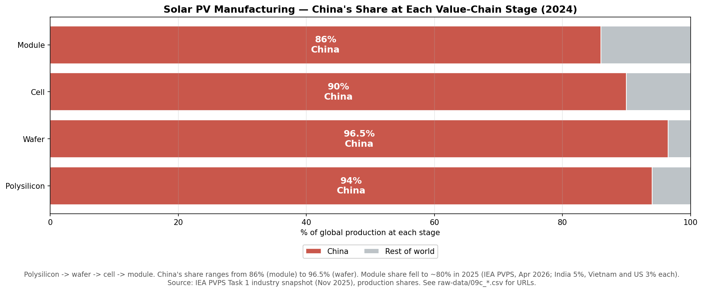

Solar PV is the cleanest dominance case in this brief. On IEA PVPS
production data for 2024, China made 94% of the world's polysilicon,
96.5% of wafers, 90% of cells and 86% of modules. The first dent came in
modules, the easiest stage to relocate (~80% in 2025, as India, Vietnam
and the US grew). Upstream nothing comparable has happened: polysilicon
and wafer plants are multi-billion-dollar capex, and cluster effects
compound. China abolished its 9% VAT export rebate on PV products from 1
April 2026. The IRA's 45X production credit and the EU Net-Zero Industry
Act aim to build alternative capacity — realistically 10–20% of their
respective domestic markets over 5 years, not displacement of China's
global share.

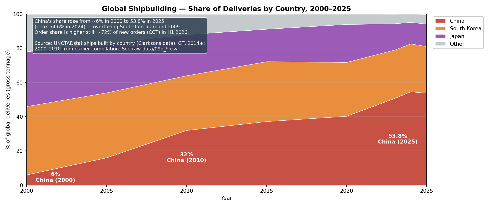

Shipbuilding is the under-covered story. By gross tonnage delivered,
China's share of world merchant shipbuilding rose from ~6% in 2000 to
54.6% in 2024 and 53.8% in 2025 (UNCTAD, from Clarksons data), against
27.3% for South Korea, 13.1% for Japan and 0.03% for the US. Orders
point further up: Chinese yards took ~72% of new orders by compensated
gross tonnage in the first half of 2026 and hold ~65% of the global
order book. It is the upstream of trade and, increasingly, of naval
power: dual-use shipyards are how the PLAN has expanded so rapidly.

Pharma APIs are the leverage point most often quoted loosely. Direct
dependency is smaller than headlines suggest. USP's Medicine Supply Map,
by volume, found China produced about 8% of the active pharmaceutical
ingredient (API) volume in US prescription medicines in 2024 — India and
the EU together more than half, the US itself about 12% — though its
March 2026 update puts China back in double digits. The real exposure is
indirect: India, the largest supplier of generic APIs and finished
generics to the US, depends heavily on Chinese key starting materials
and intermediates, the "double dependency" flagged in the EU's 2021
Strategic Dependencies report. China and India accounted for about 90%
of new US API Drug Master File filings in 2025, so the pipeline is
tilting further towards Asia; WHO and FDA shortage tracking documents
single-source risks for essential generic antibiotics, heparin
precursors and several oncology APIs.

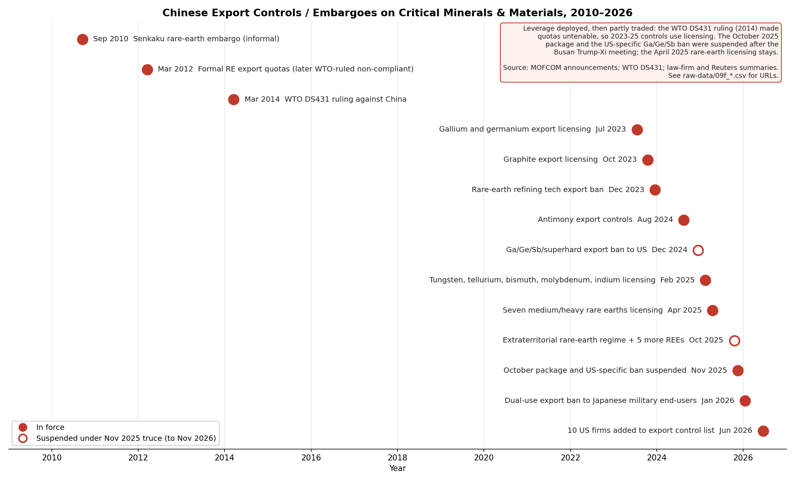

The export-control timeline is the deployment record. After the 2010
Senkaku episode — an informal rare-earth embargo on Japan — the WTO's
2014 DS431 ruling found the formalised quotas non-compliant, and they
were rolled back in 2015. Beijing's lesson was to move to licensing,
harder to challenge at the WTO and discretionary case by case — for
gallium and germanium (July 2023), then graphite, rare-earth processing
technology and antimony (August 2024). MOFCOM Announcement 46 (December
2024) barred gallium, germanium, antimony and superhard-material exports
to the US "in principle"; February 2025 added five more metals,
including tungsten.

Escalation peaked in 2025. April brought licensing on seven medium and
heavy rare earths and the magnets containing them. October's far broader
package added five more rare earths, rare-earth technology and
equipment, lithium-ion batteries and graphite anode material — and, for
the first time, an extraterritorial rule reaching foreign-made products
with as little as 0.1% Chinese rare-earth content. The IEA counts a
tripling since 2023 in tariff codes under export control and estimates
that rare-earth restrictions alone could put some \$6.5 trillion of
downstream output outside China at risk.

Then the leverage was traded. After the Busan Trump–Xi meeting, China
suspended the October package until 10 November 2026 (Announcement 70)
and the US-specific gallium/germanium/antimony ban until 27 November
2026 (Announcement 72); Washington suspended its "affiliates rule",
which had extended US export restrictions to companies at least 50%
owned by listed entities. The April 2025 rare-earth licensing stayed in
force, eased from December 2025 by one-year general licences for
selected magnet makers. The tool has since been pointed elsewhere: at
Japanese military end-users (a January 2026 dual-use ban) and, in June
2026, at ten US companies including MP Materials and USA Rare Earth. The
November 2026 expiries are pending at the time of writing; September
2026 press reports of an extension to January 2027 lack a confirming
MOFCOM text.

On the IEA's 2025 data, China refines 80% or more of world supply of six
minerals, from gallium (99%) to magnet rare earths (85%), and 73–76% of
tungsten, cobalt, lithium and bismuth. Antimony (44%) and nickel (31%)
are the exceptions, and nickel is no Western success story: Indonesia is
the top refiner at ~45%, and the two together refine roughly
three-quarters of the world's nickel. Across the major energy minerals
other than rare earths, the IEA finds the top refining country's average
share rose from 70% in 2023 to 72% in 2025 — the dominant supplier
captured most of the growth. (Several values differ sharply from the
2023 figures in earlier editions, partly on source definitions.)

2025 sharpens the central claim: the leverage is real, asymmetric (China
can deny what the West cannot similarly deny) and finite — and now
visibly a bargaining chip, usable for concessions as well as coercion.
Each binding episode triggers the alternative-supply investment that
erodes it: the Mountain Pass restart and Lynas Malaysia build-out after
2010, the first fall in China's rare-earth refining share alongside the
2025 controls. But outside rare earths, refining concentration is still
rising. The policy question is managing the 5–10 year window in which
the leverage binds while alternative supply catches up — a window whose
next test falls in November 2026, when the truce suspensions expire.

---

## §11 Industrial Policy Mechanics

How the Chinese model actually works — not as a recipe to copy, but as a
system to understand.

Start with spending intensity. CSIS's "Red Ink" study (DiPippo, Mazzocco
& Kennedy, 2022) put China's 2019 industrial-policy spending — direct
subsidies, tax breaks, below-market credit and government investment
funds — at a conservative minimum of ~1.7% of GDP: 2.6x South Korea, the
next-highest comparator, and 4.4x the US. Broader methods produce larger
numbers. An August 2025 IMF working paper, which also counts subsidised
land and extrapolates from listed-firm accounts, puts the fiscal cost at
~4.4% of GDP in 2023, against EU state aid of roughly 1.5%; the authors
treat it as an upper bound. The OECD's 2026 MAGIC database finds large
Chinese firms received industrial subsidies averaging 3.1% of sales
revenue in 2024, against ~1.2% in North America and ~0.5% in Europe. The
estimates are not comparable and their methods contested at the edges,
but all point the same way.

Credit is the financing engine. On BIS data, China's total credit to the
non-financial sector reached ~300% of GDP at end-2025, above the US
(~251%) and the euro area (~238%), and is still rising while both have
deleveraged since their 2020 peaks. The strategic detail is
*composition*: non-financial corporates account for ~143% of GDP, just
under half of China's total, versus roughly 29% of the US total. Growth
is increasingly government-led: general-government credit rose from 77%
to 99% of GDP in 2022–25 while household credit slipped with the
property market. The big state banks are the operational arm of the
National Development and Reform Commission's sectoral priorities: when
the plan names a sector, they direct credit at preferential terms to its
firms. The 15th Five-Year Plan (2026–2030), adopted on 12 March 2026,
puts a "modern industrial system" first among its objectives, seeks
self-reliance in mature-node, advanced and optoelectronic chips and in
chip-design software and equipment, and keeps preferential financial
support for priority sectors.

International standards-setting is the under-discussed lever. China rose
from 49 ISO technical-committee and subcommittee secretariats in 2010 to
87 at end-2024 — the largest gain of any member — and now ranks third,
behind Germany (135) and the US (92, 22 fewer than in 2010). At the IEC
it holds ~18 against Germany's ~30. A secretariat runs standards
development for its domain: test methods, acceptance criteria, reference
architectures. The 15th Plan tasks China with shaping global AI rules
and technical standards and exporting them through Belt and Road
projects — durable, diffuse, quiet influence.

The Big Fund is the most-discussed single vehicle: \$100B of central
authority over ten years across three phases, with provincial and local
chip funds taking the announced national total well above \$200B. Phase
III (May 2024, \$48B) is shifting from fabs toward advanced packaging,
equipment and materials, and AI chips. A national venture-capital
guidance fund began operating in December 2025: RMB 100bn of state
capital meant to mobilise RMB 1 trillion for early-stage "hard
technology" firms. Outcomes are mixed: SMIC has moved from 14nm to
7nm-class and now its N+3 process (the Kirin 9030), still short of TSMC
5nm; YMTC ships 294-layer NAND; CXMT shipped DDR5. None match the
leading edge, but the gap has closed faster than the 2018 consensus
forecast. Phase I also produced a corruption probe (2022–23 arrests
including the fund's chairman).

The Western response has converged, if less linearly since 2025.
Headline authority in 2022–23 was ~\$667B across the IRA, the CHIPS Act
and the EU's Net-Zero Industry, Chips and Critical Raw Materials Acts;
CBO's 2023 re-scoring raised the IRA's \$369B as announced to \$663B
over ten years. The US then moved two ways at once: the One Big
Beautiful Bill Act (July 2025) repealed or accelerated the phase-out of
IRA clean-energy credits worth roughly \$500B over ten years, while in
August 2025 Washington converted \$8.9B of undisbursed CHIPS and Secure
Enclave awards into a 9.9% equity stake in Intel. The EU proposed a
Chips Act 2.0 in June 2026 without a new headline figure. Instruments
differ — the US has swung from demand-side tax credits toward
supply-side and equity tools; the EU relies on regulation and
existing-fund channelling — but the targeting (semiconductors, critical
minerals, batteries) converges, and the Intel stake moves the US closer
to China's state-capital model than any 2022–23 instrument.

The composite read is a *guided market*: fierce private competition
(hundreds of EV and battery firms, brutal price wars, regular
bankruptcies) combined with state direction on *which sectors* are
favoured and *which firms* get capital — unlike Soviet planning (no
private competition) or Western market economies (no
state-bank-allocated credit at scale toward named sectors). Its failure
modes — overcapacity in steel (2014–16), solar (2011–13), and EVs and
solar again (2024–25); wasted Big Fund I capital; local-government debt
— Beijing now names itself: since a Xi-chaired meeting in July 2025 the
"anti-involution" campaign has targeted "disorderly" price competition,
below-cost selling and excess capacity in solar, EVs and steel. Whether
an administrative campaign can discipline overcapacity that the same
system's credit and local-government incentives created is the open
question.

---

## §12 What Could Derail It — and the Counter-View

Two-sided: risks to China *and* to Western "we can wait it out"
complacency.

Demography is the first-order risk. China's working-age population
(15–64) peaked in 2015 at ~1.018 billion; the UN's 2024 medium variant
projects ~750 million by 2050. Most of that ~268 million fall is still
ahead — ~225 million after 2025, roughly today's entire US working-age
population (~217 million) — and India (961 million in 2025, against
China's 975 million) overtakes China between 2025 and 2030. The total
population fell for a fourth consecutive year in 2025, to 1,404.89
million, as deaths (11.31 million) exceeded births by 3.39 million. The
Japan 1990 and Germany 2005 analogies apply, with the caveat that China
reaches this turning point at a substantially earlier stage of
per-capita income.

The real-estate slump, the second first-order risk, has not yet found a
floor. New floor space started fell from a ~2,272 million m² peak in
2019 to ~588 million m² in 2025, a 74% drop. Investment has fallen every
year since 2022, ever faster: −10.6% in 2024, −17.2% in 2025 and −19.9%
in January–August 2026, with new starts down a further 24.8%.
New-building sales fell 12.6% by value in 2025. Real estate was ~25–30%
of the economy on broad measures through the 2010s, so the contraction
drags on aggregate demand and on local governments that relied on
land-sales revenue. Evergrande's 2021 default marked the inflection;
Country Garden's in October 2023 showed that "three red lines"
deleveraging had reached even the stronger developers.

The incremental capital-output ratio (average gross capital formation as
a share of GDP divided by average real GDP growth) roughly doubled, from
~3.9 in 2001–05 to ~7.5 in 2021–24 on World Bank data: investment still
absorbs ~42% of GDP but now buys ~5.5% growth, against ~10–11% in the
2000s. The Japan (1985–95) and Korea (1995–2005) analogues suggest
investment must give way to consumption for growth to continue; China's
consumption share remains below 40% of GDP, historically and
internationally low, and rebalancing has been slow.

US export controls are the policy-driven risk, and since mid-2025 they
no longer move one way. Until September 2025 each cycle widened the
perimeter: Huawei (May 2019) → SMIC (2020) → all advanced AI chips and
the equipment to make them (October 2022) → specific Chinese AI labs
(October 2023) → high-bandwidth memory, 24 types of chipmaking equipment
and 140 Entity List entries (December 2024) → a 50% "affiliates rule"
covering subsidiaries of listed firms (September 2025). Meanwhile
Washington began trading them. The January 2025 AI Diffusion Rule was
rescinded in May before taking effect; Nvidia's H20 was licensed in
August 2025 against a reported 15% revenue share to the US government;
the affiliates rule was suspended for a year under the November 2025
Busan truce; and in January 2026 licence review for H200-class chips
moved from presumption of denial to case-by-case. Chinese customs
reportedly blocked H200 imports within days and firms were told not to
buy them unless necessary: Beijing treats US compute as a dependency to
reduce, not a concession to win. "Small yard, high fence" became a
larger yard, with gates that open and close with trade talks. Beyond
whether they slow Chinese frontier AI or merely lengthen indigenous
substitution, the question is now whether visibly negotiable controls
still shape long-horizon investment on either side.

The trade surplus is the counter-view, and 2025 its strongest data
point. US tariffs on Chinese goods reached 145% in April 2025, before
the May Geneva truce cut them back and the October Busan meeting brought
the overall level to ~47%; yet China's goods surplus rose to \$1,189
billion from \$992 billion in 2024, the first year above \$1 trillion.
Exports grew 5.5% to \$3.77 trillion while imports were flat at \$2.58
trillion; shipments to ASEAN, Africa, Latin America and the EU more than
offset a fall of about a fifth in exports to the US. The January–August
2026 surplus (~\$806 billion) is on track for another record. The engine
has re-routed, not broken. Two cautions. Part of the surplus reflects
weak domestic demand and excess capacity, which keeps provoking trade
defence abroad. And the US tariff wall is legally unsettled: in February
2026 the Supreme Court ruled that the International Emergency Economic
Powers Act does not authorise tariffs, striking down the fentanyl and
"reciprocal" levies (existing Section 301 tariffs on China were
unaffected). A temporary 10% across-the-board surcharge under Section
122 of the Trade Act, capped at 150 days without congressional approval,
filled the gap while new Section 301 investigations ran; when it lapsed
on 24 July 2026, new Section 301 tariffs on 60 trading partners — 12.5%
for China — replaced it the same day. The 2026 summits (Trump in Beijing
in May, Xi in Washington in September) brought purchase commitments, a
framework for reciprocal tariff cuts on \$30 billion of each side's
imports, and a truce extension reported to run only to January 2027.
None of this has yet changed the surplus trajectory.

China's total fertility rate fell from ~2.5 in 1990 to 1.01 in 2024
(World Bank), below Japan (1.15) and above only South Korea (0.75) among
the comparators shown. Births fell to 7.92 million in 2025 from 9.54
million in 2024 — 5.63 per thousand, the lowest on NBS records since
1949 — despite the 2015 end of the one-child policy and the 2021
three-child policy. The working-age projection above is thus a *best
case*: without a fertility recovery, the post-2050 trajectory is sharper
still.

The headwinds worsened over 2025–26 — deeper property contraction,
faster-falling births, less predictable export controls — but do not
mean "China has peaked." Japan and Germany at comparable turning points
remained formidable exporters of high-end engineering goods for several
decades, and China's 2025 export performance under 145% US tariffs is
the clearest evidence yet that its industrial base does not depend on
any single market. The headwinds will narrow the rate of expansion, not
flip the direction.

---

## §13 Implications for Western Policy

The brief does not advocate a single policy framework, but four
implications follow from the data.

**First, the "selective leadership" frame should replace the "China is
or isn't innovating" binary.** China leads where scale, integrated
supply chains, energy costs and learning-curve depth have compounded
over a decade or more. These sectors share a profile — mid-skill
manufacturing scale, state-directed demand-pull, integrated upstream
materials — that predicts which *additional* sectors are at risk
(drones-at-defense-scale, mid-range commercial aircraft beyond 2035,
certain specialty chemicals, advanced grid hardware). In 2025 a 20% fall
in exports to the US was absorbed by other markets within the year —
what broad-based competitiveness looks like.

**Second, supply-chain leverage is a multi-year transition problem, not
a permanent veto — but 2025 showed it is also a bargaining chip that can
be played repeatedly.** The 2010 rare-earth episode is the prototype:
leverage deployed, alternative supply built, leverage degraded over the
following decade. The 2025 rounds were larger and faster: April
licensing on seven medium and heavy rare earths and their magnets; then,
in October, five more elements and an extraterritorial rule reaching
foreign products with as little as 0.1% Chinese rare-earth content.
Within a month the October package was suspended under the Busan truce
in exchange for a one-year US suspension of the affiliates rule and a
tariff cut; the April controls stayed. Leverage that can be switched on,
priced and partly switched off is worth more than a one-shot embargo,
and compresses the West's binding window. The calendar is explicit: the
US affiliates-rule suspension lapses on 9 November 2026 and China's
suspension of its October 2025 measures on 10 November 2026, unless
extended (reports of the September 2026 summit point to a short
extension to January 2027). Alternative supply is coming — the US
Department of Defense took an equity stake in MP Materials in July 2025
and guaranteed a \$110/kg NdPr oxide floor price — but on a 5–10 year
horizon. The leverage will erode regardless; the task is managing the
window: strategic stockpiling, faster permitting for OECD processing
facilities, allied-supply diversification, MP Materials-type price
floors and offtake deals, and explicit pricing of environmental costs
into the build-out.

**Third, energy and grid build-out is the under-priced strategic
asset.** Data-centre electricity projections (§8) indicate that AI is
becoming energy-bound, not purely chip-bound. Countries that can build
large-scale clean baseload and the grid to deliver it at competitive
industrial prices will have a structural edge in AI-compute economics,
and the current generation mix and build-out rate favour China
substantially. US and EU policy here has been less coordinated than on
chips or batteries — perhaps the most important under-prioritised gap in
Western industrial policy. The 2025–26 loosening of chip controls
sharpens the point: if compute access becomes partly negotiable, energy
becomes a larger share of the durable advantage.

**Fourth, Western industrial policy has converged on intervention but
diverged on instruments.** The 2022–23 wave (IRA, CHIPS, EU NZIA, EU
CRMA) rested on production subsidies, domestic-content preferences and
strategic-sector targeting. Since 2025 the US has turned to tariffs,
deal-making and direct state ownership: the July 2025 budget law ended
the federal EV purchase credit from 30 September 2025; in August 2025
\$8.9 billion of undisbursed CHIPS Act and Secure Enclave awards became
a 9.9% equity stake in Intel; the MP Materials deal added price
guarantees; and the February 2026 Supreme Court ruling narrowed the
tariff instrument itself. The EU has kept its EV countervailing duties
but in January 2026 agreed guidance with China for minimum-price
undertakings, accepting the first (a China-built Volkswagen model) in
February 2026. The question is no longer *whether* to do industrial
policy but *how*, and transatlantic answers are pulling apart. China's
mechanism — a guided market with fierce private competition under
state-directed credit allocation — cannot be transplanted directly, but
its *targeting principles* (long-horizon, sectoral, willing to absorb
early overcapacity cycles) are adaptable. The next phase will be a
learning exercise in which mechanisms work at scale in OECD institutions
and survive changes of government and court challenges.

The brief deliberately recommends no tariff levels, export-control
thresholds or budget allocations; the data are meant to inform those
choices, not pre-determine them.

---

## §14 Conclusion

China is no longer the world's workshop and not yet the world's
laboratory. It is a distinct third thing: a producer-economy of
unprecedented scale that has developed selective frontier capability in
a few strategically chosen sectors while retaining the upstream
supply-chain leverage accumulated over the prior two decades.

All three propositions hold. The three-phase trajectory is clear in the
macro data. Selective frontier leadership shows in the sectoral data for
batteries, EVs, parts of AI, robotics (a lead of scale and cost rather
than automation density), solar PV manufacturing and electricity
build-out. Supply-chain leverage shows across rare earths, battery
materials, solar PV and merchant shipbuilding (pharma APIs more
indirectly, via Indian intermediates) — and it is not merely
theoretical: in 2025 it was deployed at its largest scale yet, then
partly traded for a truce that expires in November 2026.

The counter-evidence is that several major domains remain firmly
Western-led: advanced semiconductors, commercial aerospace, originator
pharmaceuticals, industrial software and cloud, and a substantial
portion of defense systems. These are the high-margin platform layers of
the modern economy, and in most of them the gap is durable and unlikely
to close within a decade — the clearest exception being originator
pharmaceuticals, where Chinese discovery is now licensed to Western
majors at record scale. The lags also cut both ways: in 2025
Washington's chip-design-software and jet-engine licence suspensions
were traded within weeks against Beijing's rare-earth export controls.

The headwinds are real too: a working-age population that peaked in 2015
and is still falling, fertility of ~1.0 with births at a record low,
construction starts down three-quarters from their peak, a doubled ICOR,
and a US export-control perimeter that remains wide after the 2025
relaxations and can tighten again at short notice. They will tighten the
constraints on the Chinese model in the coming decade.

But — and this is the brief's framing claim — selective leadership *and*
supply-chain leverage *and* a structural energy advantage *and* a record
\$1,189 billion trade surplus in 2025, earned in a year when US tariffs
peaked at 145%, do not describe an economy that has peaked. They
describe a different and durable configuration: neither the cheap-labour
workshop of 2005 nor the universal frontier-rival of the most aggressive
readings, but a producer-economy with selective frontier capability and
substantial upstream leverage — able to force real strategic choices on
its trading partners over a multi-decade horizon and, as the 2025 tariff
escalation and subsequent truces showed, unlikely to be talked or
tariffed out of those capabilities on the time-frames that matter for
Western policy.

The right question for Western capitals is not whether China will keep
leading in batteries, EVs, parts of AI, robotics, solar and the energy
build-out — the data suggest it will for at least the next decade — but
how to manage the multi-year window in which Chinese supply-chain
leverage binds while alternative supply catches up, and how to invest
selectively where Western institutional advantages — IP enforcement,
deep capital markets, originator-pharma clinical-trial ecosystems,
advanced lithography, dominant platform software — remain genuinely
durable.

---

*Data and sources for every chart in this brief are documented in
[`raw-data/SOURCES.md`](raw-data/SOURCES.md). Each chart's underlying
CSV in `raw-data/` carries `# source:` / `# url:` / `# retrieved:`
header comments. World Bank–sourced charts can be refreshed by running
`python3 00_fetch_world_bank.py`; other CSVs are hand-compiled from the
cited public reports and are updated by editing the CSV file directly.*
