# Greece: Crisis, Adjustment, and the Slow Reconstruction

*October 2026 edition — data updated to 2025 (retrieved 13 October 2026). First published May 2026.*

### A Data-Driven Analysis, 2000–2025

> **What changed in the October 2026 edition**
>
> *New data.* All series now run to 2025 where published. Real GDP grew
> 2.1% in 2025 and is 14% below its 2007 peak; the budget surplus reached
> 1.7% of GDP and debt fell to 146%; unemployment fell to 8.9% and NPLs
> to 3.0%; tourism receipts hit a record €23.6bn; net migration has been
> positive since 2022 and the population stopped falling in 2025. RRF
> figures now come live from the Commission's Scoreboard: Greece has
> drawn 68% of its envelope (EU: 78%), with its last two requests
> (€11.3bn) under assessment.
>
> *Corrections.* About twenty figures in the first edition did not match
> the underlying data — among them the 2009 deficit (15.4% of GDP, not
> 15.1%), the debt peak (209%, not 207%), the fall in deposits (about
> half, not a third) and the claim of an EU-leading RRF disbursement
> rate, which is withdrawn. The full list is at the end of the report.
---

## Executive Summary

Between 2007 and 2013 Greece lost more than a quarter of its real GDP, and between 2009 and 2015 nearly half of its bank deposits; from its 2010 peak the population then fell by about 700,000. The non-performing loan ratio peaked at 46% — a figure normally associated with post-war financial systems. The 10-year sovereign yield averaged 29% in February 2012. By every standard macroeconomic measure, Greece experienced the worst peacetime depression of any developed economy since the 1930s.

A decade later the headline numbers have stabilised. Real GDP in 2025 is still 14% below its 2007 peak and 5% below its 2010 level — the recovery is real but partial. Public debt has fallen from 209% of GDP (2020) to 146% (2025). NPLs are down to 3%. Unemployment has dropped from 28% to under 9%. Bond yields trade inside Italy's. The current account is still in deficit (5.6% of GDP in 2025), but a services surplus of €22.4bn — built on record tourism receipts of €23.6bn and €18.7bn of shipping receipts — covers two-thirds of a chronic €34bn goods deficit.

But the recovery is incomplete and uneven. Per-capita GDP in purchasing-power terms is 69% of the EU average, down from a pre-crisis peak of 96% and below its 2000 level of 85%. Attica, the dominant economic region, fell from 127% of the EU average in 2006 to 86% in 2020 and was back to 96% by 2024. Eleven of thirteen NUTS2 regions lost population over 2007–2025; West Macedonia lost 15%. Tertiary attainment among 25–34-year-olds, which had been climbing for two decades, has slipped since 2022 — a legacy of the crisis-era brain drain, even though net migration turned positive in 2022.

Greece in 2025 is no longer in crisis but is not yet converging. The fiscal turnaround is real and durable. The banking system is repaired. Tourism is a runaway success. Yet the economy that emerged from the adjustment is smaller, older, more service-dependent and more regionally concentrated than the one that entered it. The chapters below reconstruct the trajectory from the data.

---

## 1. The Macroeconomic Trajectory

### 1.1 The boom, the bust, the long flatline

Real GDP grew at about 4.5% per year in the half-decade before 2008, fuelled by cheap euro-denominated credit, public spending, and Olympics-related construction. Output peaked in 2007, was flat in 2008, and then contracted in seven of the following nine years. By 2013 the economy was 27% smaller in real terms than at peak.

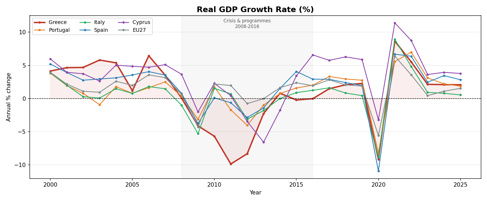

Recovery began tentatively in 2014, was interrupted by the 2015 capital controls episode, then resumed at modest rates of 1.5–2.3% until COVID. The post-pandemic rebound was the strongest stretch of growth Greece had seen since the early 2000s: 8.7% in 2021, 5.5% in 2022, then a steady 2.1% a year in 2023–2025 — faster than the EU average in each of those years. Even so, real GDP in 2025 is still 5% below its 2010 level and 14% below the 2007 peak. On a 25-year horizon, Greek output is roughly where it was in 2003.

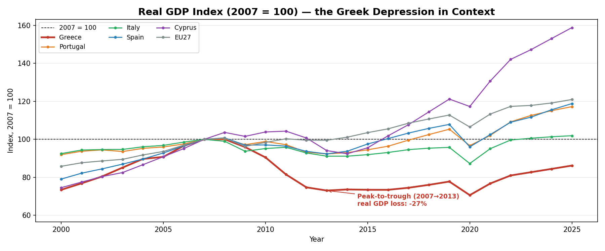

In nominal per-capita terms, Greece peaked at about US\$31,700 in 2008, fell to roughly US\$18,000 by 2015–2016, and has slowly climbed back to about US\$26,900 in 2025 — still below the 2008 peak even before adjusting for inflation.

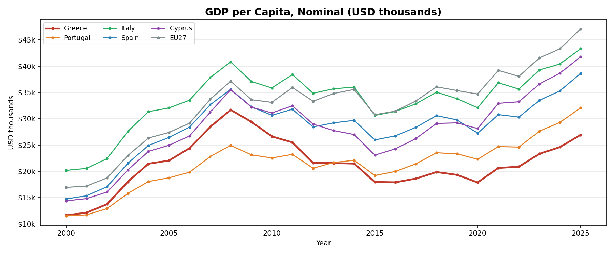

### 1.2 Convergence reversed

The purchasing-power-adjusted level of per-capita GDP captures the deeper story. Greece reached 96% of the EU27 average in 2006 and was still at 94% in 2009. By 2013 it was at 71%, slid to 62% in 2020, and has recovered only to 69% (2024–2025) — below its 2000 level of 85%. Its southern peers lost ground too — Italy fell from 123% to 96% over 2000–2025, Spain from 98% to 91%, Portugal from 85% to 81% — but none fell as fast: Greece lost 25 points in seven years (2006–2013). The Maastricht convergence promise — that monetary union would deliver real convergence to richer Europe — was, for Greece, reversed.

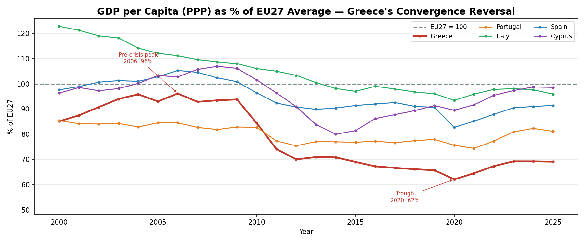

### 1.3 Sectoral composition

The shape of the economy shifted with the crisis. On the Eurostat accounts (§7.1), industry excluding construction is essentially flat at 13.5–15% of value added, and services account for close to 80% of GVA. The trade-transport-tourism aggregate held its share around 24–25% — meaning it shrank in absolute terms only as much as the rest of the economy and grew faster on the way out. Construction collapsed, as the dedicated charts in [§7.2](#72-construction-a-90-collapse) show. (The World Bank chart below expresses sectors as a share of GDP rather than GVA, so the three bands sum to about 87%; the remainder is net taxes on products.)

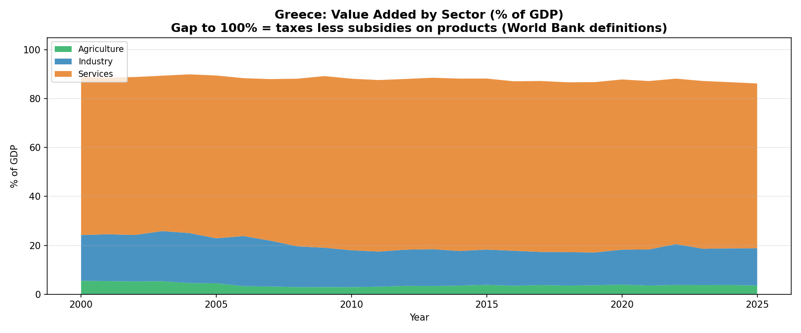

---

## 2. Public Finances: From Crisis to Surplus

### 2.1 The deficit

The 2009 budget deficit was 15.4% of GDP — and the in-year revisions that produced that number triggered the loss of market access. Seven years and three programmes later, Greece ran a primary surplus of 3.4% of GDP in 2016. By 2025 the headline balance was a surplus of 1.7% of GDP with a primary surplus of 4.9%. Few advanced economies have ever sustained primary surpluses this large for this long.

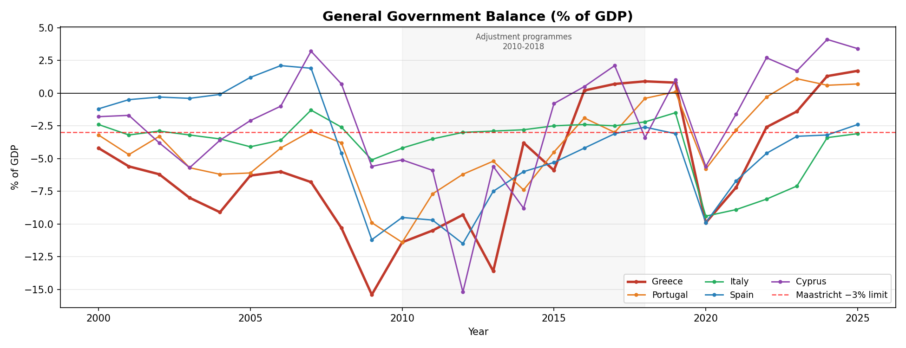

Tax revenue rose sharply during the adjustment as both rates and enforcement intensified. In 2024, the latest year Eurostat has published for most countries, taxes and social contributions were 41.6% of GDP, well above the pre-crisis level (33.9% in 2007) and slightly above the EU27 average of 40.2%.

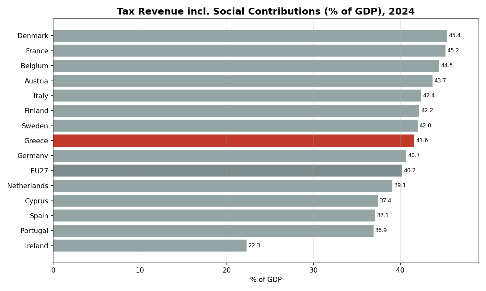

The revenue and expenditure trajectory together show the squeeze: revenue rose while expenditure was cut, closing the gap from both sides. In 2025 revenue was 50.0% of GDP and expenditure 48.3%.

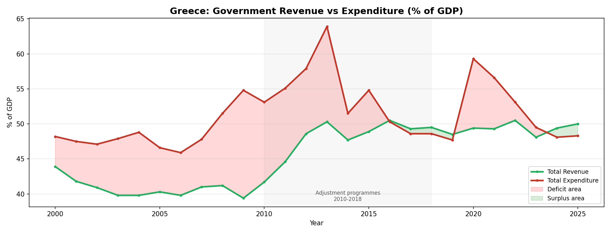

### 2.2 The debt

Public debt rose from 105% of GDP (2007) to a peak of 209% in 2020. The 2012 Private Sector Involvement (PSI) — the largest sovereign restructuring in history — wiped roughly €100bn off the debt stock and dramatically shifted its composition.

In plain terms: pre-2012 Greece borrowed mainly by selling **bonds** — tradable IOUs held by banks, pension funds and hedge funds. The PSI was a forced swap. Bondholders gave up €100 of old bonds for new bonds worth €46.50 in face value, with lower coupons and longer maturities — a "haircut" of about 53.5% in nominal terms, closer to 75% in present-value terms once the worse interest rates and longer wait are taken into account. It applied only to *private* creditors (hence the name); official loans from EU governments and the IMF were untouched.

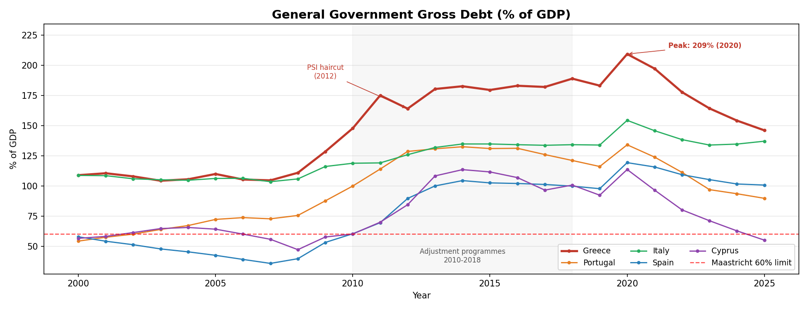

The composition chart below splits the total debt by instrument. **Bonds** are tradable IOUs whose price moves with market sentiment, refinanced every few years at whatever rate investors demand. **Loans** are direct, non-tradable contracts with a specific lender on fixed terms — no rollover risk, no mark-to-market. Pre-PSI, market-held bonds were the largest creditor class. The bailout packages (EFSF, ESM, bilateral euro-area partners, IMF) replaced most of those bonds with loans on extraordinarily soft terms. In 2025 loans still made up about 70% of Greek debt (103.5% of GDP out of 146.1%), mostly owed to official lenders at concessional rates with maturities stretching to the 2070s. That share is edging down — loans were 120% of GDP in 2023 — as GDP grows and Greece repays official loans ahead of schedule (the IMF was repaid in full in 2022).

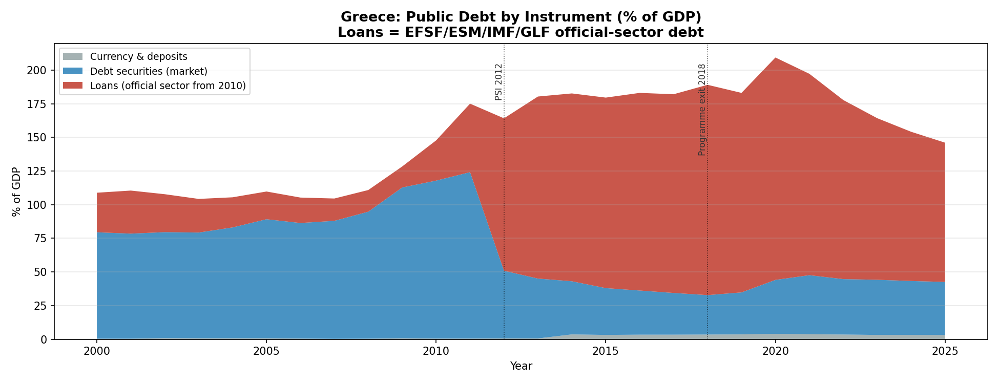

This is why the headline debt/GDP ratio overstates the actual burden. Italy sits at ~137% but mostly in market bonds it must keep refinancing; rate moves bite quickly. Greece is at ~146% but mostly in long-dated official loans at fixed concessional rates — so the effective interest rate on the debt stock is only about 2% (interest of 3.2% of GDP in 2025 on debt of about 150% of GDP). Markets recognised this in 2023, when Greece regained investment-grade ratings.

### 2.3 The primary-balance achievement

First, the terminology. The **headline balance** is total government revenue minus total government spending — *including* interest payments on existing debt. It is the figure the EU's 3%-of-GDP deficit ceiling refers to. The **primary balance** strips out the interest line and measures only revenue minus *non-interest* spending. So `primary balance = headline balance + interest paid`.

The distinction matters because interest payments are largely fixed by past borrowing — they are not what this year's tax-and-spend decisions can move. The primary balance is. A country can run a primary surplus and still post a headline deficit if the interest bill swallows the surplus. Greece's 2025 numbers go the other way: a primary surplus of **+4.9% of GDP**, interest payments of **3.2%**, leaving a headline surplus of **+1.7%** — a remarkable position for a country whose 2009 headline deficit was 15.4%.

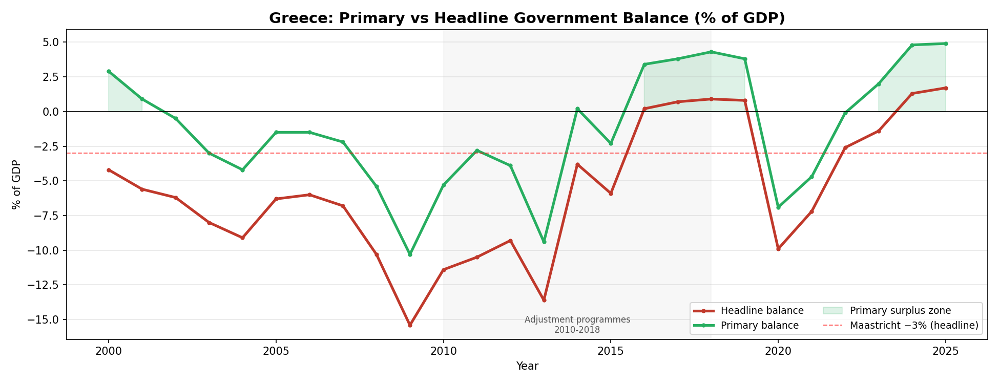

Debt-to-GDP has fallen by 63 percentage points since 2020. The mechanics: when nominal GDP grows faster than the effective interest rate on debt — what economists shorthand as "r minus g" working in your favour — the ratio falls automatically, even before counting any primary surplus on top. Greece has both working: long-dated official loans at fixed rates averaging around 2%, and nominal GDP growth of 5–12% a year in 2022–2025 from real growth plus inflation. The primary surpluses contributed too but were not the dominant driver. The political economy of austerity produced both the worst macroeconomic outcomes in the EU and the strongest fiscal discipline.

The trajectory is now sustainable on conservative assumptions. Greece regained investment-grade ratings in 2023, thirteen years after losing them in 2010.

---

## 3. Labour Market and Demographics

### 3.1 The employment collapse and partial recovery

The Greek labour market suffered the deepest collapse in the modern OECD. Unemployment rose from 9.8% (2009, the first year of this Eurostat series) to **27.8%** (2013); by 2025 it had fallen to 8.9%, the lowest since 2009 — though still above Italy (6.1%) and Portugal (6.0%).

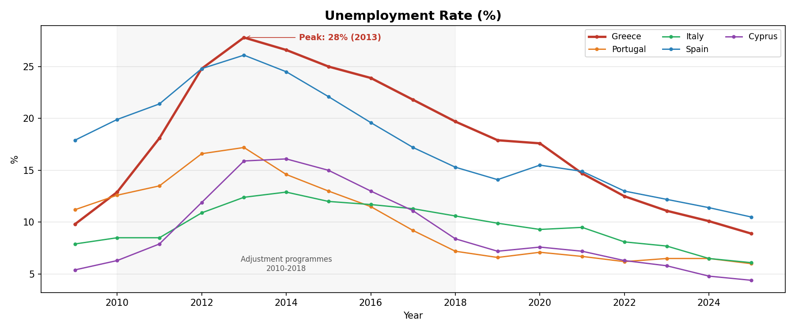

Youth (15–24) unemployment peaked at **59.2%** in 2013 — at one point, three out of five young job-seekers were unemployed. The 2025 figure of 19.1% is below Italy's and Spain's.

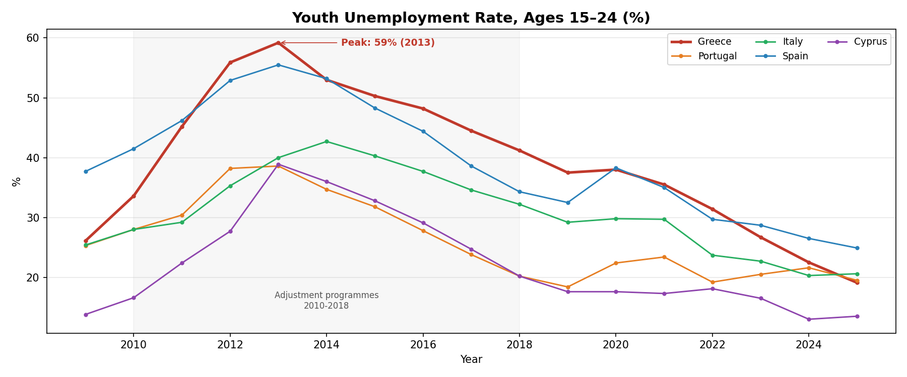

The employment rate (15–64) recovered to 64.6% by 2025 — far above the 2013 trough of 48.5% and the highest reading in the series, but still the second-lowest in the peer group after Italy.

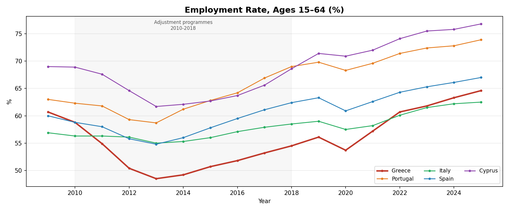

### 3.2 Internal devaluation

With the exchange rate locked, adjustment ran through wages. The wages-and-salaries labour cost index fell by 21% between 2010 and 2015 while consumer prices were roughly flat (+0.6% over 2011–2015) — a real wage cut of about the same size. The competitiveness gain is real but the cost to household incomes was severe. Wages have since risen strongly: by 2025 the index was 12% above its 2010 level.

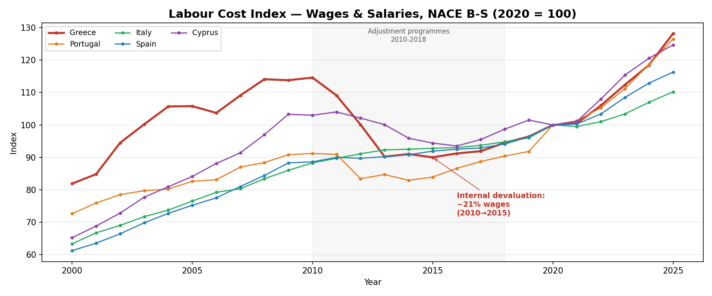

### 3.3 Demographic loss

Greece's population peaked at 11.12 million in 2010 and fell every year until 2024, reaching 10.41 million — a loss of roughly 700,000 people, or 6.4% of the total. It ticked up slightly in 2025.

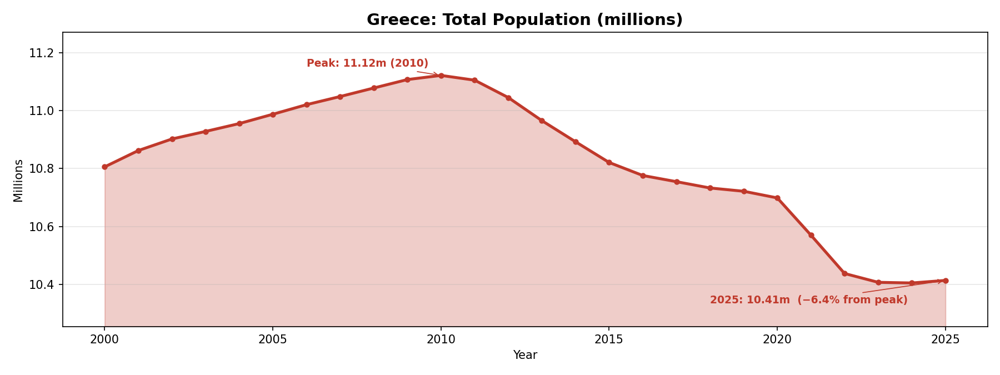

Indexed to 2000, Greece has lost population while every other peer has grown:

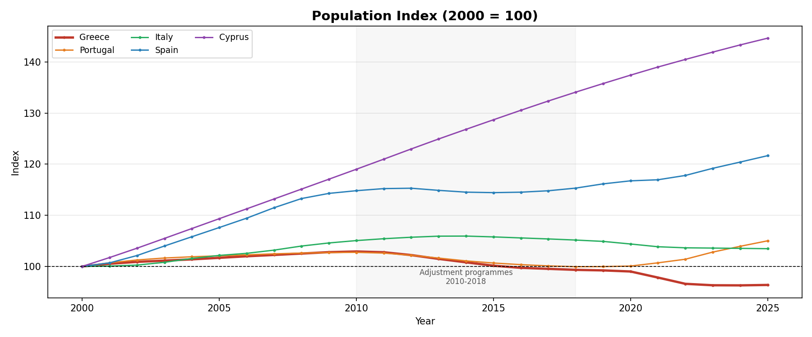

Net migration turned strongly negative in 2011–2015 (peak outflow of about 6 per 1,000 residents per year in 2012–2013) and again briefly in 2020–2021. Since 2022 it has been positive, reaching +5.2 per 1,000 in 2024 and +4.8 in 2025. The crisis-era outflow is the brain-drain channel that doesn't appear directly in the regional or labour data but underpins both; the recent inflow is what has halted the population decline.

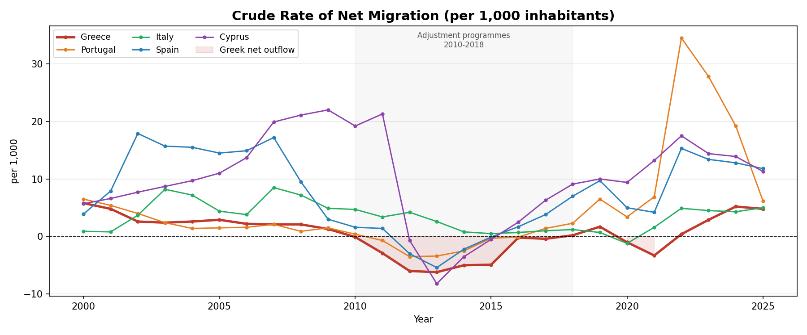

The age-dependency ratio reached 59% in 2025, the second-highest in the peer group after Portugal.

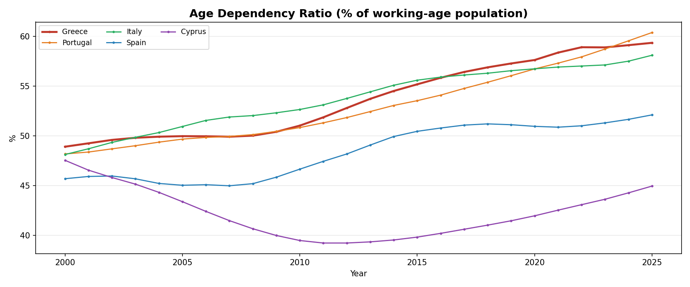

The total fertility rate was 1.24 in 2024 — below the EU average of 1.34 and far below replacement. Greece is ageing and, without migration, shrinking.

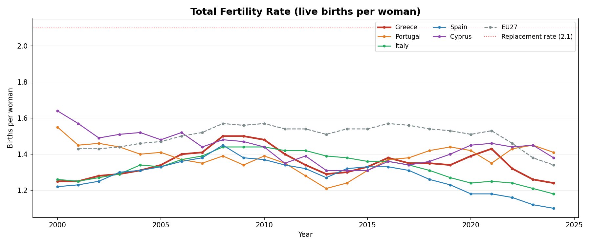

---

## 4. Inflation, Yields and the Loss of Monetary Sovereignty

### 4.1 Deflation, then disinflation

First, a note on the measure. The **Harmonised Index of Consumer Prices (HICP)** is the EU's standardised CPI: the same idea as a regular consumer-price index, but built under a common methodology across all member states so numbers are directly comparable. HICP excludes owner-occupied housing costs, weights consumption more broadly (including tourist spending on the territory), and is what the ECB targets — its 2% euro-area inflation goal is defined on HICP. The gap to a national CPI is typically under half a percentage point per year, so the broad inflation story is the same either way.

Greece experienced **three consecutive years of HICP deflation (2013–2015)**, followed by zero inflation in 2016 — a textbook symptom of a fixed-exchange-rate adjustment with no monetary offset. Prices fell cumulatively by about 3.4%. By contrast, the 2022 energy shock pushed headline inflation to 9.3%, close to the euro-area's 8.4%. Inflation has since settled at 3.0% (2024) and 2.9% (2025), still somewhat above the euro area's 2.1%.

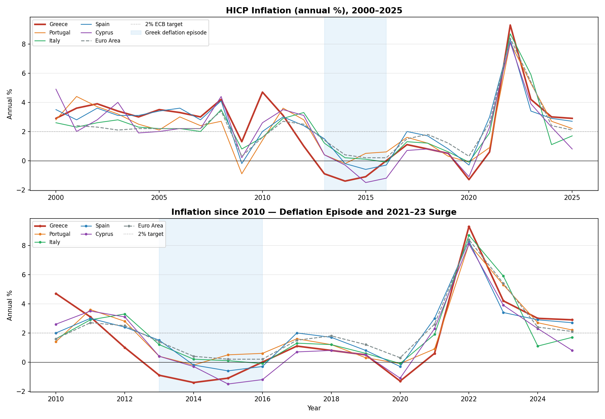

### 4.2 Sovereign yields

The 10-year Greek government bond yield rose from about 6% in early 2010 to a monthly average of **29.2%** in February 2012, on the eve of the PSI; the 2012 annual average was 22.5%. Successive bailouts, the PSI, and ECB liquidity progressively normalised the yield curve. In 2025 the 10-year annual average was 3.37%, below Italy's 3.59% — Greek paper now trades inside Italian. Monthly data for 2026 show Greek yields rising in step with Bunds, to 4.2% in September.

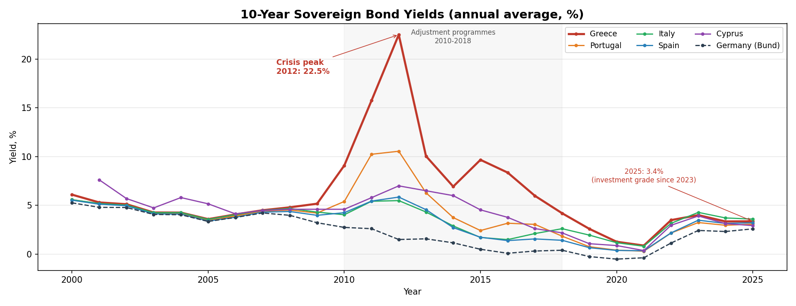

To isolate the *Greek-specific* risk premium, analysts look at the **spread** to Germany. A **Bund** is a German federal government bond (from "Bundesanleihe"); because Germany is treated by markets as the most creditworthy sovereign in the euro area, its 10-year yield is the regional benchmark "safe" rate. The Greek–Bund spread is simply the difference between the two 10-year yields, expressed in percentage points. It strips out the common eurozone factor — ECB policy, global rates, region-wide risk appetite — and shows only how much extra investors demand to hold Greek debt instead of German. Pre-2008 the spread was negligible (markets treated Greek debt as effectively German); at the 2012 peak it reached **21 percentage points** on annual averages; by 2025 it had collapsed back to 0.8 pp, and it was about 0.75 pp in September 2026. The convergence trade that vanished in 2010 has substantially reconstituted itself.

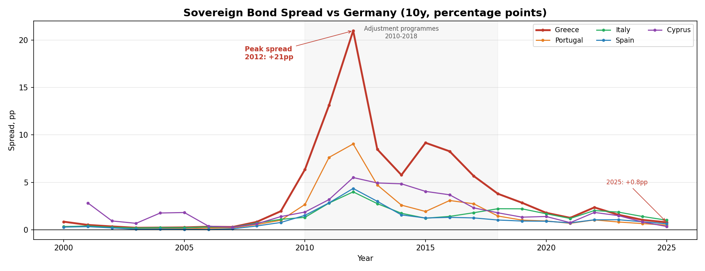

### 4.3 Competitiveness

The CPI-deflated real effective exchange rate appreciated by roughly 14% over 2001–2009 — the loss of competitiveness inside the euro that no policy lever could correct. The subsequent 2009–2015 depreciation of roughly 10% was achieved entirely through internal devaluation: deflation and falling wages.

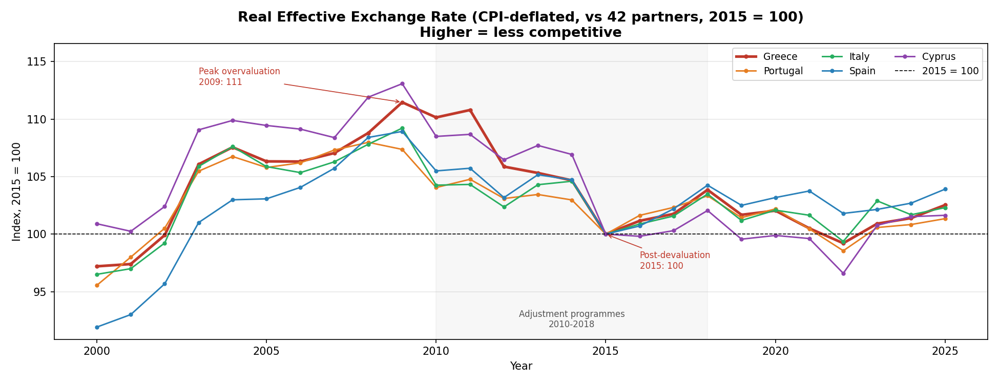

Nominal unit labour costs tell the same story even more cleanly. Greek NULC in 2025 sits at 113 on the 2015=100 index — only about 5% above the 2009 level (107) — while the euro-area aggregate has risen from 96 to 130 over the same period, a 36% increase.

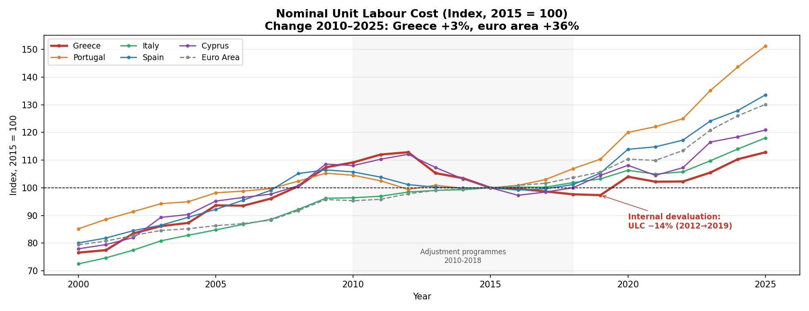

---

## 5. Banking: From Near-Collapse to Recovery

### 5.1 The NPL crisis

The Greek banking system experienced one of the largest non-performing loan accumulations in modern banking history. The NPL ratio rose from under 3% (2008) to **46.0%** (2017) — a level normally seen only in post-war or post-currency-collapse economies. Resolution came through securitisation under the Hercules state-guarantee scheme: NPL ratios fell to 6.0% by 2023, 3.5% in 2024 and 3.0% in 2025 — close to Italy, Spain and Portugal (2.3–2.6%).

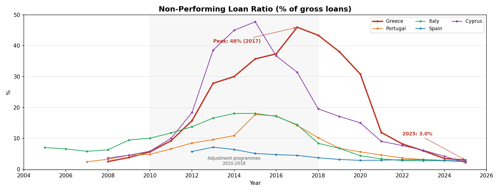

### 5.2 The deposit flight

Deposits at Greek banks from the non-bank private sector and local government (all non-MFI depositors except central government) peaked at €244bn in December 2009. By July 2015, on the eve of the third bailout and the imposition of capital controls, they had fallen to €126bn — a loss of roughly half. Capital controls (June 2015–September 2019) stemmed the bleed and gradually deposits rebuilt. By end-2024 they stood at €219bn, and by August 2026 at €240bn — less than 2% below the nominal peak.

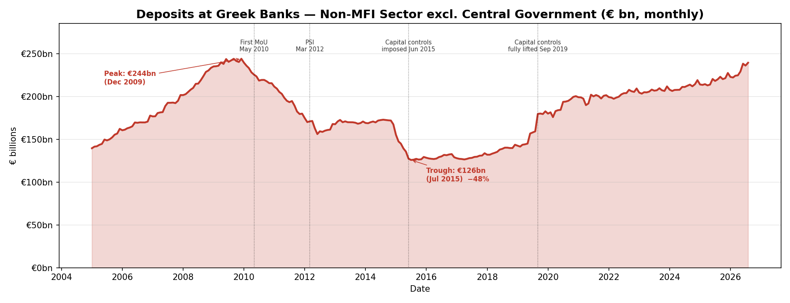

### 5.3 Credit deleveraging and bank capital

Domestic credit to the private sector by banks peaked at 120% of GDP in 2012, inflated by the shrinking denominator; by 2024 it had fallen to 48%. Part of this is denominator effects but most is genuine deleveraging — balance-sheet repair by banks unwilling to lend, depressed demand from households and firms, and the transfer of NPLs off bank balance sheets. Greek private credit penetration is now the lowest in the peer group.

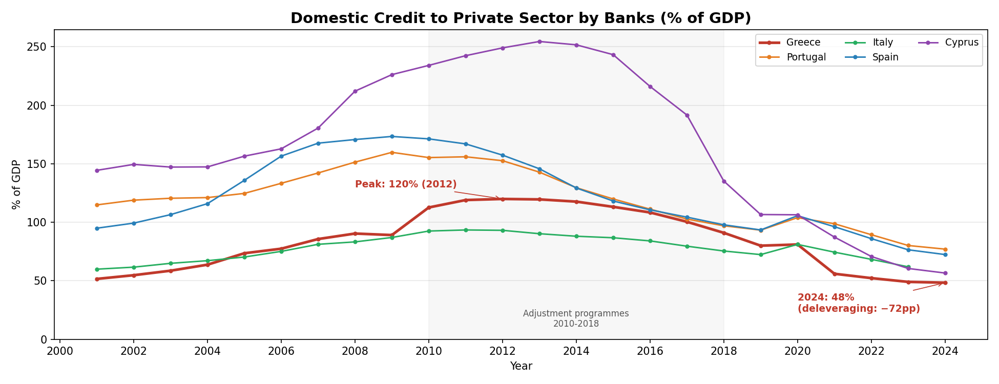

Multiple recapitalisations restored bank capital from a negative capital-to-assets ratio in 2011 to 7.6% in 2025, within the 5.7–9.5% range of peers.

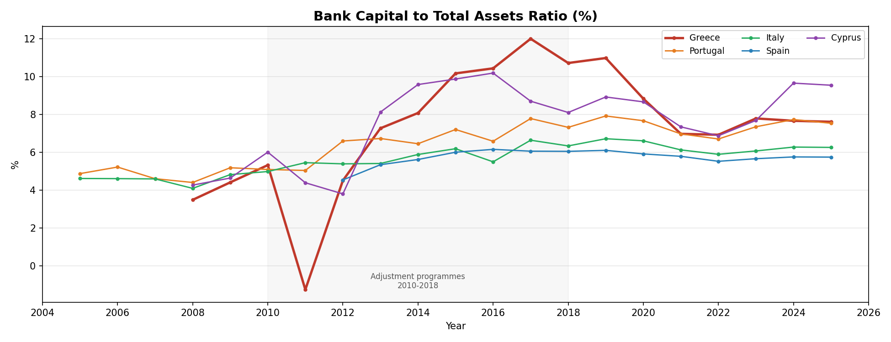

---

## 6. External Sector: Tourism, Shipping and the RRF

### 6.1 The current account

The pre-crisis current account ran a chronic deficit of 6–15% of GDP — financed by capital inflows that reversed sharply in 2010. Internal devaluation and import compression cut the deficit to 1.4–3.6% of GDP over 2012–2019. The post-2020 reopening combined with energy shocks pushed it back to deficits of roughly 7–11%; in 2025 it narrowed to 5.6%, the smallest since 2019.

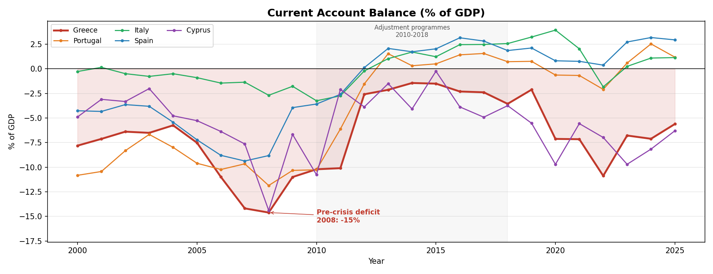

### 6.2 Goods deficit, services surplus

The distinctive Greek pattern: a structural goods deficit of €18–44bn per year, partly offset by a structural services surplus driven by tourism and shipping. The services surplus reached €22.6bn in 2024 — its highest level — and held at €22.4bn in 2025, against a goods deficit of €33.7bn. Goods trade has never been balanced; the question is how much of the gap services can close.

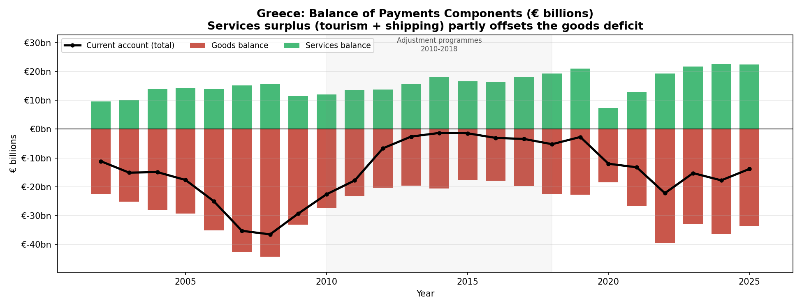

### 6.3 Tourism and shipping

Tourism credits rose from €4.3bn (2020 COVID low) to €21.6bn in 2024 and **€23.6bn** in 2025 — an absolute record. Shipping (transport) receipts were €21.2bn in 2024 and €18.7bn in 2025, below their 2022 peak of €23.4bn. Together these two sectors generated €42.3bn of gross foreign earnings in 2025 — about 17% of GDP (18% in 2024) — and are the single largest source of resilience in the Greek balance of payments.

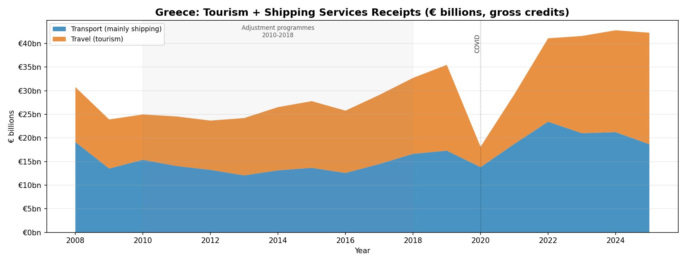

Per-capita tourism intensity makes the scale clear: nights spent at accommodation per resident tripled from 5 (2005) to 15 (2025), putting Greece behind only Cyprus among the peer group.

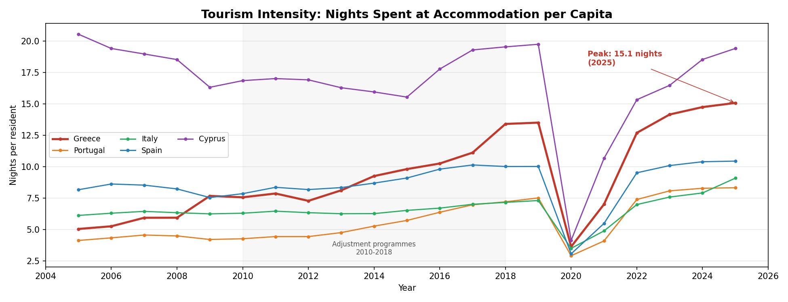

### 6.4 FDI

FDI flows were chronically thin. Greece struggled to attract investment during the crisis, with net inflows below 1.5% of GDP in most years to 2016. They have picked up since, to 2.6% of GDP in 2024 and 4.8% in 2025 — the highest in the series and the first year in which Greece out-attracted Portugal, Spain and Italy relative to GDP. One strong year does not make a trend, and the stock built up over two decades remains small, which is one reason RRF and EU funds matter so much.

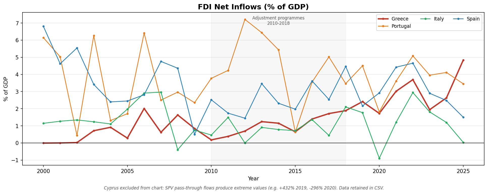

### 6.5 The RRF

Greece has the **largest Recovery and Resilience Facility envelope relative to GDP** of any member state: €35.9bn (€18.2bn of grants and €17.7bn of loans), equivalent to 16.0% of its 2023 GDP. As of 13 October 2026 it had received €24.6bn, or 68% — below the EU-wide rate of 78% and 23rd of 27. The gap is largely timing: Greece's last two payment requests, submitted on 25 May and 29 September 2026 and worth €11.3bn together (exactly the undrawn balance), were still under Commission assessment, and RRF payments must be made by the end of 2026. The Greek RRF profile — heavy on green transition and digitalisation, with serious reform conditionality — is one of the genuinely bright spots in the post-2020 trajectory, but whether Greece collects the full envelope will only be known at the end of 2026.

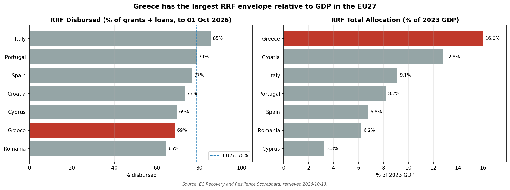

---

## 7. Sectoral Structure

### 7.1 The shape of value added

Greek gross value added is now overwhelmingly services. The construction share collapsed from 9.4% (2006) to a low of 1.5% (2019), recovering only to 2.5% (2025). Public administration, education and health peaked at nearly 22% of GVA in 2012 — austerity contracted private activity faster than the public payroll — and has since fallen back to 17.5%. Real estate rose to 18% by 2020, partly a denominator effect, partly a rental-yield revival post-2017; it was 16.8% in 2025.

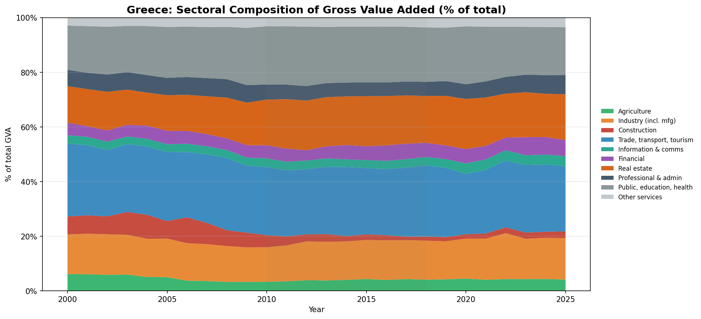

Manufacturing accounts for about 10.5% of GVA, second-lowest in the peer group (above only Cyprus) and well below the EU average of 16%. Italy at 17%, Portugal at 13% and Spain at 12% all maintain larger industrial bases. Greek industrial weakness predates the crisis; the share has edged up from its 2013 low of 8.8% but is still below its 2000 level of 11.2%.

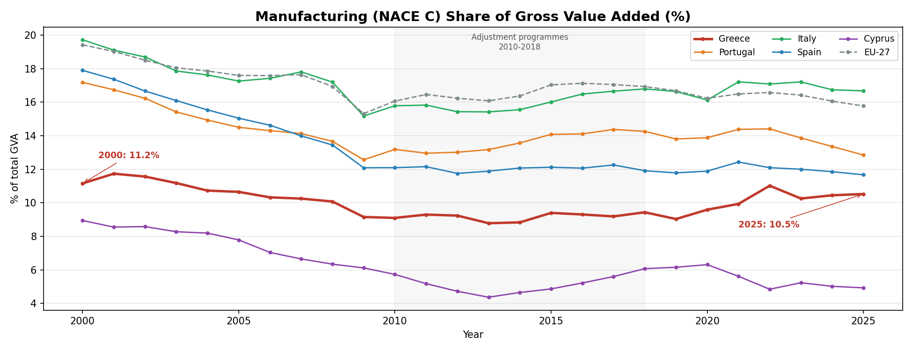

### 7.2 Construction: a 90% collapse

The Greek construction production index — now published by Eurostat with 2021 = 100 — peaked at **961 in 2002** (the Olympic build-out) and fell to **94 in 2020**: roughly a **90% collapse from peak**. The recovery since has been real but leaves activity far below the boom: the index reached 152 in 2025, up 62% from the 2020 trough but still about 84% below 2002. No peer experienced anything comparable. The construction collapse explains a large fraction of both the unemployment surge and the credit deleveraging.

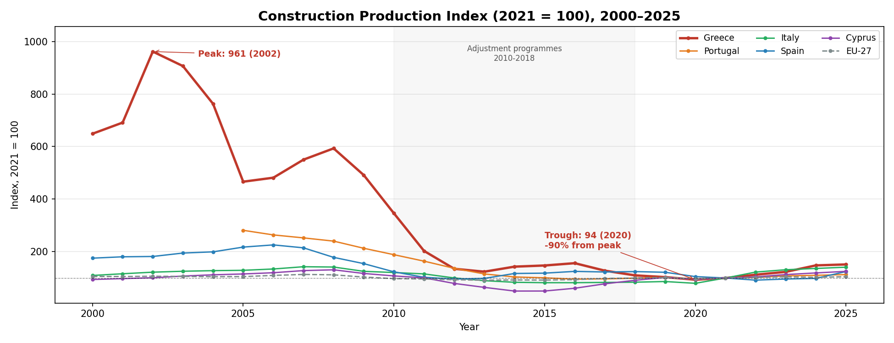

### 7.3 Renewables: a quiet success

The share of renewables in gross final energy consumption rose from 7.2% (2004) to **26.9% (2025)** — slightly above the EU average of 26.2%. Portugal leads peers at 37%, but Greek progress has been steady through the crisis decade and has accelerated post-RRF.

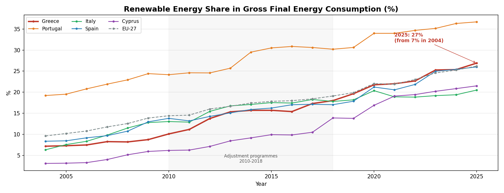

---

## 8. Regional Disparities

### 8.1 Attica dominates

Greater Athens (NUTS2 region EL30) accounts for 49% of Greek GDP from 36% of the population (2024, the latest regional data). North Aegean is at 42% of EU27, among the EU's poorer regions; West Macedonia at 48%, having fallen from 85% in 2006.

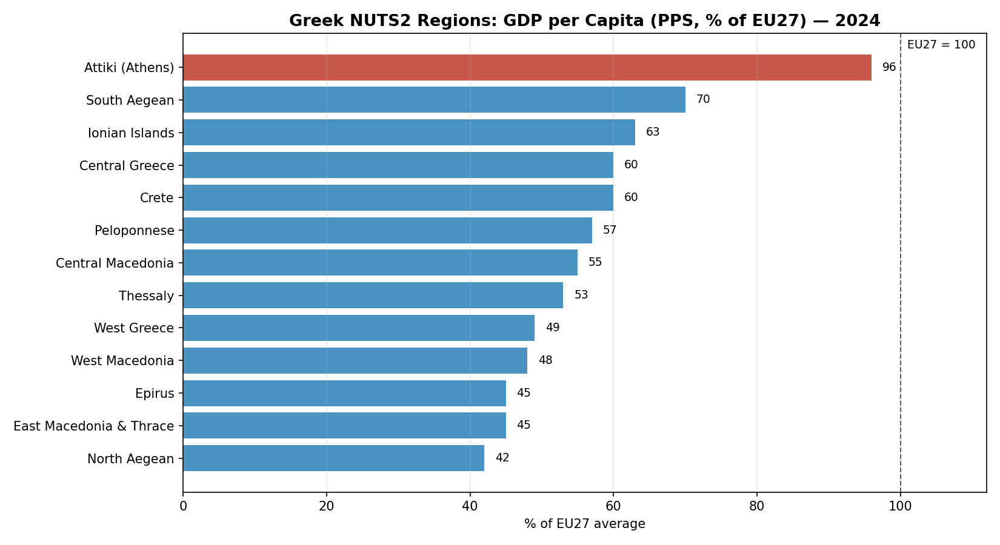

Per-capita output in Attica was 1.49× the rest of Greece in 2000; by 2024 the ratio had widened to **1.67×**. The gap opened mostly in the boom and early crisis years (it was already 1.68× in 2011) and has not closed.

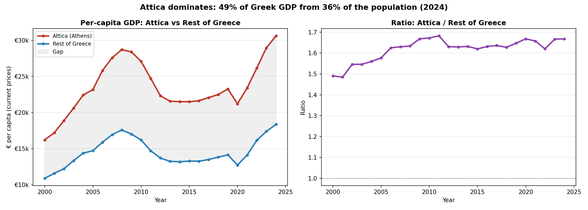

The capital is not particularly rich by European capital standards — at 96% of EU27 average in PPS (2024), Attica trails Lisbon (PT1A: 129), Madrid (125) and Rome's Lazio (113). The most economically dynamic Greek region is, by international standards, a middle-income area.

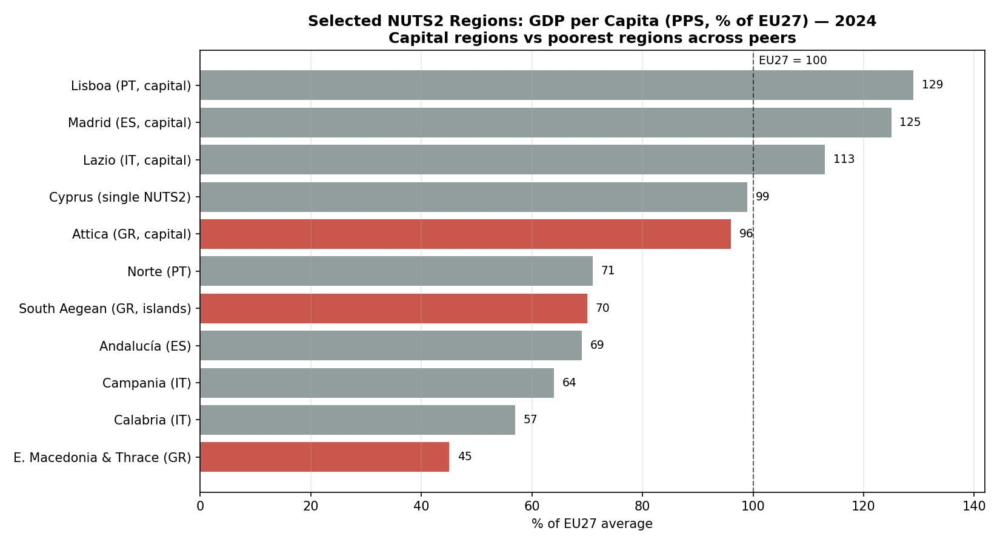

### 8.2 The reversal of convergence at NUTS2 level

The two regions that fell the furthest are illustrative. Attica went from 127% of EU27 (2006) to 86% (2020) — a 41-point collapse — and has since recovered to 96% (2024). West Macedonia, the coal-and-lignite region around Ptolemaida, fell from 85% (2006) to 48% (2024) — a 37-point collapse tied to the energy transition that has produced no successor industry, and one that is still deepening.

### 8.3 Depopulation

Eleven of thirteen Greek NUTS2 regions lost population over 2007–2025. West Macedonia lost 15%. Even Attica lost 218,000 people (−5.5%). Only North Aegean (+4.9%) and Crete (+2.0%) grew; South Aegean was flat. The hollowing-out of the continental periphery is one of the structural problems most resistant to short-run policy.

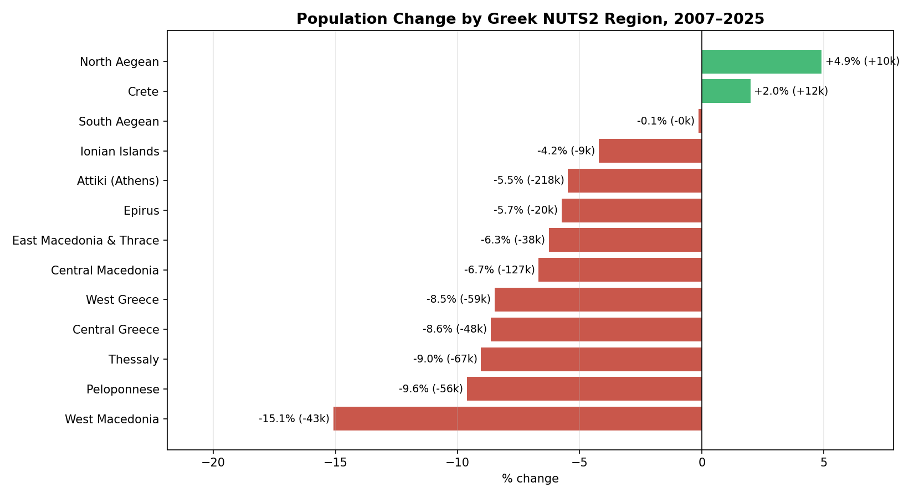

### 8.4 Unemployment dispersion

In 2025, regional unemployment ranged from 5.1% (Crete) to 15.3% (West Macedonia), with Central Macedonia (11.7%) and East Macedonia & Thrace (10.6%) also in double digits. In 2013 the range had been 18.1% (Ionian Islands) to 31.6% (West Macedonia). The Ionian Islands, which had the highest rate in 2024 (16.2%), fell to 9.0% in 2025 — tourism-dependent labour markets swing widely from year to year — but it is the continental north, led by lignite-dependent West Macedonia, where unemployment is most entrenched.

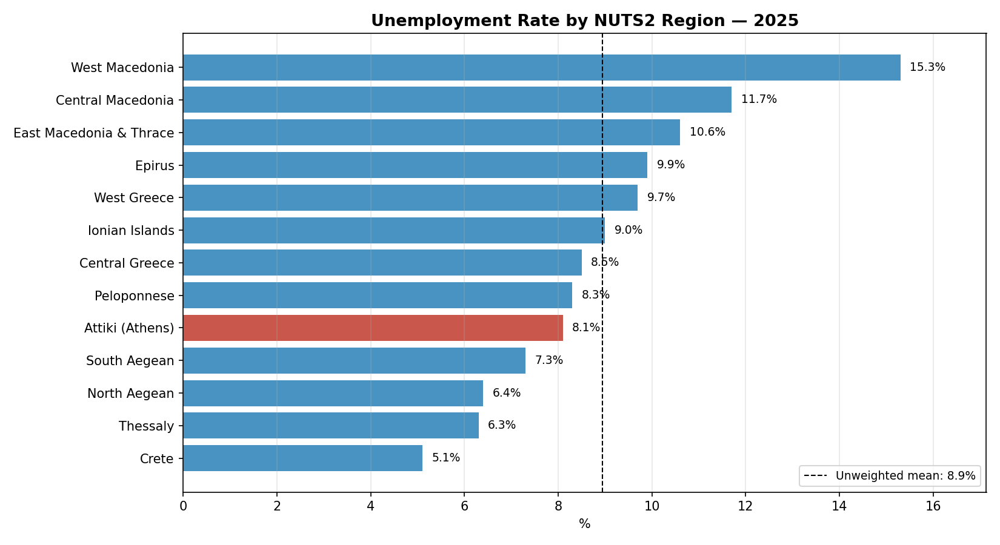

---

## 9. Social Outcomes

### 9.1 Poverty and inequality

The at-risk-of-poverty-or-social-exclusion rate peaked at **36% in 2014** — more than one Greek in three. It fell to 26% by 2023 but has edged back up to 27.5% in 2025, still well above the EU average of 21%.

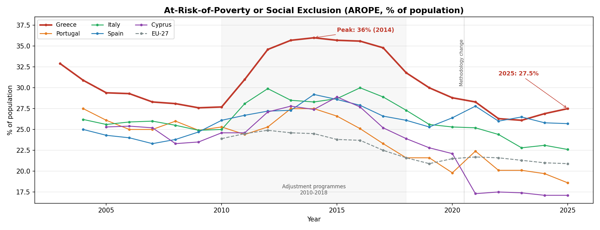

The Gini coefficient, in contrast, stayed remarkably steady through the crisis: between 34 and 37 throughout, and 34.1 in 2025, equal to the EU average. Greek inequality didn't blow up because incomes contracted across the distribution; this is poverty as a level effect, not a distribution effect.

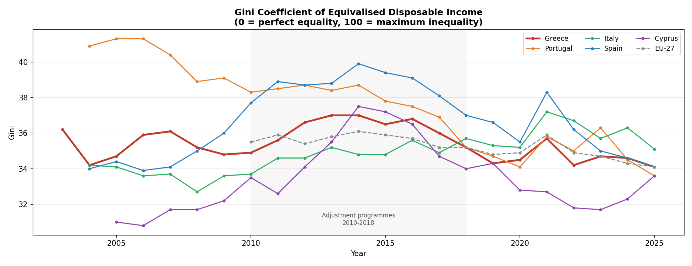

### 9.2 The NEET story

Greece's NEET (not in employment, education or training) rate for ages 15–29 hit **28.1% in 2013** — the highest in the peer group. The fall to 13.5% by 2025 — 14.6 points — is the largest improvement in the peer group, though the rate is still above the EU average of 11.0%.

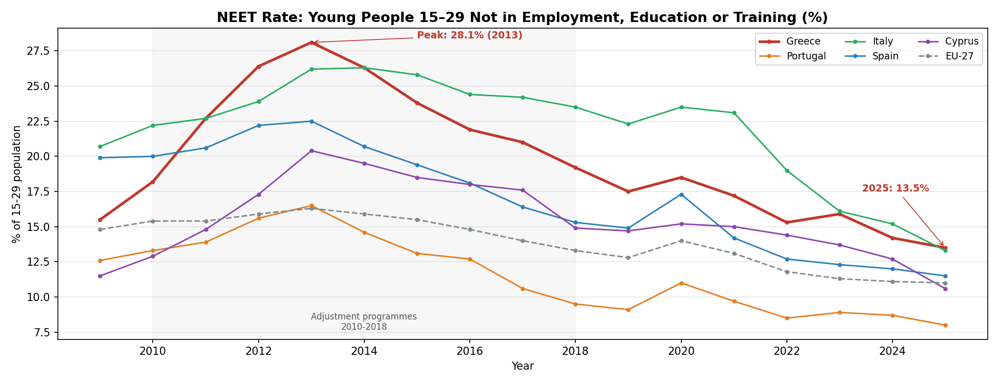

### 9.3 Education and the brain drain

Tertiary attainment among 25–34-year-olds rose from 19% (1992) to 45% (2022), then slipped to 42.8% (2025), falling below the EU average (44.8%) for the first time since 2011. Spain (52.5%) has pulled further ahead, and Portugal (42.5%) has almost caught up from a much weaker baseline. The dip is consistent with the cohort effects of the crisis-era brain drain — many of the educated young Greeks who left in 2011–2015 have not returned — even though net migration has been positive since 2022.

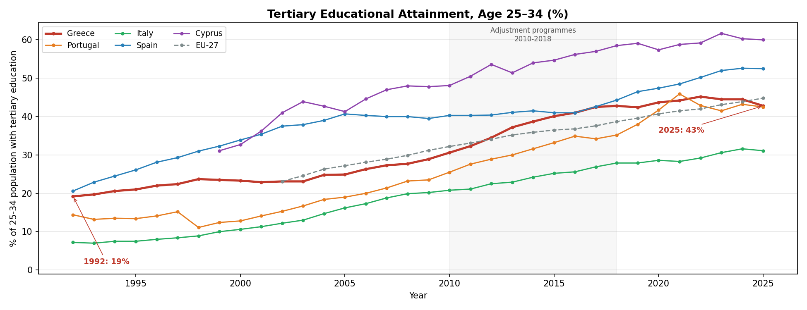

### 9.4 Life expectancy

Greek life expectancy at birth held up remarkably well through the austerity decade. The 2010 figure of 80.6 years rose to 81.5 by 2018 despite the crisis. COVID cut about 1.3 years (81.4 in 2019 to 80.1 in 2021), but the recovery has been fast: the 2024 figure of 81.9 is above the pre-COVID peak. Greece still trails Spain, Italy and Cyprus on life expectancy by 1.6–2.1 years.

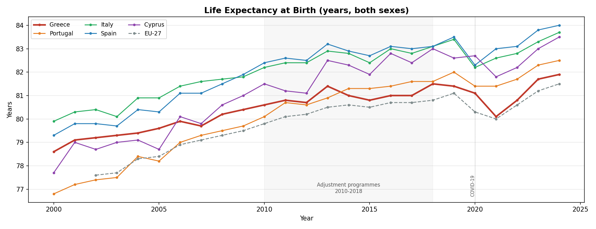

---

## 10. Synthesis: Where Greece Stands in 2025

The Greek crisis has not so much ended as receded. The acute symptoms have been treated — yields are normal, banks are solvent, unemployment is below 9%, fiscal balance is restored. The chronic conditions remain: an old population that only migration keeps from shrinking; a manufacturing sector that is small by peer standards; a regional structure dominated by one mid-tier capital; and per-capita output that has not converged toward the EU average in twenty years.

The current trajectory has three strong tailwinds. **First**, the largest RRF envelope in the EU relative to GDP is funding green and digital investment that the private sector and the depleted state could not — provided the final €11.3bn is approved and paid by the end-2026 deadline. **Second**, tourism is at a record and shipping receipts are near their highs, with no obvious cap on either. **Third**, the fiscal turnaround is genuine and durable — Greece has demonstrated political and institutional capacity to sustain large primary surpluses for a decade, which transforms the debt-sustainability calculation.

The headwinds are equally clear. **Demographics** remain fragile: the population fell by about 0.5% a year over 2010–2022 and has stabilised only because net migration turned positive, while fertility is 1.24. **Brain drain** has reversed in net terms, but its legacy is visible in the tertiary-attainment downturn. **Manufacturing** has edged up but remains well below peer levels. **Regional convergence** has been replaced by regional divergence, with continental Greece — outside Attica and the tourism islands — depopulating.

What the data do not settle is whether the equilibrium being reached is the new normal or a way station to something better. Real GDP is back only to its 2003 level. Per-capita PPP output is 69% of the EU average, against 85% in 2000 and 96% at the 2006 peak. The recovery has been real but has not been convergence. Whether the green-and-digital RRF investment, combined with the cleaner banking system and a now-sustainable fiscal position, can produce the productivity acceleration that the previous twenty years failed to deliver is the central economic question facing Greece for the rest of this decade.

---

### Data sources

- Eurostat (national accounts, government finance incl. EDP notification tables, labour force, HICP, bond yields, BoP, regional accounts, demography, SILC, education, energy, short-term business statistics).
- World Bank World Development Indicators (GDP, PPP income, population, dependency ratio, current account, FDI, NPLs, private credit, bank capital).
- ECB Data Portal (monthly bank deposits).
- European Commission Recovery and Resilience Scoreboard (RRF allocations, disbursements and payment requests, queried from the Scoreboard's public data engine).

All series retrieved 13 October 2026. Government deficit and debt figures predate Eurostat's October 2026 EDP notification (due around 21–22 October 2026), which may revise them; re-running `02_public_finances.py` picks up the revisions. All charts in `charts/`. All underlying data CSVs in `raw-data/`, each with `# source:`, `# url:` and `# retrieved:` header lines (read with `pd.read_csv(..., comment="#")`). Module scripts `01_*.py` through `09_*.py`.

---

## Corrections to the first edition

Figures in the first edition that did not match its own data: 2009 deficit 15.4% of GDP (not 15.1%); 2016 primary surplus 3.4% (not 4.1%); debt 105% of GDP in 2007 and a 209% peak in 2020 (not 103% and 207%); PPP income peaked at 96% of the EU average in 2006 and was 94% in 2003, so today's 69% is not "the 2003 level"; Portugal, Spain and Italy also lost ground against the EU (they did not "converge or hold steady"); output contracted in seven of the ten years 2008–2017 (not nine); population peaked at 11.12m in 2010 (not 11.13m in 2008), and the ~700,000 loss is of all residents, not working-age ones; deposits fell by about half (not "a third"); deflation lasted three years, 2013–2015, cumulating to −3.4% (not four years and −2.5%); 2022 inflation was 9.3% (not 9.6%); 22.5% was the 2012 *annual* average yield — the monthly peak was 29.2% (Feb 2012) and early-2010 yields were about 6% (not below 5%); the REER rose ~14% over 2001–2009 and fell ~10% over 2009–2015 (not 15% and 12%); youth unemployment peaked at 59.2% (not 59.4%); tourism plus shipping receipts were 18% of GDP in 2024 (not 20%) and shipping is gross receipts, not a "surplus"; Peloponnese unemployment was 7.6% in 2024 (not 7.1%); Portugal had not overtaken Greece in tertiary attainment; the deposit series covers all non-bank depositors except central government, not just households and firms. The hand-typed RRF figures did not match the Scoreboard (Greece had received €21.3bn by mid-2025, not €22.3bn), so the claim of an EU-leading disbursement rate is withdrawn. Unsourced claims (a halving of property values; 36% intraday yields) have been removed.
