# Romania: Economic Trajectory and Structural Challenges
### A Data-Driven Analysis, 2000–2025

*October 2026 edition — data updated to 2025 (retrieved 13 October 2026). First published April 2026.*

*Data sources: Eurostat, World Bank, BIS, Ember, European Commission Cohesion Open Data. Charts in `charts/`, raw data in `raw-data/` (each CSV carries its source, URL and retrieval date).*

> **What changed in the October 2026 edition**
>
> *New data.* All series now run to 2025 where published, and to mid-2026 for monthly prices, rates and the exchange rate. Romania's deficit narrowed from 9.3% of GDP in 2024 to 7.9% in 2025 (April 2026 EDP notification), the largest correction in the EU but still the EU's largest deficit. Public debt rose to 59.3% of GDP. Growth slowed to 0.8%, the weakest outside a recession year since 2013. HICP inflation was 6.8% in 2025, the highest in the EU, after the August 2025 VAT increase. GDP per capita reached 78% of the EU average in purchasing power. The leu weakened in two steps, after the May 2025 presidential election and after the government fell in May 2026.
>
> *Corrections.* Several figures in the first edition were hand-typed approximations, and some were badly wrong; they are now fetched from source. The regional GDP figures were the worst: Nord-Est was 43% of the EU average in 2022, not 28%, and the richest-to-poorest region ratio is about 4:1, not 5.8:1. Romania's absorption of 2014–2020 EU funds was 89.7% at end-2023, not 72.4%, and it was not the lowest in the region. The electricity mix had nuclear at a constant 18%. The Maastricht dashboard mixed years. The 2005 BNR policy rate was 7.5%, not 8.5%, and the RON/EUR rate had silently fallen back to typed values. The energy-intensity chart's title had its meaning inverted. In the text, several statements were wrong against the data: that Poland and Romania started at similar income levels, that Romania's tax take is the EU's lowest, that pensions are over 10% of GDP, that agriculture employs 20% of workers, and that Romania's infant mortality is double its nearest peer's.

---

## Executive Summary

Romania's economic story over the past two decades is one of remarkable growth shadowed by deep structural failure. GDP per capita in purchasing power standards (PPS) has risen from 26% of the EU average in 2000 to **78% in 2025**, one of the fastest convergence trajectories in the bloc. But the growth has come with costs that compound. The fiscal deficit reached **9.3% of GDP in 2024**, the worst in the EU, and was still the EU's worst in 2025 at **7.9%** after a painful consolidation. The population is more than 4 million smaller than in 1990. Over a quarter of citizens are at risk of poverty or social exclusion. And the state is slow to turn available EU money into finished projects.

Romania is not a failing economy. It is a rapidly growing one with a structural architecture that is increasingly incompatible with that growth. In 2025 the adjustment finally began, through higher VAT and a public-pay freeze, and the costs showed up at once: growth below 1%, inflation the highest in the EU and youth unemployment the highest in the EU. Then the governing coalition collapsed in May 2026. The tensions are acute, and the window for orderly adjustment is narrowing.

---

## 1. Macroeconomic Overview

### 1.1 Growth Story

Romania has been one of the EU's fastest-growing economies since accession in 2007. Real GDP growth averaged about 4% a year from 2000 to 2019: above 6% in the pre-2008 boom, with peaks of 10.4% in 2004 and 9.3% in 2008, and about 3% in the 2010s. The post-crisis peak was **8.2% in 2017**, driven partly by consumption-fuelled fiscal stimulus. Post-COVID recovery was strong at 5.9% in 2021, but the economy has since decelerated sharply: **2.5% in 2023, 1.1% in 2024 and just 0.8% in 2025**. That is the weakest reading outside a recession year since 2013, and for a second year running below the EU average (1.4% in 2025), something that last happened in 2009–2010. Poland grew 3.8% in 2025, Bulgaria 3.1% and Czechia 2.6%.

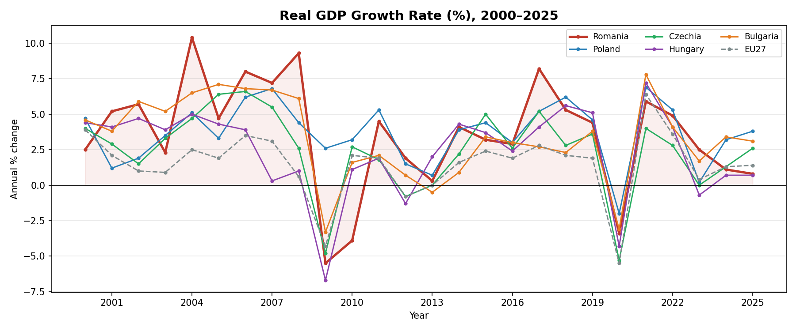

The deceleration reflects headwinds that arrived together: the fiscal consolidation of 2025, inflation eroding real incomes, a cooling European demand environment, and the structural limits of a labour-scarce economy. The consolidation's VAT increase and pay and pension freeze took effect in August 2025, squarely in the consumption-led growth model.

### 1.2 Convergence

The convergence chart is Romania's most compelling headline number. GDP per capita in PPS has climbed from 26% of the EU27 average in 2000 to **78% in 2025**, a tripling of relative living standards in one generation.

| Country | 2000 | 2010 | 2020 | 2025 |
|---------|------|------|------|------|
| Romania | 26%  | 52%  | 71%  | 78%  |
| Poland  | 48%  | 63%  | 78%  | 81%  |
| Bulgaria| 29%  | 44%  | 57%  | 68%  |

Romania started from barely half of Poland's relative level in 2000 and has closed most of the gap: from 22 points in 2000 to 3 points in 2025. It overtook Hungary in 2024. The path has been uneven. Romania surged in 2016–2020 (58% to 71%) on fiscal stimulus and strong wage growth, stalled in 2020–2022, and then resumed. The 2025 gain was the smallest in three years (+1.0 point against Poland's +2.8), as growth slowed under consolidation.

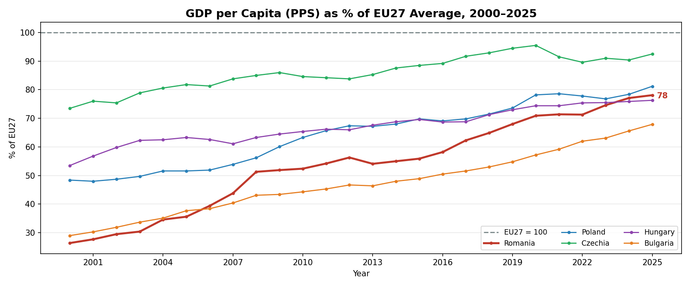

### 1.3 Economic Structure

Romania's sectoral composition has evolved steadily from an agriculture-heavy post-communist structure toward a service-led economy, though industry retains a significant share. In 2025, as gross value added in % of GDP (the remainder is net taxes on products):

- **Services**: ~62% of GDP
- **Industry, including construction**: ~25% of GDP
- **Agriculture**: ~3% of GDP, high by EU standards (EU average ~1.6%) and down from 11% in 2000

The agricultural share reflects both Romania's natural endowment (it is among the EU's largest agricultural producers) and the persistence of low-productivity subsistence farming. The industrial base, anchored by automotive (Dacia/Renault, Ford Otosan), chemicals and machinery, is the primary goods-export engine; IT services are the fastest-growing services export.

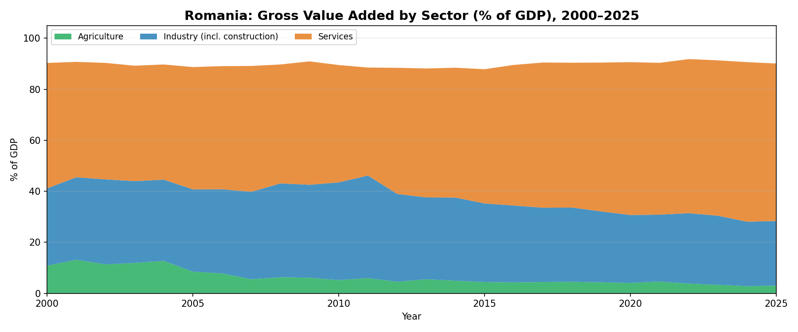

---

## 2. Public Finances: The Central Crisis

If there is a single defining economic problem in Romania today, it is fiscal. The general government deficit has been consistently among the EU's largest. The 2024 figure of **−9.3% of GDP**, equal to the COVID-year 2020 figure, was the largest in the EU by a wide margin; Poland was next at −6.4%. The 2025 outcome, **−7.9%**, was a 1.4-point improvement, the largest in the EU, but Romania still ran the EU's largest deficit.

### 2.1 The Deficit Trajectory

Romania's fiscal problems predate COVID. The deficit was already at **−4.4% of GDP in 2019**, before any pandemic shock and in a year of solid 4.4% GDP growth. The story since then:

| Year | RO deficit | PL deficit | CZ deficit |
|------|-----------|-----------|-----------|
| 2019 | −4.4%     | −0.7%     | +0.3%     |
| 2020 | −9.3%     | −6.9%     | −5.6%     |
| 2021 | −7.2%     | −1.7%     | −5.0%     |
| 2022 | −6.5%     | −3.4%     | −3.1%     |
| 2023 | −6.6%     | −5.2%     | −3.7%     |
| 2024 | −9.3%     | −6.4%     | −2.0%     |
| 2025 | −7.9%     | −7.3%     | −2.1%     |

Poland's deficit has widened to −7.3%, driven in large part by a rapid defence build-up. Romania's deficit is structural: it has been outside the Maastricht 3% limit every year since 2019, and before that it ran at 2.5–2.8% through the 2016–2018 boom, when a cyclical surplus would have been the prudent setting. Czechia, facing the same European headwinds, roughly halved its deficit between 2023 and 2024 and held it there.

Romania has been under the EU's Excessive Deficit Procedure (EDP) since 2020. The consolidation path agreed with the European Commission has been repeatedly revised because Romania repeatedly missed it; the deadline for bringing the deficit below 3% now runs to 2030. The 2025 correction came from two packages adopted in summer 2025. The standard VAT rate rose from 19% to 21% on 1 August 2025 and the reduced rates were unified at 11%. Excises and bank taxes went up, and public-sector wages and pensions were frozen. Total government revenue rose from 34.0% to 35.4% of GDP while expenditure held at 43.3%.

*The 2025 figures are from Eurostat's April 2026 EDP notification. The October 2026 notification (due around 21–22 October) may revise them; re-running `02_public_finances.py` picks up the revision.*

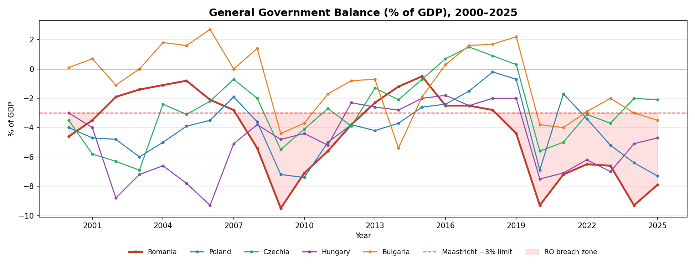

### 2.2 The Revenue Problem

The deficit is partly a spending problem, but primarily a revenue problem. Romania collected just **28.7% of GDP in taxes and social contributions in 2024**, the lowest rate in the EU apart from Ireland (whose ratio is depressed by a GDP figure inflated by multinational profits). The EU average is 40.2%. France collects 45.2%, Sweden 42.0%; even Slovakia manages 35.9% and Bulgaria 30.3%. (Detailed 2025 tax data are not yet published; total revenue, which also includes EU grants and property income, rose to 35.4% of GDP in 2025.)

The causes are well-documented:
- **Large informal economy**: cash-economy sectors (construction, agriculture, retail) with systematic under-reporting
- **VAT gap**: the European Commission's annual VAT-gap studies have consistently put Romania's compliance gap at or near the top of the EU
- **Structural under-investment in ANAF** (tax authority): digital infrastructure, audit capacity, and enforcement systematically underfunded
- **Multiple exemptions**: the agricultural sector, for example, is largely outside the formal tax base

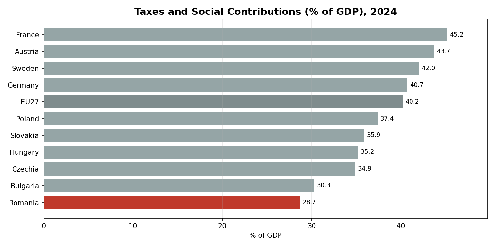

### 2.3 The Spending Rigidity

On the expenditure side, the problem is structural inflexibility. Two items dominate:

1. **Pensions**: the 2019 pension law and the 2024 recalculation of pensions raised payouts sharply. Old-age spending rose from 8.4% of GDP in 2019 to **9.8% in 2024**. That is still below the EU average of 10.7%, but in the context of Romania's low revenue base even this is hard to finance, and reversing the increases is politically near-impossible; the 2025 package froze pensions rather than cutting them.

2. **Public sector wages**: a series of wage increases from 2016–2019, and again in 2024, compressed the deficit headroom permanently.

The result is a government that spends **43.3% of GDP**, broadly European-normal, but takes in only **35.4% of GDP** in total revenue (2025) and under 29% in taxes and contributions. Closing an 8-point gap is beyond any one-year measure.

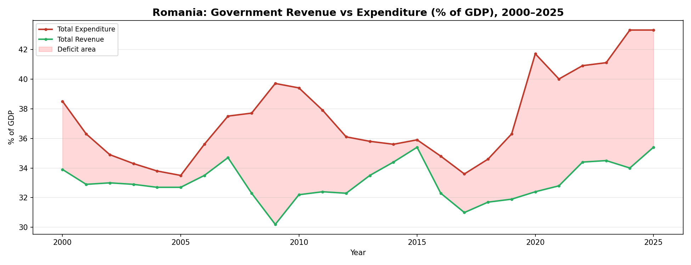

### 2.4 Public Debt

Public debt stood at **59.3% of GDP in 2025**, up from 54.8% in 2024 and 35.2% in 2019: a 24-point deterioration in six years. It is now just below the Maastricht 60% ceiling, and the European Commission projects it will cross that line in 2026. Romania's borrowing costs have risen in response. The 10-year government bond yield averaged 6.7% in the 12 months to May 2026, among the highest in the EU and well above the 5.1% convergence reference value, reflecting market concern about fiscal sustainability.

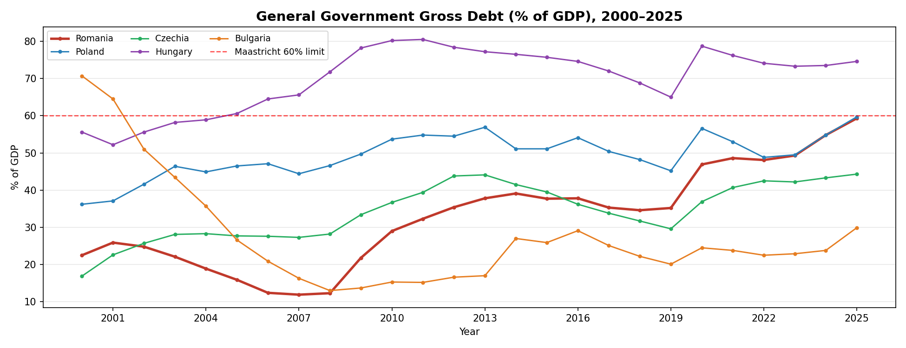

---

## 3. Labour Market and Demographics

### 3.1 Employment

Romania's employment rate of **63.0%** (ages 15–64, 2025; 63.8% in 2024) is the lowest among its peer group and the second-lowest in the EU after Italy. Czechia reaches 75.7%, Hungary 75.1%, Poland 72.8%. The gap of roughly 10 percentage points represents hundreds of thousands of Romanians outside the formal labour market. Many are in subsistence agriculture or the informal economy, and many more have emigrated.

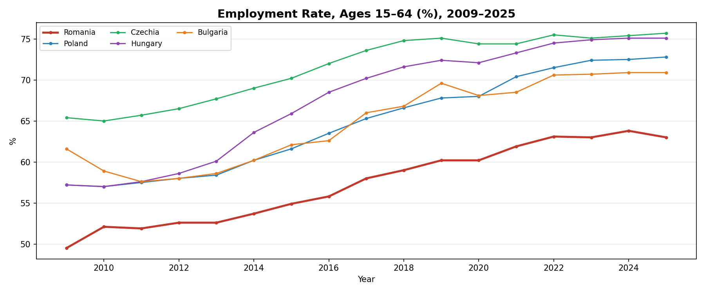

Unemployment rose to **6.1% in 2025** from 5.4% in 2024. That is not alarming in isolation. But low unemployment alongside low employment does not signal a tight labour market; it signals a shrunken workforce, with people who have left the labour force entirely, through emigration or discouragement.

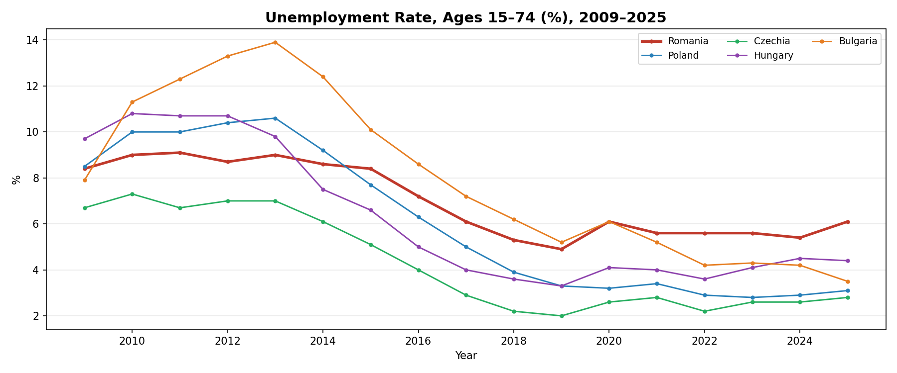

### 3.2 Youth Unemployment

Romania's youth unemployment rate (**26.1%** for ages 15–24 in 2025, the highest in the EU) is the most troubling single indicator in the labour market. It has been above 20% every year since 2009, and rather than converging with peers, it has diverged:

| Country | 2019 | 2022 | 2024 | 2025 |
|---------|------|------|------|------|
| Romania | 21.0%| 22.8%| 23.9%| 26.1%|
| Bulgaria| 12.1%| 10.6%| 12.3%| 13.1%|
| Hungary | 11.4%| 10.6%| 15.2%| 13.9%|
| Poland  |  9.7%| 10.8%| 10.8%| 12.2%|
| Czechia |  5.6%|  6.8%|  9.1%| 10.4%|

At 26%, Romania's youth unemployment is two and a half times the Czech rate. This is not primarily a cyclical problem: it persists in boom years as well as slowdowns. It reflects a skills mismatch, an education system misaligned with labour market needs, and the emigration of the most mobile young Romanians before they even enter the domestic labour market. The 2025 rise, the sharpest in the peer group, coincided with the public-sector hiring freeze and the slowdown.

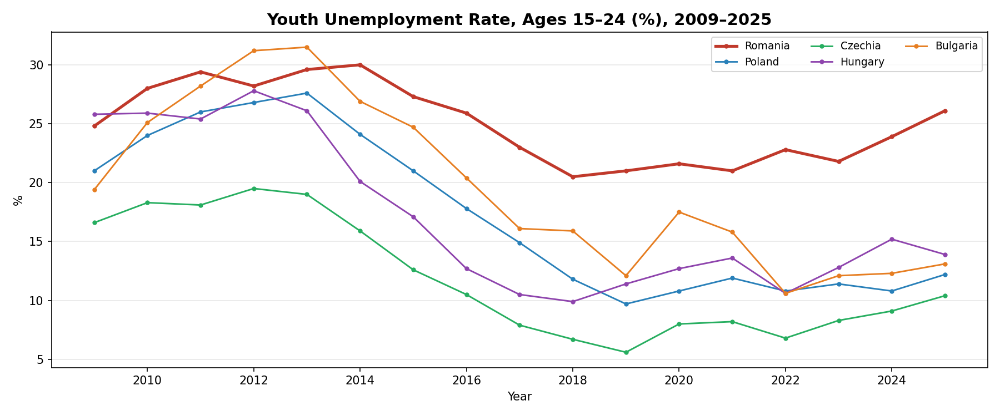

### 3.3 Wages and Labour Costs

The Labour Cost Index for wages and salaries (2020=100, national currency) tells a striking story. Romania's index reached **170.9 in 2025** (155.2 in 2024): a 71% nominal rise in five years. Bulgaria (185.6) and Hungary (181.6), also converging from low bases, rose even faster, and Poland (167.1) at a similar pace; Czechia (128.1) lagged far behind. Part of the Romanian increase is inflation: real wages fell in late 2025 as the VAT increase and the public pay freeze hit.

Romanian wages have risen sharply in EUR terms over the past decade, narrowing the cost advantage that attracted FDI. This compression is not inherently bad. It reflects genuine productivity gains and living standard improvements, but it requires matching improvements in productivity and skills to avoid competitiveness erosion.

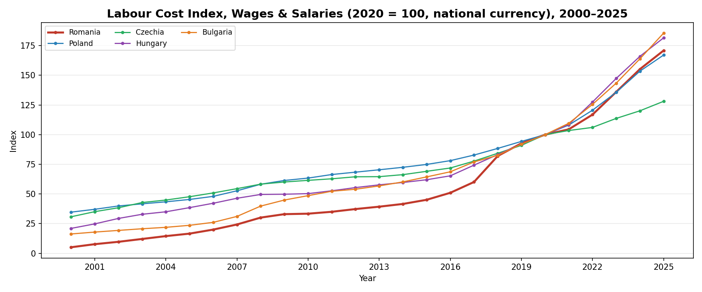

### 3.4 Population Collapse

Romania's demographic trajectory is among the most severe in Europe. The population has fallen from **23.2 million in 1990 to 19.0 million in 2025**, a decline of 4.2 million people, or 18%, in 35 years. Among the peers only Bulgaria (−26%) has shrunk faster.

The driver is dual: fertility well below replacement level and massive emigration, which accelerated after EU accession opened free movement to Spain, Italy, Germany and the UK. Romania lost an estimated 3–4 million citizens to Western Europe, one of the largest peacetime emigrations in post-war Europe.

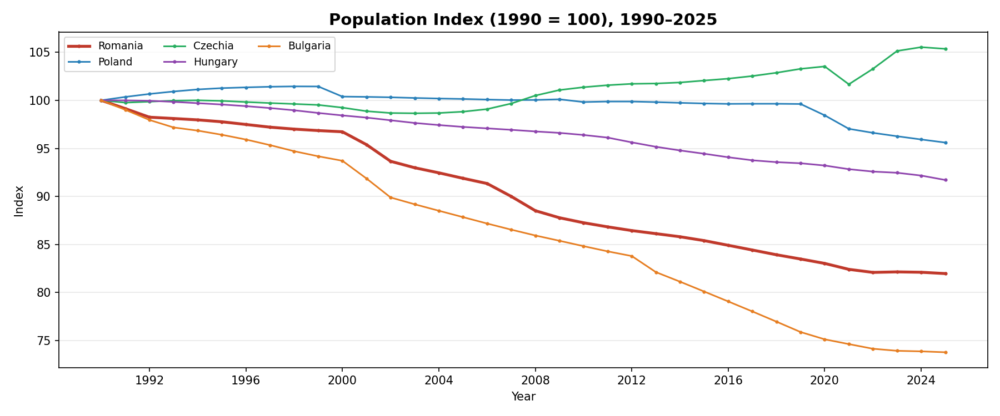

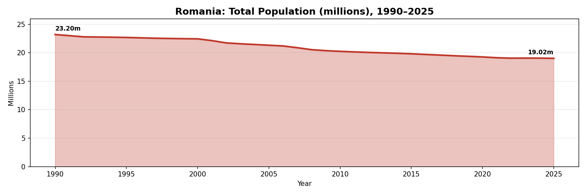

Remittances, the money sent home by the diaspora, ran at about **3% of GDP** a year from 2015 to 2023 and eased to **2.5% in 2024–2025**. They are a significant transfer that supports domestic consumption and reduces measured poverty. But they mask the deeper cost: the human capital that left does not return, and the care economy (child-rearing, elder care) has been severely disrupted by the departures.

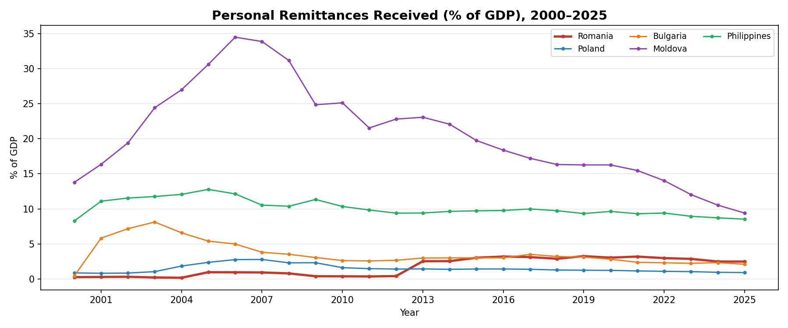

The age dependency ratio is rising, from a low of 44.7 dependants per 100 working-age adults in 2006 to 55.5 in 2025. The pressure will intensify through the 2030s and 2040s as the large cohorts born before 1990 reach retirement age against a dramatically smaller working-age population.

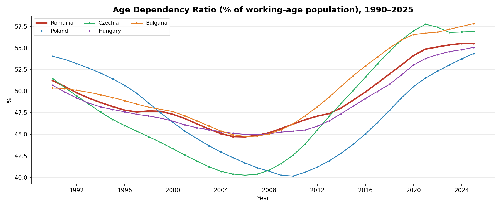

---

## 4. Inflation and Monetary Policy

### 4.1 From Hyperinflation to European Norm — and Back

Romania's inflation history is a textbook arc of post-communist monetary stabilisation. The 1990s saw very high inflation, 155% in 1997 on the harmonised measure, as price controls were lifted and the leu collapsed. The 2000s brought disinflation, and by the mid-2010s Romania was operating with inflation near the 2% European norm, sometimes even slightly negative (−1.1% in 2016).

The 2021–2023 global inflation shock hit Romania harder and more persistently than most peers. HICP inflation peaked at **12.0% in 2022**, fell to 9.7% in 2023 and 5.8% in 2024, still well above the Euro Area average (2.4%). In 2025 it rose again, to **6.8%, the highest in the EU**. This time the cause was the fiscal consolidation itself, not stimulus. The annual rate jumped from 6.6% in July to 8.5% in August 2025 when the VAT increase took effect. It peaked at 9.7% in May 2026, after the removal of the natural-gas price cap in March 2026, and fell to 6.3% in August 2026 as the VAT step dropped out of the 12-month comparison. The 12-month average rate stood at 8.6% in August 2026.

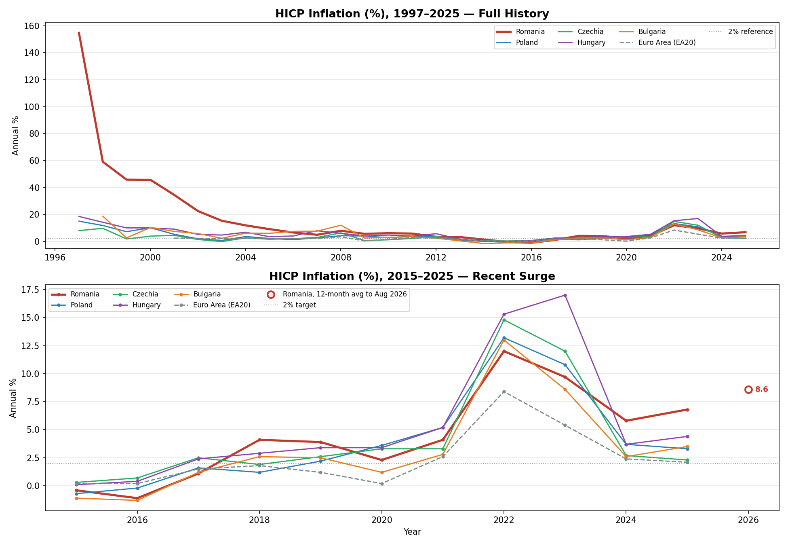

### 4.2 BNR Response

The National Bank of Romania (BNR) began tightening in October 2021, raising its policy rate from 1.25% to a peak of **7.0% in January 2023**. This was a significant and appropriate response. It cut to 6.5% in August 2024 and has held there since, through all of 2025 and the October 2026 meeting, treating the 2025–26 inflation spike as a tax-driven price-level shift rather than a demand problem. With inflation above the policy rate for most of the past year, real rates have been negative.

A structural feature of Romanian inflation is its wage-push component: public sector wage increases and minimum wage hikes (which have been aggressive in recent years) feed through rapidly into services inflation.

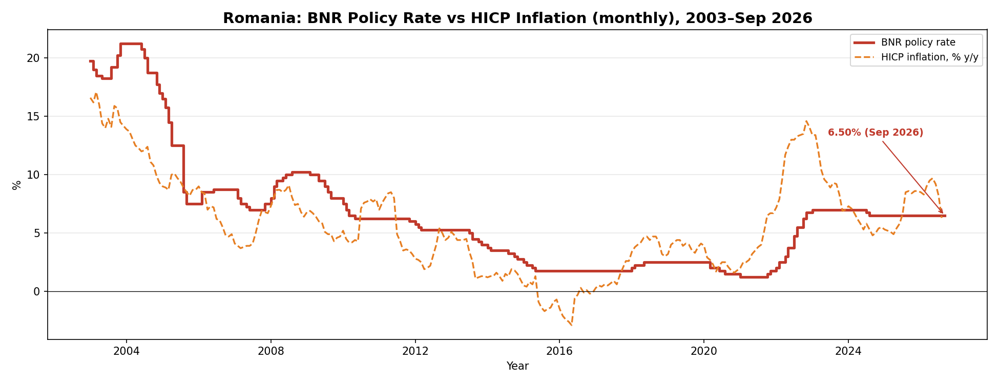

### 4.3 RON/EUR: The Managed Float

The RON/EUR exchange rate has depreciated slowly but relentlessly, from 3.34 in 2007 at EU accession to 4.97 in 2024 and **5.04 in 2025** (annual averages). The BNR manages a tight corridor: day-to-day volatility is very low, but the trend depreciation persists, and in 2025–26 it came in two political steps. The monthly average jumped from 4.98 in April to 5.07 in May 2025 around the presidential election. It jumped again from 5.10 in April to 5.23 in May 2026, when the governing coalition collapsed, and reached 5.26 in September 2026. This gentle depreciation partially offsets wage increases in EUR terms, maintaining some export competitiveness. But it also raises the cost of EUR-denominated public debt and undermines confidence in long-term savings.

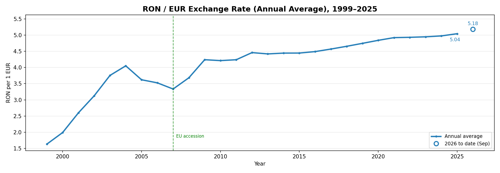

### 4.4 Euro Adoption: The Perpetually Deferred Target

Romania has nominally committed to euro adoption since accession but has never come close to meeting the Maastricht criteria simultaneously. The picture on the basis of the June 2026 Convergence Report (12 months to May 2026; fiscal data for 2025):

| Criterion | Romania | Reference value | Status |
|-----------|---------|-------|--------|
| Inflation (12-month average HICP) | 8.4% | 2.7% | FAIL |
| Long-term interest rate (12-month average) | 6.7% | 5.1% | FAIL |
| Budget deficit (2025) | 7.9% of GDP | 3.0% | FAIL |
| Public debt (2025) | 59.3% of GDP | 60% | PASS (narrowly) |

Three of four criteria are breached, and the deficit criterion is breached by a factor of 2.6. The debt criterion is on course to be breached in 2026. Romania is also not in ERM II, a precondition the Convergence Report lists separately. Bulgaria, which started from similar income levels, adopted the euro in January 2026; Romania has no credible near-term path. The political incentive to adopt has also weakened, because the leu gives Romania a depreciation valve that euro membership would permanently close.

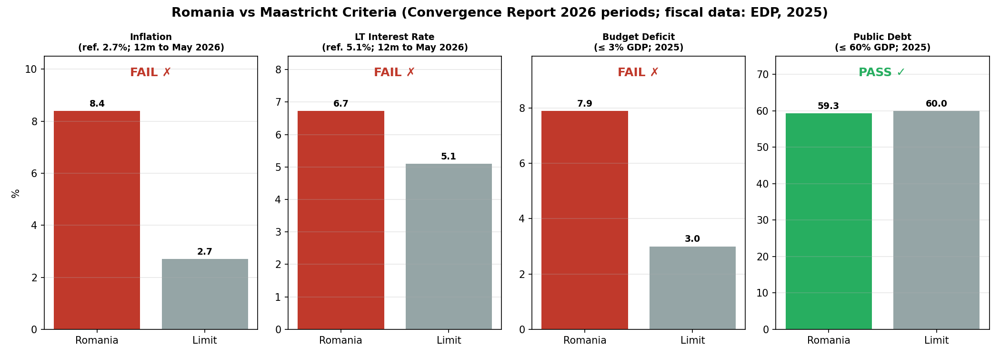

---

## 5. External Sector

### 5.1 Current Account: A Structural Deficit

Romania's current account deficit was **−7.9% of GDP in 2025** (−8.2% in 2024), making it one of the EU's most exposed economies on external balance. The deficit has been structural and widening:

| Year | Romania CA | Poland CA | Czechia CA |
|------|-----------|----------|-----------|
| 2017 | −3.2%     | −1.2%    | +1.4%     |
| 2019 | −4.9%     | −0.3%    | +0.4%     |
| 2021 | −7.2%     | −1.3%    | −2.0%     |
| 2022 | −9.3%     | −2.3%    | −4.5%     |
| 2024 | −8.2%     | +0.3%    | +1.7%     |
| 2025 | −7.9%     | −1.0%    | +0.6%     |

Poland and Czechia have largely corrected their post-COVID external imbalances. Romania has not: the 2025 squeeze on consumption trimmed the deficit only marginally. A current account deficit of this size, sustained over multiple years, means an ongoing dependence on external financing, primarily EU transfers, FDI and foreign purchases of government bonds. The risk is not immediate default, but rising external vulnerability.

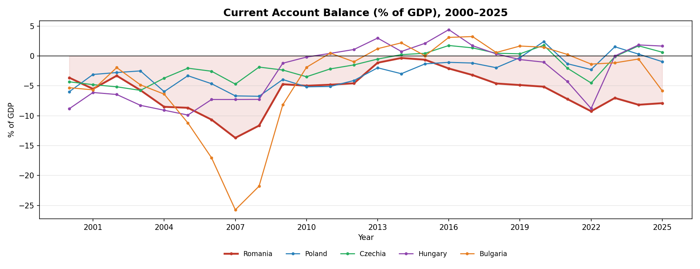

### 5.2 Trade Balance

Romania runs a persistent trade deficit, driven by the import intensity of domestic consumption and investment. In 2025 exports of goods and services were about **35.5% of GDP** and imports **40.7%**, a deficit of roughly 5 percentage points. The economy has become more open: trade (exports plus imports) rose from under 50% of GDP in 2000 to a peak of 94% in 2022, before easing to 76% in 2025. But the import bill consistently exceeds the export base.

The export profile is led by automotive (Dacia/Renault, Ford Otosan), machinery and equipment, and an increasingly significant IT services sector. Agricultural exports are large in volume but relatively low in value-added.

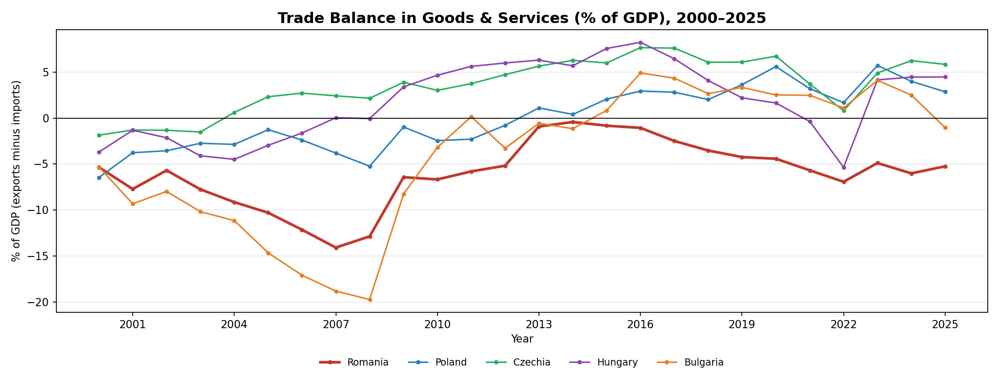

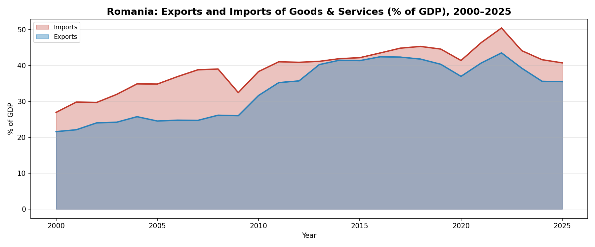

### 5.3 Foreign Direct Investment

FDI inflows have weakened from about 4% of GDP in 2021–2022 to **1.9% in 2024 and 2.2% in 2025**, broadly level with Poland (2.0% in 2025) and below Czechia (2.7%). The decline reflects several factors: wage convergence eroding the low-cost manufacturing advantage, infrastructure deficits that raise logistics costs, and growing fiscal and political uncertainty. Romania attracted significant automotive and manufacturing FDI in the 2000s–2010s, but greenfield investment in the latest technology sectors (semiconductors, advanced manufacturing) has disproportionately gone to Poland and Czechia.

*Note: Hungary's FDI figures are not comparable to the other countries and run off the chart's scale. Hungary is a well-documented conduit for "phantom FDI": multinational companies route holding structures and Special Purpose Vehicles through Hungary for tax purposes. These financial flows count as FDI inflows and outflows even though no real productive investment occurs, which produces the extreme swings in the data (e.g., +106% of GDP in 2020, −40% in 2018, −28% in 2025). The IMF and Eurostat have flagged this as a persistent statistical distortion in Hungary's balance of payments.*

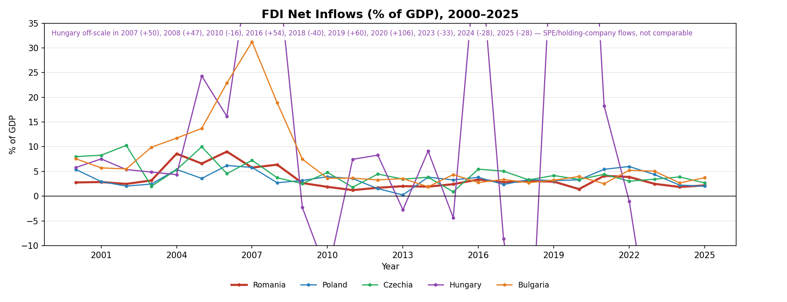

### 5.4 EU Funds: The Absorption Problem

Romania's problem with EU cohesion funds is one of speed rather than final loss. For the 2014–2020 programming period, EU payments reached **89.7%** of the planned EU amount by end-2023, the last regular year of the period. That put Romania behind Czechia, Hungary, Estonia and Poland (all 96–98%), but ahead of Slovakia, Croatia and Bulgaria. In the closure phase Romania caught up most of the way:

| Country | End-2023 | 2026 (closure) |
|---------|---------|----------------|
| Czechia | 97.8% | 99.4% |
| Hungary | 97.7% | 98.9% |
| Estonia | 97.2% | 98.9% |
| Poland | 96.2% | 99.3% |
| Lithuania | 94.9% | 98.8% |
| Latvia | 91.4% | 98.8% |
| **Romania** | **89.7%** | **97.9%** |
| Slovakia | 87.2% | 99.2% |
| Croatia | 86.6% | 98.5% |
| Bulgaria | 82.9% | 98.3% |

*Payments as % of planned EU amount, 2014–2020 ESIF excluding REACT-EU; European Commission Cohesion Open Data.*

The final shortfall, about 2 percentage points or some €0.7 billion of a €33.5 billion envelope, is the largest among these ten, but small. The real cost is the delay. Projects were bunched into the last years of the period and the n+3 extension, which postponed their growth effects and left investment hostage to end-of-period rushes. The causes are structural: weak project preparation capacity, under-staffed managing authorities, procurement irregularities requiring fund returns, and difficulty co-financing projects from a constrained national budget. For the 2021–2027 period, Romania has so far received **36.3%** of planned EU payments, mid-table among the peers (Estonia 57%, Hungary 21%, Bulgaria 25%).

This matters for the growth outlook. Romania has some of the largest infrastructure gaps in the EU, and so the most to gain from cohesion investment. Slow absorption is a self-inflicted constraint on potential growth.

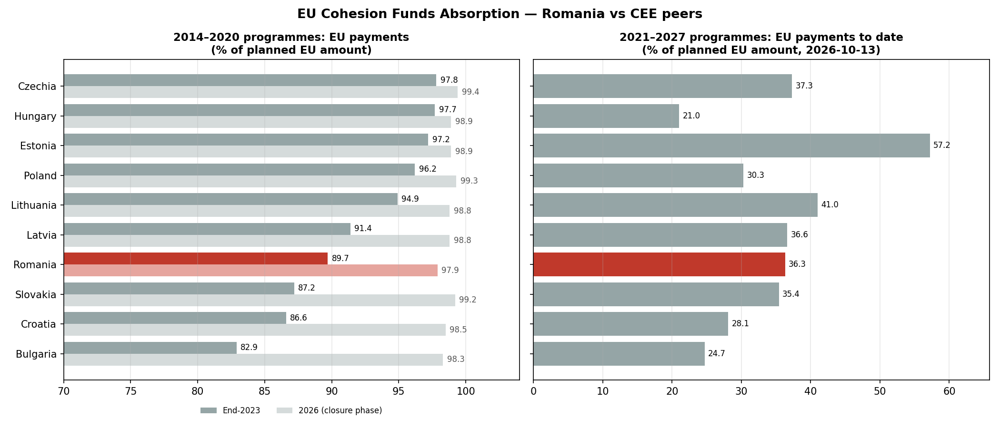

---

## 6. Sectoral Highlights

### 6.1 Industry: Strong but Concentrated

Romanian industrial production tracked or beat EU trends until 2018, outperforming particularly in 2017–2018. The base is relatively diversified: automotive, petrochemicals, food processing, textiles, and a growing electronics and machinery sub-sector.

The automotive cluster is the most significant. Dacia (owned by Renault) produces over 300,000 vehicles annually at its Mioveni plant and is Romania's single largest exporter. Ford Otosan's Craiova plant adds further capacity. The transition to electric vehicles poses both an opportunity (Romania produces cells and components through partnerships) and a risk (the ICE drivetrain expertise embedded in the supply chain faces obsolescence).

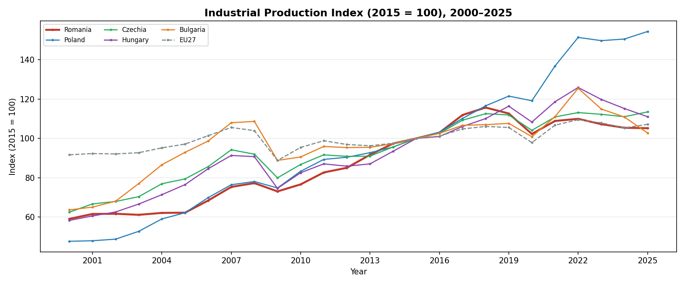

*Note: the chart shows an index (2015 = 100), not absolute levels, so every country starts at the same point regardless of the size or sophistication of its industrial base. Czechia's industrial sector is considerably more advanced in absolute terms: higher value-added per worker, a deeper automotive supply chain built over three decades, and significantly higher-tech exports. And since 2018 Romania has been losing ground even on the growth measure. Its index peaked at 115.7 in 2018 and has drifted down to 105.2 in 2025, about the EU27 level (107.2). Czechia is at 113.5 and Poland at 154.3.*

### 6.2 IT Sector: The Bright Spot

Romania has developed one of the region's strongest IT and software development industries. ICT value added reached about 5.6% of GDP in 2024, above Poland (3.4%), Czechia (4.4%) and Hungary (3.4%). Romania has around 222,000 ICT specialists, and the sector has attracted significant outsourcing and R&D-centre investment from Western multinationals (figures from the companion report in `../it-romania/`). Bucharest, Cluj-Napoca, Iași and Timișoara host dense clusters of software companies and R&D centres.

High-technology exports as a share of manufactured exports have risen to 13.4% (2024), on a par with Poland (13.5%) and Bulgaria (13.4%) but well below Czechia (22.4%) and Hungary (22.6%). Romania's IT strength is primarily in services (exported as services, not goods) rather than high-tech manufacturing.

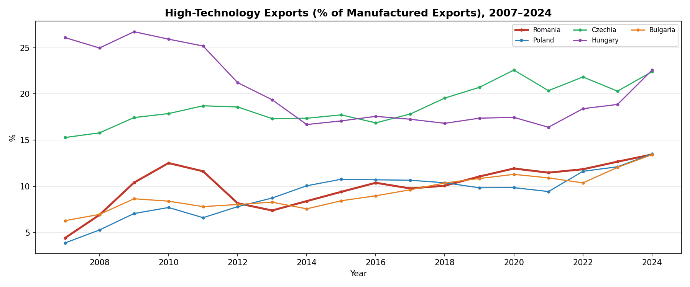

### 6.3 Energy

Romania's electricity generation mix is notably diversified by regional standards. In 2025: 24% hydro, 20% nuclear (Cernavodă's two CANDU units), 17% gas and 15% coal, with wind (12%) and solar (10%) together supplying 22%. Solar's share has risen two and a half times since 2023. Total generation fell from 57 TWh in 2023 to 50 TWh in 2025. Romania is one of the few EU members with both domestic oil production (Petrom) and gas reserves; both are in decline, though the Neptun Deep offshore gas field is due to start production in 2027.

The energy transition agenda is complex. Romania has committed to closing its coal plants (Oltenia), but the replacement capacity (additional nuclear units, offshore Black Sea wind) requires capital investment that depends on the same constrained fiscal environment.

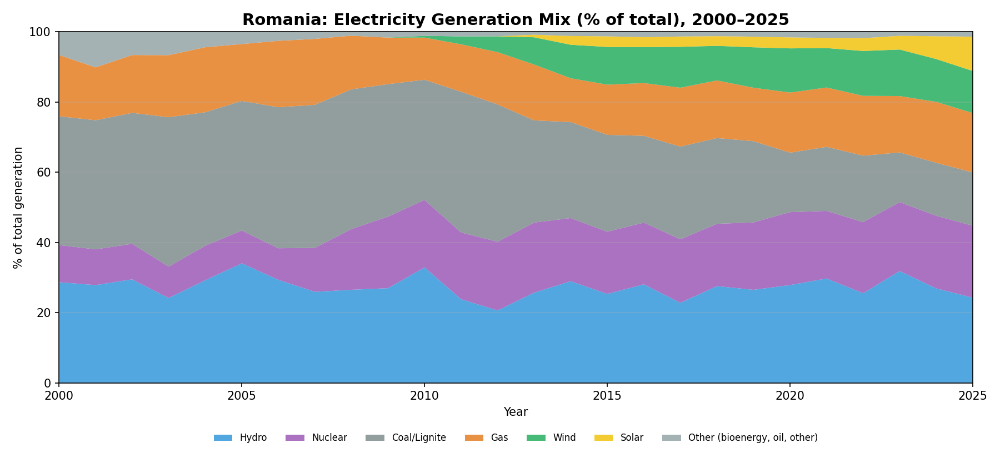

### 6.4 Agriculture: Potential Squandered

Romania has one of the EU's largest agricultural areas yet remains a net importer of processed food. Cereal yields are typically a quarter to a half below German levels, and far more volatile: drought years such as 2020, 2022 and 2024 cut yields to around half the German level. The gap reflects the dominance of smallholder farming and under-investment in irrigation; Romania had extensive irrigation under communism, and most of it has since deteriorated. Limited use of precision agriculture and fragmented land ownership add to it.

The sector's large workforce, about 11% of employment against a 3% share of GDP and an EU average of about 3% of employment, is a proxy for disguised unemployment and structural poverty in rural areas.

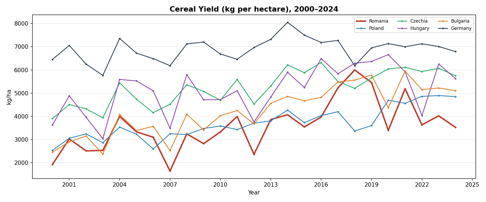

---

## 7. Regional Disparities: A Country of Extremes

No analysis of Romania is complete without confronting the scale of its internal regional inequality. The gap between Bucharest and the rest of the country is among the widest in the EU.

### 7.1 NUTS2 Divergence

GDP per capita (PPS) as a percentage of the EU27 average, by region (2024, latest regional data):

| Region | % of EU27 avg |
|--------|--------------|
| Nord-Est | 48% |
| Sud-Muntenia | 55% |
| Sud-Est | 59% |
| Sud-Vest Oltenia | 60% |
| Nord-Vest | 71% |
| Centru | 71% |
| Vest | 78% |
| **Bucuresti-Ilfov** | **188%** |

Nord-Est, home to Iași, the second-largest city, sits at **48% of the EU average**, the poorest region in Romania. That is on a par with Hungary's Észak-Magyarország (47%) and above Bulgaria's two poorest regions (42–43%). Bucharest-Ilfov, meanwhile, at 188%, is second only to Prague among CEE capital regions, and on this measure ahead of Stockholm (153%), Vienna (137%) and Berlin (127%). Capital-region figures are flattered by head-office effects, but the scale of the gap is real.

The ratio between Romania's richest and poorest regions is approximately **3.9:1**, the widest among the CEE peers. Hungary is at 3.6:1, Czechia 3.1:1, Poland 2.9:1 and Bulgaria 2.5:1.

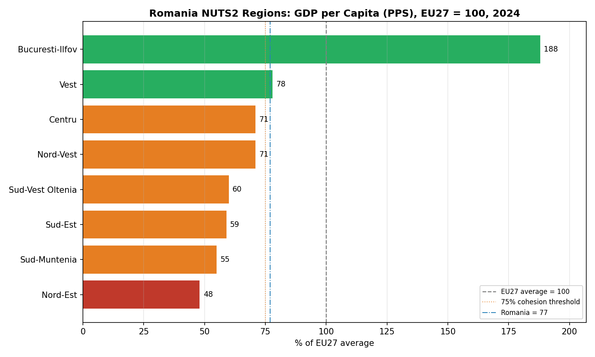

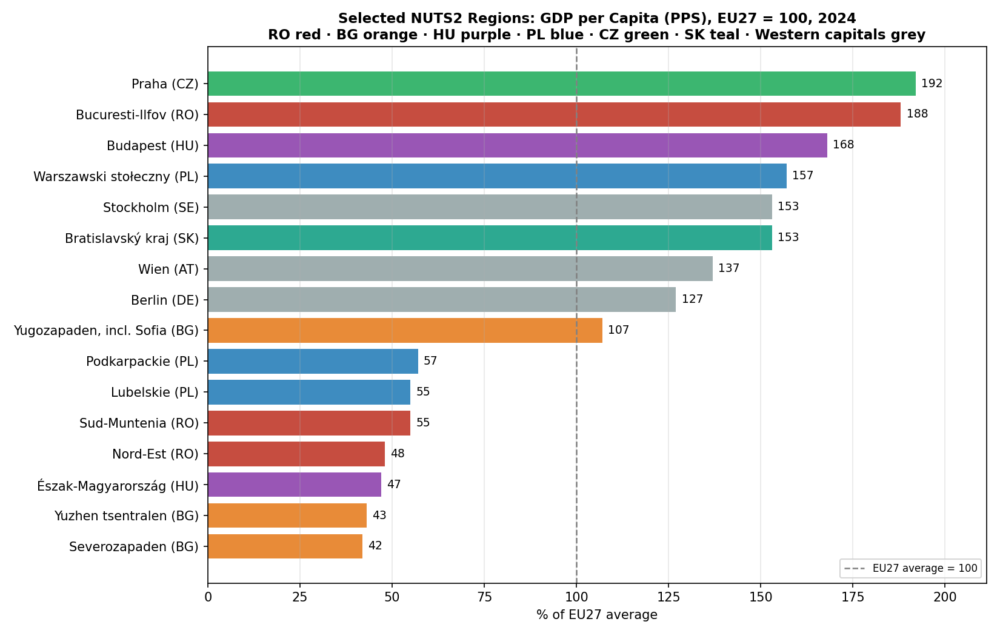

### 7.2 Divergence, Not Convergence

The internal regional story is one of two speeds. The rest of the country, Romania outside Bucharest-Ilfov, has converged on the EU, rising from 23% of the EU average in 2000 to 62% in 2024 (a population-weighted figure derived from Eurostat regional accounts). But Bucharest-Ilfov has pulled away even faster, from 58% to 188%. The capital's lead over the rest of the country has widened from 2.5 times to 3.0 times. The capital captures the lion's share of FDI, EU-funded infrastructure investment, skilled labour (both domestic and return migrants) and government employment. Every major multinational entering Romania heads to Bucharest. Every talented graduate from Nord-Est or Oltenia faces a stark choice: Bucharest or abroad. Cluj, Timișoara and Iași are the main exceptions.

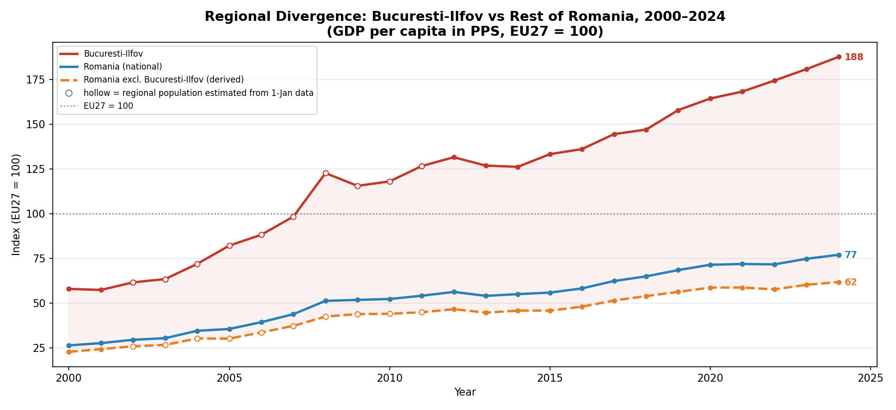

### 7.3 Population Haemorrhage Outside the Capital

Between the census-anchored population estimates of 1 January 2012 and 1 January 2025, Romania lost 1.05 million people (−5.2%). Every region except Bucharest-Ilfov, which gained about 34,000 (+1.5%), lost population. The south was hit hardest: Sud-Muntenia lost about 303,000 (−9.7%), Sud-Vest Oltenia 219,000 (−10.6%, the steepest proportional fall), Sud-Est 208,000 (−8.2%) and Vest 157,000 (−8.6%). Nord-Est, with higher birth rates, lost proportionally least among the poorer regions (−2.3%). Rural depopulation in Oltenia, Muntenia and Dobrogea is severe enough to threaten the viability of basic services, such as schools, hospitals and local government, in hundreds of communes.

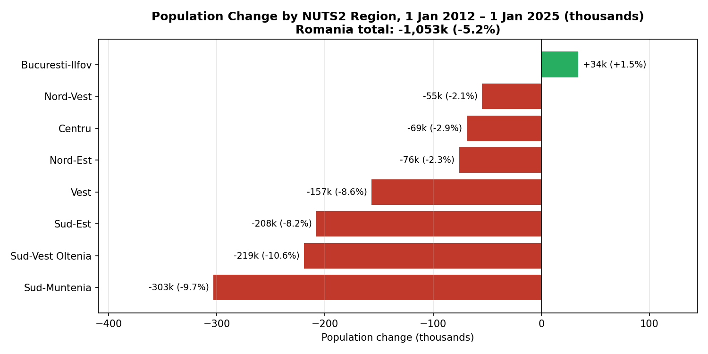

---

## 8. Social Indicators: Growth Without Inclusion

### 8.1 Poverty

Romania's at-risk-of-poverty or social exclusion rate (AROPE) stood at **27.4% of the population in 2025** (27.9% in 2024). This has declined markedly from 35.6% in 2020, as wage increases and pension hikes lifted many above the statistical poverty threshold. But Romania remains the EU's third-highest, after Bulgaria (29.0%) and Greece (27.5%). The 2025 survey measures 2024 incomes, so it does not yet capture the 2025 VAT rise and pay and pension freeze.

The EU27 average is 20.9%. Czechia achieves 11.5%; Romania's rate is more than double.

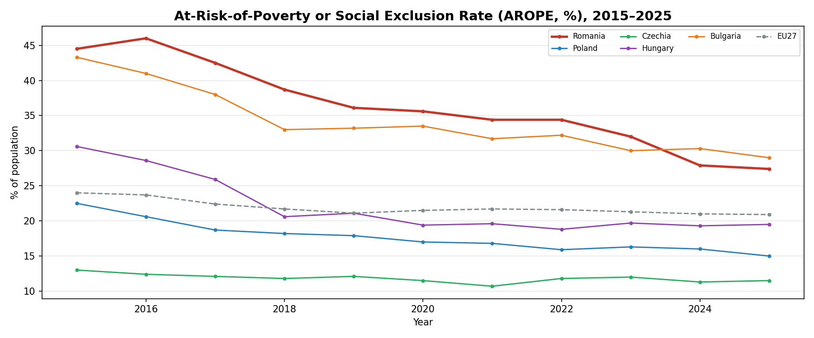

### 8.2 Inequality

The Gini coefficient (zero is perfect equality, 100 maximum inequality) has improved notably in recent years, falling from 34.3 in 2021 to 28.0 in 2024 and **27.3 in 2025**. This rapid improvement reflects primarily the compression of the wage distribution at the bottom through aggressive minimum wage increases, plus the 2024 pension recalculation. Whether it is durable, or reverses as fiscal consolidation constrains public wages and pensions, will be an important test; the income effects of the 2025 measures will first show up in the 2026 survey.

Romania's Gini of 27.3 is now below the EU average of 29.2, one of the few genuinely positive recent developments.

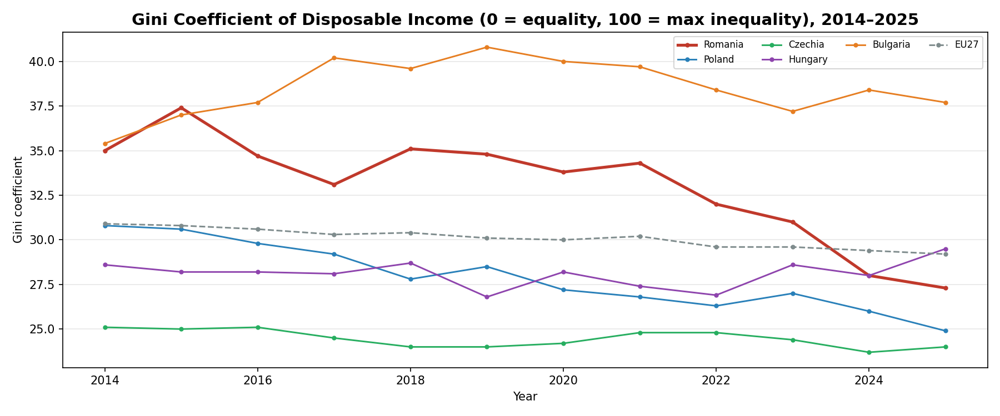

### 8.3 Education: A Crisis in Progress

Early school leaving, the share of 18–24 year olds who have not completed upper secondary education and are not in further training, stood at **15.5% in Romania in 2025**, the highest in the EU and well above the EU27 average of 9.1%. The EU's 2030 target is 9%. The 2025 figure is an improvement on 16.8% in 2024, but it only returns Romania to where it was in 2020–2022: there has been no sustained progress in five years.

| Country | 2022 | 2023 | 2024 | 2025 |
|---------|------|------|------|------|
| Romania | 15.6%| 16.6%| 16.8%| 15.5%|
| EU27    |  9.6%|  9.6%|  9.6%|  9.1%|
| Poland  |  4.7%|  3.7%|  4.1%|  4.0%|
| Czechia |  6.2%|  6.4%|  5.4%|  6.1%|

Each percentage point represents thousands of young Romanians permanently locked out of formal employment prospects. The structural drivers are not abating: rural poverty, school infrastructure deficits, and the economic necessity to work rather than study.

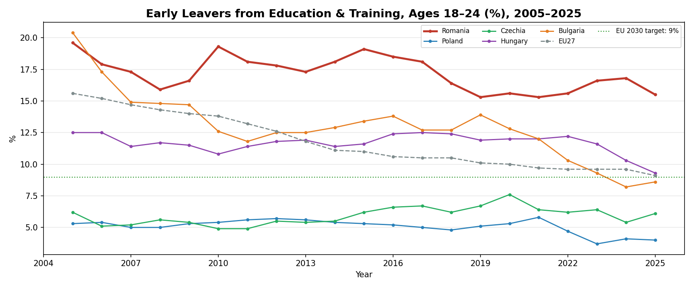

### 8.4 Healthcare: Europe's Most Underfunded System

Romania spends approximately **\$1,051 per capita on healthcare** (current prices, 2023), compared with \$2,671 in Czechia and \$6,395 in Germany. On a PPP-adjusted basis the gap is somewhat smaller, but Romania's health spending as a share of GDP, **5.7% in 2023** against an EU average of 10.0%, is among the lowest in the EU.

The consequences are visible in outcomes:

**Life expectancy** (2024): Romania 76.5 years, Czechia 80.0, Germany 80.8. The 3.5-year gap to Czechia is exceptional between two EU member states.

**Infant mortality** (2024): Romania 6.0 per 1,000 live births, Czechia 2.1. Romania's rate is the highest in the peer group, about 30% above Bulgaria (4.6), nearly three times the Czech rate, and it has edged up since 2021 (5.3) while every CEE peer's has fallen.

The healthcare system suffers from chronic underfunding and severe staff shortages caused by the emigration of thousands of doctors and nurses. Infrastructure is crumbling, particularly outside major cities, and endemic informal payments effectively constitute a regressive private tax on the sick.

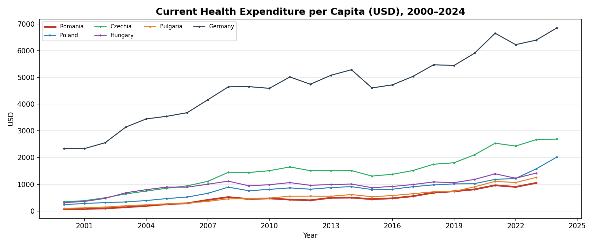

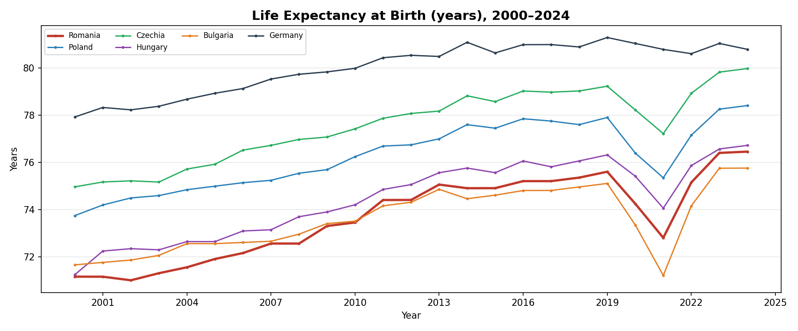

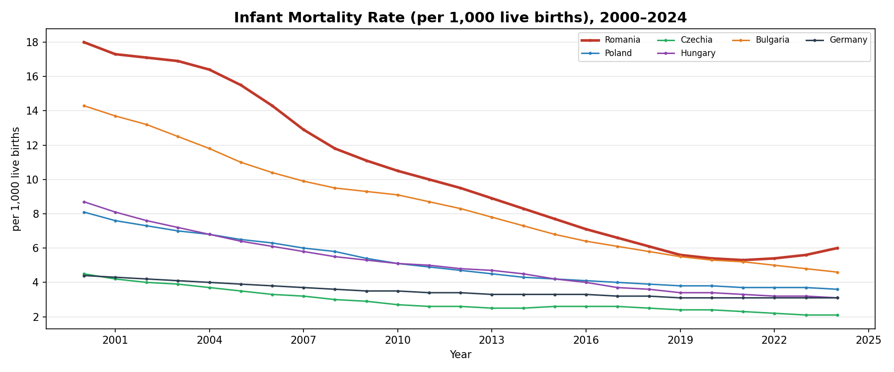

---

## 9. Structural Problems: A Synthesis

Romania's challenges are interconnected. Understanding them requires looking at the system, not just the individual indicators.

### 9.1 The Fiscal Trap

The fiscal deficit is not simply the result of irresponsible politicians, though there has been political irresponsibility. It emerges from a structural trap: Romania has the tax base of a much poorer country (28.7% of GDP) with the spending commitments of a European welfare state. The gap is paid for by debt, and the debt raises borrowing costs, which widen the deficit further. The escape requires either much higher revenue collection (politically difficult, administratively demanding, slow to materialise) or deep spending cuts (politically near-impossible given the pension and wage commitments already baked in).

2025 showed what the first route costs. The VAT increase and pay freeze delivered the EU's largest deficit reduction (1.4 points). The bill was inflation of nearly 10%, falling real wages, growth below 1% and, in May 2026, the fall of the government that imposed it. The EDP path now aims to bring the deficit below 3% by 2030. The European Commission's spring 2026 forecast put the 2026 deficit at about 6.2% of GDP. At that pace the 3% threshold would be reached around 2030 at the earliest, and only if there are no recessions and no political reversals.

### 9.2 The Demographic Time Bomb

The population decline is not yet fully priced into Romania's fiscal projections. The pension system's sustainability calculations assume a working-age population that no longer exists. Every year of continued emigration — particularly the emigration of the young and skilled — reduces the future tax base that must service the growing public debt and fund the growing pension bill. There is a self-reinforcing dynamic at work: deteriorating public services (due to fiscal pressure) drive more emigration (particularly of those with options), which reduces the revenue base, which worsens public services.

### 9.3 Infrastructure Deficit

Romania's motorway density is among the lowest in the EU, despite accelerated construction since 2022. Rail infrastructure is largely unreformed since the communist era. Internet connectivity in rural areas lags. The physical infrastructure gap is both a direct constraint on productivity and a contributing factor to regional divergence and emigration.

The National Recovery and Resilience Plan (NRRP), revised in October 2025 to €21.4 billion from an original allocation of roughly €29 billion, was meant to accelerate infrastructure development. Its final milestones fell due in August 2026, and how much was ultimately disbursed will only be clear once the Commission settles the last payment requests. Romania's cohesion-fund record, ending at 98% but only after a late rush, suggests the risk lies in delay and lost projects rather than in money left wholly unspent.

### 9.4 Institutional Capacity

Underlying many of Romania's failures is a question of state capacity: the ability of the public administration to design, implement and manage complex programmes. Several weaknesses compound each other. Managing authorities have weak project management. Procurement systems are vulnerable to abuse. The judiciary is functional but slow, and the civil service has lost much of its best talent to the private sector and abroad. Together these explain why EU funds are absorbed late, why infrastructure projects are delivered years late and over budget, and why tax collection underperforms its potential.

---

## 10. Outlook and Scenarios

### Baseline

Forecasts for 2026 cluster around **1% growth** (European Commission spring 2026: 1.1%), conditional on consolidation continuing. Public debt is projected to exceed the 60% Maastricht ceiling in 2026 and reach about 63% of GDP by 2027 (European Commission). Inflation has peaked: the annual HICP rate fell to 6.3% in August 2026 as the VAT step dropped out. The BNR's early-2026 projections had it returning to the target band during 2027, which would allow the first rate cut since 2024.

This baseline assumes that the post-May 2026 government keeps the 2025 measures in place, that EU fund flows continue, and that the external environment is stable.

### Optimistic Scenario

Romania might hold the deficit on the path to 6% in 2026, accelerate absorption of 2021–2027 cohesion funds, and benefit from nearshoring flows as Western firms diversify supply chains. In that case growth could re-accelerate to 2–3% by 2027 as real wages recover once inflation falls. The IT sector and the green energy transition offer genuine structural tailwinds. Wage convergence, if matched by productivity, is a feature rather than a bug.

### Pessimistic Scenario

Fiscal consolidation could stall. The May 2026 collapse of the coalition shows the risk is real, not hypothetical. Credit agencies would then downgrade Romanian debt from its current lowest investment-grade rating to high-yield territory, borrowing costs would spike, and the deficit-debt dynamic would become self-reinforcing. Continued emigration of skilled labour would deepen skill shortages, constraining the very growth needed to resolve the fiscal problem. Regional depopulation would cross thresholds that make social services non-viable in the third of the country most in need.

### What History Suggests

Countries with structural deficits of this magnitude and revenue bases this thin have tended to require either external programme conditionality (IMF/EU support, as Romania experienced in 2009) or sustained multi-year political consensus for reform. 2025 showed that Romania can deliver a large one-year correction. 2026 showed how quickly the political consensus behind it can break. The most probable path remains muddling through: gradual consolidation interrupted by political reversals, rather than either crisis or decisive reform.

---

## Key Takeaways

1. **Romania has converged economically.** GDP per capita at 78% of the EU average in PPS is a genuine achievement, unprecedented in the country's modern history, and has closed most of the gap to Poland.

2. **The fiscal situation is unsustainable without continued adjustment.** A 9.3% deficit in a non-recessionary year (2024), still 7.9% after the EU's largest correction (2025), with debt about to cross 60%, is the single most acute macroeconomic risk.

3. **Demographics are a slow-motion crisis.** There are 4.2 million fewer people than in 1990, and the continued outflow of the young and skilled undermines every aspect of long-term sustainability.

4. **Social outcomes lag economic growth.** Romania has the EU's third-highest poverty rate (27%), its highest early school leaving (15.5%) and youth unemployment (26%), life expectancy 3.5 years below Czechia, and the highest infant mortality in the peer group. Inequality, by contrast, has fallen below the EU average.

5. **Regional divergence is entrenched.** The rest of Romania is converging on the EU, but Bucharest is pulling away faster. The roughly 4:1 gap between Bucharest-Ilfov and Nord-Est has not narrowed in a decade.

6. **Institutional capacity is the binding constraint.** Romania consistently underperforms its potential on every dimension that requires state action: tax collection, the speed of EU fund absorption, infrastructure delivery and public service quality.

7. **The window for adjustment is real but narrowing.** EU fund access, debt still around 60% and a large one-year correction already behind it give Romania tools that many comparator countries lack. Whether the political system can keep using them after May 2026 is the central open question.

---

*All data: Eurostat, World Bank, BIS, Ember and European Commission Cohesion Open Data, retrieved 13 October 2026. Charts and underlying CSVs available in the `charts/` and `raw-data/` directories; re-running the scripts `01_…`–`08_…` refreshes every figure (for example after Eurostat's October 2026 EDP notification).*
